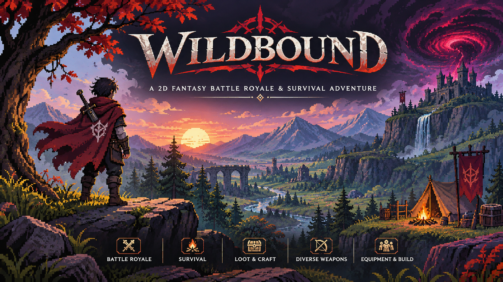

<div align="center">

# WILDBOUND



### An Evolving Fantasy Battle Royale & Survival Adventure

*Explore the wilderness. Gather your strength. Survive the unknown.*

<br>

**C++20** &nbsp; · &nbsp; **raylib** &nbsp; · &nbsp; **Lua 5.4** &nbsp; · &nbsp; **Pixel Art**

<br>


</div>

---

## About Wildbound

**Wildbound** is a 2D top-down fantasy battle royale and survival adventure game built around exploration, combat, equipment, environmental challenges, and an evolving fantasy world.

Set across diverse landscapes, the game brings together atmospheric environments, dangerous creatures, abandoned settlements, hidden locations, and a growing collection of weapons, equipment, and resources.

Players can explore the wilderness, encounter hostile creatures, collect valuable resources, customize their characters, discover hidden locations, and engage in combat.

Wildbound aims to combine the accessibility of classic top-down adventure games with the tension and unpredictability of battle royale survival gameplay.

> **The wilderness is vast. The dangers are unpredictable. Survival is everything.**

---

## The World of Wildbound

The world of Wildbound is designed around exploration and environmental diversity. From dense forests and forgotten ruins to frozen landscapes and desert settlements, every environment contributes to the atmosphere and gameplay experience.

### Explore Diverse Biomes

Wildbound features five distinct environmental regions:

| Biome | Description |
|:---|:---|
| 🌲 **Verdant Forest** | Dense woodlands, ancient ruins, wildlife, villages, and hidden pathways. |
| 🏜️ **Sunscorched Wastes** | Arid landscapes, desert settlements, and harsh environmental conditions. |
| ❄️ **Frostfall Taiga** | Snow-covered wilderness, frozen landscapes, and blizzard conditions. |
| 🌿 **Murkwood Mire** | Atmospheric swamplands, dense vegetation, and mysterious surroundings. |
| ⛰️ **Iron Crag Highlands** | Rugged mountain terrain, rocky landscapes, and elevated wilderness. |

### Discover the Unknown

The world contains:

- Abandoned structures and forgotten settlements.
- Enterable buildings with dedicated interiors.
- Hidden exploration locations and secret discoveries.
- Interconnected roads, bridges, and woodland pathways.
- Environmental objects and animated scenery.
- Ambient wildlife and atmospheric weather effects.

Exploration is designed to reward curiosity and encourage players to venture beyond familiar paths.

---

## Gameplay Experience

Wildbound combines several interconnected gameplay systems to create a cohesive survival experience.

### ⚔️ Combat & Weapons

A dedicated combat architecture supports both melee and ranged combat.

**Combat features include:**

- Directional melee attacks and hit detection.
- Sword-based combat with multiple weapon types.
- Bow-based ranged combat and physical projectiles.
- Dynamic attack animations and weapon cooldowns.
- Multi-target melee attacks.
- Enemy combat behavior and damage calculations.
- Weapon rarity and stat scaling.

### 🛡️ Equipment & Character Customization

Character progression and visual customization are built around modular equipment systems.

**Customization includes:**

- Eight equipment and cosmetic categories.
- Modular character appearance layers.
- Armor and defensive equipment.
- Primary and secondary weapon slots.
- Multiple clothing and armor designs.
- Directional character rendering and visual occlusion.
- Persistent character appearance configurations.

### 🎒 Inventory & Resource Management

A dedicated inventory system manages collected items, consumables, equipment, and resources.

**Inventory capabilities include:**

- 24-slot inventory capacity.
- Automatic item stacking.
- Stack splitting and merging.
- Item dropping and ground pickups.
- Transactional loot collection.
- Loot containers and treasure.
- Consumable and healing mechanics.
- Ammunition management.

### 🐺 Creatures & Wildlife

The wilderness features both hostile creatures and ambient wildlife.

**Creature systems include:**

- Forest Goblins.
- Undead Skeletons.
- Forest Wolves.
- Wild Boars.
- Dusk Bats.
- Ambient birds and butterflies.
- Directional creature animations.
- Autonomous enemy behavior.
- Collision-aware enemy spawning.
- Lua-driven enemy AI with native C++ fallback.

### 🌩️ Dynamic Environmental Systems

The environment is designed to feel alive through continuous animation and atmospheric effects.

Features include:

- Animated water and waterfalls.
- Moving clouds and environmental fog.
- Swaying trees and vegetation.
- Atmospheric smoke and fire.
- Environmental wildlife behavior.
- Weather customization.
- Scripted environmental events.
- Corruption storm and safe-zone gameplay systems.

### 🏰 Exploration & Interaction

A centralized interaction architecture connects players with the surrounding world.

Players can interact with:

- Doors and building entrances.
- Chests and loot containers.
- Ground collectibles.
- Levers and switches.
- Pressure plates.
- Environmental mechanisms.
- Other interactive objects.

Contextual prompts and interaction feedback help make the world responsive to player actions.

---

## A World with Its Own Identity

Wildbound uses a handcrafted pixel-art visual direction inspired by classic top-down fantasy adventures.

Its visual identity combines:

- Detailed environmental tilesets.
- Character sprites and directional animations.
- Modular weapons and equipment.
- Custom-designed interface elements.
- Atmospheric environmental animations.
- Distinctive biome palettes.
- Original procedural audio.

The goal is to create a cohesive visual and audio experience rather than a collection of disconnected game assets.

---

## Audio & Atmosphere

Audio is an important part of Wildbound's environmental identity.

The game features an original procedural audio collection generated through mathematical waveform synthesis.

### Audio Categories

| Category | Examples |
|:---|:---|
| 🎵 Music | Main menu, character selection, forests, desert, snow, and results. |
| 🌲 Environment | Birds, wind, blizzards, insects, and campfires. |
| ⚔️ Combat | Sword swings, weapon impacts, bows, and arrows. |
| 🎮 Interface | Buttons, notifications, confirmations, and navigation. |
| 👣 Movement | Footsteps across different terrain types. |
| 🏆 Match Events | Countdown, match start, zone alerts, victory, and defeat. |

Audio is managed through a centralized architecture with independent volume controls, mixing, and configuration persistence.

---

## Technology Stack

Wildbound is built using a modular C++ architecture with integrated scripting and development tools.

| Technology | Purpose |
|:---|:---|
| **C++20** | Core gameplay and engine architecture |
| **raylib 5.5** | Graphics, input, and audio |
| **Lua 5.4** | Gameplay scripting and enemy AI |
| **sol2** | C++ and Lua interoperability |
| **Dear ImGui** | Developer interface and diagnostics |
| **rlImGui** | raylib and ImGui integration |
| **nlohmann/json** | JSON serialization and data management |
| **CMake** | Build configuration and dependency management |
| **CTest** | Automated testing |
| **Tiled Map Editor** | Tilemap creation and world design |

---

## Developer & Engineering Features

Wildbound also includes dedicated development infrastructure to support debugging, inspection, and gameplay-system development.

### Developer Interface

An integrated developer interface provides access to:

- Entity and gameplay inspection.
- Collision visualization.
- Combat diagnostics.
- Weapon and equipment inspection.
- Inventory and loot inspection.
- Biome and environment exploration.
- Animation controls.
- Audio testing.
- Input diagnostics.
- Interactive gameplay debugging.

### Architecture & Engineering

The underlying architecture emphasizes:

- Modular gameplay systems.
- Data-driven definitions and configurations.
- Deterministic simulation.
- Decoupled gameplay components.
- Transactional inventory operations.
- Centralized input and interaction management.
- Automated asset registration and validation.
- Native C++ gameplay systems with Lua scripting integration.

---

## Getting Started

### Prerequisites

Before building Wildbound, ensure you have:

- Windows development environment.
- Visual Studio 2022 or compatible MSVC compiler.
- CMake 3.20 or newer.
- Git.
- Internet connection for initial dependency fetching.

### Clone the Repository

```powershell
git clone https://github.com/fr45201-collab/wildbound.git

cd wildbound
```

### Configure the Project

```powershell
cmake -B build -S .
```

### Build Wildbound

**Debug configuration:**

```powershell
cmake --build build --config Debug
```

### Run Automated Tests

```powershell
ctest --test-dir build -C Debug --output-on-failure
```

### Launch the Game

```powershell
.\build\Debug\wildbound.exe
```

---

## Controls

The following table describes the default gameplay controls.

| Action | Keyboard / Input |
|:---|:---|
| Movement | `W`, `A`, `S`, `D` / Arrow Keys |
| Sprint | `Left Shift` |
| Attack | `Spacebar` / Left Mouse Button |
| Interact / Pickup | `E` or `F` |
| Hotbar Selection | `1`, `2`, `3`, `4` |
| Inventory | `I` or `Tab` |
| Character Wardrobe | `C` |
| Pause Menu | `Escape` |
| Developer Interface | `F1` |
| Collision Debug | `F3` |
| Player Anchor | `F4` |
| Animation HUD | `F5` |
| Combat Hitboxes | `F6` |
| Enemy Spawner | `F7` |
| Respawn / Reset Player | `R` |

---

## Project Documentation

Wildbound maintains dedicated technical documentation covering its architecture, gameplay systems, asset pipelines, specifications, and implementation details.

The repository's `docs/` directory contains the detailed engineering documentation.

Explore the documentation for information about:

- Game architecture and rendering.
- World generation and biome systems.
- Character animation and customization.
- Combat and enemy AI.
- Weapons and equipment.
- Inventory and item management.
- Input and interaction systems.
- Physics and collision detection.
- User interface and audio architecture.
- Asset management and licensing.
- Build configuration and coding standards.

**For detailed technical information, refer to the [`docs/`](docs/) directory.**

---

## Development Status

<div align="center">

### 🚧 Wildbound Is Actively Evolving

</div>

Wildbound is an ongoing game-development project.

New gameplay mechanics, environmental systems, world features, and technical improvements are continuously being developed and refined.

The project is focused on building a cohesive and engaging survival adventure, with particular attention to gameplay architecture, world design, and the overall player experience.

**The journey is still unfolding.**

---

## Repository Structure

```text
Wildbound/
│
├── assets/
│   ├── branding/
│   │   └── wildbound-poster.png
│   ├── audio/
│   ├── characters/
│   ├── definitions/
│   ├── environment/
│   ├── items/
│   ├── maps/
│   ├── ui/
│   └── weapons/
│
├── config/
│
├── data/
│
├── docs/
│   ├── art/
│   ├── audio/
│   ├── environment/
│   ├── input/
│   ├── interaction/
│   ├── inventory/
│   ├── physics/
│   ├── ui/
│   └── world/
│
├── include/
│
├── scripts/
│
├── src/
│
├── tests/
│
├── tools/
│
├── CMakeLists.txt
├── README.md
└── .gitignore
```

*Directory names are representative; consult the repository for the current complete structure.*

---

<div align="center">

# WILDBOUND

### Beyond the Known. Into the Wild.

*A world to explore. A wilderness to survive.*

<br>

**Built with C++20, raylib, and Lua.**

<br>

---

**Wildbound** &nbsp; · &nbsp; An Independent Game Development Project

*The wilderness awaits.*

</div>