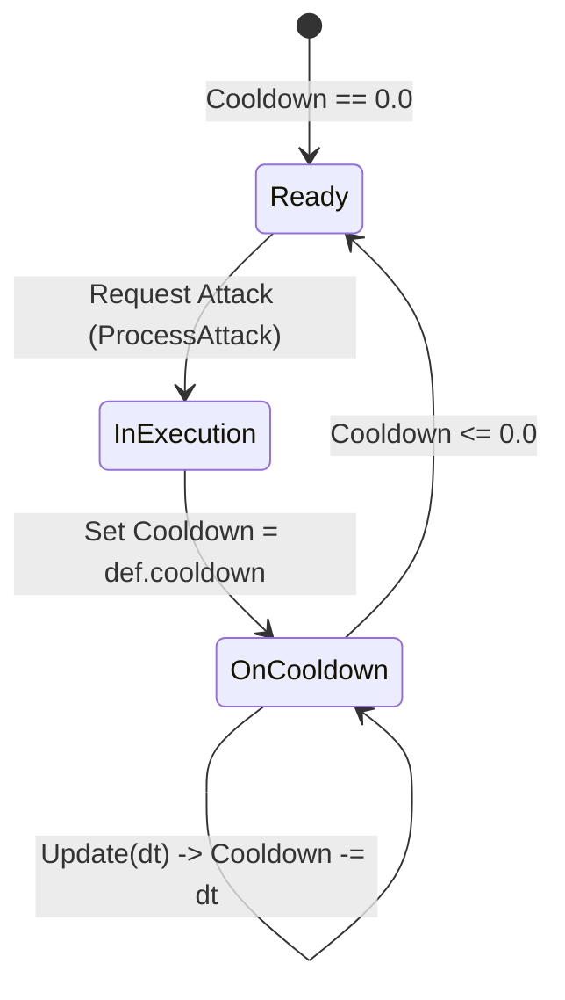

# Wildbound Attack System

The Attack System manages attack definitions, weapon swings, cooldown timers, and animation dispatch for both players and hostile monsters.

---

## 1. Overview

Each combatant owns an instance of `wildbound::combat::AttackSystem` ([`src/combat/AttackSystem.hpp`](file:///c:/dev/Wildbound/src/combat/AttackSystem.hpp)). The system:
- Maintains a registry of named attacks available to that entity.
- Tracks per-attack cooldown timers updated with delta time.
- Validates whether an attack can be triggered.
- Stores directional hitbox dimensions and forward reach offsets.

---

## 2. Attack Definition (`AttackDefinition`)

Attacks are declared via JSON in `data/combat/attacks.json` or defined directly in code:

```cpp
struct AttackDefinition {
    std::string id;                         // Unique identifier ("slash", "goblin_club")
    std::string name;                       // Display name
    DamageType damageType;                  // Physical, Magical, etc.
    float baseDamage = 20.0f;               // Base damage value
    float range = 32.0f;                    // Effective range in pixels
    float cooldown = 0.5f;                  // Attack cooldown period in seconds
    float hitboxWidth = 32.0f;              // Attack box width in pixels
    float hitboxHeight = 24.0f;             // Attack box height in pixels
    float forwardOffset = 16.0f;            // Distance in front of attacker anchor
    std::string animationPrefix = "attack"; // Linked animation state prefix
};
```

### Registered Attacks in Phase 5:
- **`slash`**: Player's primary sword slash. Deals 25 physical damage, $36 \times 28$ px hitbox, 0.45s cooldown.
- **`goblin_club`**: Goblin wooden club strike. Deals 12 physical damage, $30 \times 24$ px hitbox, 1.00s cooldown.
- **`skeleton_blade`**: Skeleton rusty blade slash. Deals 18 physical damage, $32 \times 26$ px hitbox, 1.20s cooldown.

---

## 3. Cooldown Lifecycle



1. When `AttackSystem::CanAttack(attackId)` is queried, it returns `true` only if `m_cooldownTimers[attackId] <= 0.0f`.
2. When the attack is executed, `AttackSystem::TriggerAttack(attackId)` resets the timer:
   ```cpp
   m_cooldownTimers[attackId] = atkDef.cooldown;
   ```
3. During every frame update:
   ```cpp
   void AttackSystem::Update(float dt) {
       for (auto& [id, timer] : m_cooldownTimers) {
           if (timer > 0.0f) timer -= dt;
       }
   }
   ```

