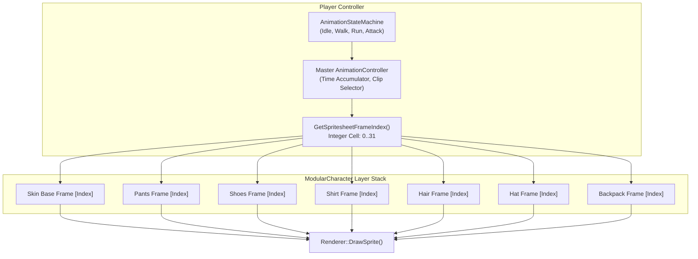

# Wildbound — Character Animation Synchronization

## 1. Challenge & Design Problem

In modular 2D pixel art character engines, rendering independently equipped layers (body, hair, shirts, trousers, boots, accessories) introduces a high risk of **animation desynchronization**:
- Layers may run on independent frame clocks and drift over time.
- Bobbing and limb displacement can become mismatched, causing shirts to float off torsos or legs to separate from trousers.
- Complex state transitions (walking to sprinting, attacking, hurting) can trigger state changes on some layers before others.

Wildbound solves this definitively through **Master-Driven Cell Synchronization**.

---

## 2. Master-Driven Cell Synchronization Mechanism

Instead of maintaining independent [`AnimationController`](file:///c:/dev/Wildbound/src/graphics/animation/AnimationController.hpp) instances for each equipped layer, the character entity owns **a single master [`AnimationController`](file:///c:/dev/Wildbound/src/graphics/animation/AnimationController.hpp)**:



### Technical Synchronization Steps:
1. **Clock Update**: In `Player::Update(dt)`, only `m_animController.Update(dt, assetMgr)` advances.
2. **Cell Index Derivation**:
   ```cpp
   int frameIndex = animCtrl.GetSpritesheetFrameIndex();
   ```
3. **Lockstep Frame Lookup**:
   In `ModularCharacter::Render`, for each active layer in the sorted stack:
   ```cpp
   const auto* sheet = assetMgr.GetSpriteSheet(layer.spritesheetId);
   if (sheet) {
       srcRect = sheet->GetFrameRect(frameIndex);
       origin = sheet->GetFrameOrigin(frameIndex);
   }
   ```
4. **Drawing**:
   Every layer draws using the identical `frameIndex` cell. Because all 15 cosmetic spritesheets share the standardized $4 \times 8$ grid ($128 \times 384$ px, 32 cells), cell index `k` maps to the exact same anatomical pose and bobbing offset across every single layer.

---

## 3. Frame Grid & Pose Mapping

All humanoid spritesheets are arranged in an identical 32-frame layout:

| Row | Frame Range | Direction | Animation State | Frames Per Second |
| :---: | :---: | :---: | :---: | :---: |
| **0** | `0 .. 3` | Down (South) | Walk | 8.0 fps |
| **1** | `4 .. 7` | Up (North) | Walk | 8.0 fps |
| **2** | `8 .. 11` | Left (West) | Walk | 8.0 fps |
| **3** | `12 .. 15`| Right (East) | Walk | 8.0 fps |
| **4** | `16 .. 19`| Down (South) | Idle (Breathing + Blink) | 4.0 fps |
| **5** | `20 .. 23`| Up (North) | Idle (Breathing) | 4.0 fps |
| **6** | `24 .. 27`| Left (West) | Idle (Breathing + Blink) | 4.0 fps |
| **7** | `28 .. 31`| Right (East) | Idle (Breathing + Blink) | 4.0 fps |

### Limb & Torso Bobbing Lockstep:
- **Walk Cycle Phase 0**: `left_leg_dy = -2`, `right_leg_dy = +2`, `bob_y = 0`.
- **Walk Cycle Phase 1**: `left_leg_dy = 0`, `right_leg_dy = 0`, `bob_y = -1` (passing step).
- **Walk Cycle Phase 2**: `left_leg_dy = +2`, `right_leg_dy = -2`, `bob_y = 0`.
- **Walk Cycle Phase 3**: `left_leg_dy = 0`, `right_leg_dy = 0`, `bob_y = -1` (passing step).

Because the tunic, vest, trousers, boots, hair, hat, and backpack were authored with matching pixel offsets across each phase, zero layer floating or pixel jitter occurs during motion.

---

## 4. Multi-State Extensibility

When future combat states (e.g. melee attack swing, dodge roll, casting) are introduced:
1. The spritesheet grid expands vertically or uses dedicated action sheets.
2. The master animation clip specifies frame index sequences (e.g. `[32, 33, 34, 35]`).
3. As long as the cosmetic sheets mirror the master frame sequence, all equipped visual layers instantly inherit the new combat animation in 100% lockstep without any C++ code modifications.

