# Wildbound — Character Layer Architecture

## 1. Paperdoll Compositing Model

Wildbound utilizes a dynamic multi-layer paperdoll rendering architecture. All humanoid cosmetic items are authored and exported onto the standardized Wildbound humanoid template:
- **Canvas Resolution**: $32 \times 48$ pixels per frame cell.
- **Grid Structure**: 4 columns $\times$ 8 rows (32 total frames per spritesheet).
- **Logical Anchor Point**: $(16, 48)$ bottom-center (aligned with the player's ground foot contact).
- **Collision Footprint**: $16 \times 12$ pixels centered around anchor point.

Because every layer shares the exact same anchor point and bounding dimensions, layers can be composited directly over one another without per-pixel runtime translation offsets.

---

## 2. Layer Stacking & Base Z-Indices

The default layer stack establishes a natural front-to-back ordering representing human anatomy and clothing layers:

| Layer Order | Category | Base Z-Index | Purpose |
| :---: | :--- | :---: | :--- |
| **0** | Contact Shadow | — | Rendered via Raylib `DrawEllipse` beneath all sprites ($9 \times 4$ px) |
| **1** | Back Accessory (South/Sides) | 10 | Backpack / cloak behind torso when facing South, West, East |
| **2** | Base Body / Skin | 20 | Humanoid torso, head, limbs, underwear |
| **3** | Pants / Legwear | 30 | Trousers, greaves, shorts worn over legs |
| **4** | Shoes / Footwear | 40 | Boots, armored sabatons over lower leg & foot |
| **5** | Shirt / Torso | 50 | Tunics, vests, breastplates over torso & arms |
| **6** | Waist / Belt | 55 | Belts, sashes, buckle hardware over tunic |
| **7** | Hair | 60 | Hair bangs, ponytails, top cuts over head |
| **8** | Face Accessory (South/Sides) | 70 | Eyepatches, explorer goggles over face |
| **9** | Headwear / Helmets | 80 | Ranger hoods, iron bascinets over head/hair |
| **10** | Back Accessory (North) | 85 | Backpack in front of torso when viewing character from behind |

---

## 3. Directional Sorting & Dynamic Depth Rules

Certain equipment categories exhibit depth inversion depending on the character's facing direction. This is resolved dynamically inside [`ModularCharacter::BuildLayerStack(Direction facing)`](file:///c:/dev/Wildbound/src/entities/ModularCharacter.cpp):

```mermaid
stateDiagram-v2
    direction TB
    state "Facing Down (South) / Left / Right" as FrontView {
        BackPack_Behind: Back Accessory (Z = 10)
        Body_Front: Skin Body (Z = 20)
        Clothes_Front: Pants & Shirt (Z = 30..50)
        Hair_Front: Hair (Z = 60)
        Face_Front: Face Accessory (Z = 70, Visible)
        Hat_Front: Headwear (Z = 80)
    }

    state "Facing Up (North)" as BackView {
        Body_Back: Skin Body (Z = 20)
        Clothes_Back: Pants & Shirt (Z = 30..50)
        Hair_Back: Hair (Z = 60)
        Face_Hidden: Face Accessory (Z = 15, Hidden)
        BackPack_Front: Back Accessory (Z = 85, In Front)
        Hat_Back: Headwear (Z = 80)
    }
```



### Depth Inversion Rules:
1. **Backpack / Cloak (`CosmeticCategory::Back`)**:
   - When facing **Down**, **Left**, or **Right**: The player's chest and limbs face the viewer. The backpack sits behind the character's back: **Z = 10**.
   - When facing **Up**: The viewer observes the character from behind. The backpack rests on top of the tunic and torso: **Z = 85**.
2. **Face Accessories (`CosmeticCategory::Face`)**:
   - When facing **Down**, **Left**, or **Right**: Eyepatches and goggles are visible in front of the character's face: **Z = 70**, `visible = true`.
   - When facing **Up**: The front of the face is completely occluded by the back of the head. Face accessories are marked: **Z = 15**, `visible = false`.

---

## 4. Occlusion Flags System

Equipment pieces can carry metadata occlusion flags that suppress other visual layers to prevent unsightly clipping artifacts:

| Occlusion Flag | Triggering Items | Suppressed Layers | Visual Rationale |
| :--- | :--- | :--- | :--- |
| `hair_hide_all` | `hat_iron_helm`, Full Bascinets, Greathelms | `CosmeticCategory::Hair` | Enclosed metallic helmets cover the entire skull; suppressing hair prevents hair meshes from poking through the metal geometry. |
| `hair_hide_top` | Low-profile caps, circlets | Partial hair crop | Preserves sideburns/ponytails while suppressing crown hair. |
| `robe_hide_pants` | Full-length Mage Robes, Cultist Cassocks | `CosmeticCategory::Pants` | Ankle-length heavy robes cover trousers completely; suppressing pants eliminates redundant draw calls and clipping. |

In [`ModularCharacter::BuildLayerStack`](file:///c:/dev/Wildbound/src/entities/ModularCharacter.cpp):
```cpp
bool hideHair = m_equipment.HasOcclusionFlag("hair_hide_all");
bool hidePants = m_equipment.HasOcclusionFlag("robe_hide_pants");

if (!hideHair) {
    // Add hair layer to stack
}

if (!hidePants) {
    // Add pants layer to stack
}
```

---

## 5. Performance & Draw Call Optimization

- **Zero Runtime Texture Allocation**: All cosmetic textures and spritesheets are loaded upfront or on-demand through [`AssetManager`](file:///c:/dev/Wildbound/src/resources/AssetManager.hpp).
- **Zero Shader Switching**: Native Raylib software draw calls (`DrawTexturePro`) execute within the virtual canvas target without changing pipeline shaders.
- **Sorted Layer Stack Reusability**: Directional layer ordering is calculated in a lightweight `std::vector<VisualLayer>` with an upper bound of 12 items, incurring zero heap allocations per frame when using pre-reserved vector capacity.

