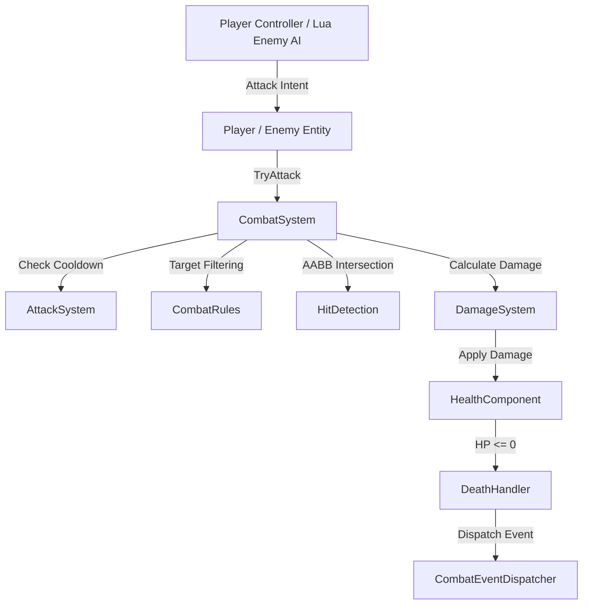

# Wildbound Combat System

The Wildbound Combat System provides a unified, deterministic, authoritative combat framework for both human players and AI-driven entities. Designed from the ground up for authoritative calculation and future network multiplayer replication, the combat architecture separates combat calculations (damage, cooldowns, hit resolution, death events) from entity input and rendering representation.

---

## 1. Core Architectural Principles

1. **Shared Combat Pipeline**:
   Both `Player` and `Enemy` implement the `wildbound::combat::Combatant` interface. No entity type receives hardcoded, proprietary damage formulas or combat shortcuts.
2. **Controller/Intent Separation**:
   Input devices (keyboard/mouse for the player) and AI scripts (Lua behavior trees for enemies) produce *intentions* (`RequestAttack`, `MoveDirection`). Centralized C++ systems validate whether the entity can attack, calculate hitboxes, test hurtbox intersections, and apply damage.
3. **Multiplayer-Ready Determinism**:
   Combat calculations rely solely on discrete tick time, entity IDs (`CombatantId`), positions, facing directions, and data-driven configuration tables. No rendering or graphical effects influence damage resolution.
4. **Decoupled Event Architecture**:
   State transitions trigger events via `CombatEventDispatcher` (`DamageEvent`, `DeathEvent`, `AttackEvent`). Audio, animation controllers, UI damage numbers, and camera shake systems subscribe to these events without tight coupling.

---

## 2. Combat Subsystem Components

### Subsystem Overview

| Component | Header / Source | Responsibility |
|---|---|---|
| `Combatant` | [`src/combat/Combatant.hpp`](file:///c:/dev/Wildbound/src/combat/Combatant.hpp) | Abstract interface implemented by all damageable, attacking entities. |
| `CombatSystem` | [`src/combat/CombatSystem.hpp`](file:///c:/dev/Wildbound/src/combat/CombatSystem.hpp) | Central registry and attack orchestrator. Resolves attacks and queries. |
| `HealthComponent` | [`src/combat/HealthComponent.hpp`](file:///c:/dev/Wildbound/src/combat/HealthComponent.hpp) | Encapsulated HP state, clamp logic, invulnerability, and healing. |
| `DamageSystem` | [`src/combat/DamageSystem.hpp`](file:///c:/dev/Wildbound/src/combat/DamageSystem.hpp) | Pure calculation engine for damage types, multipliers, and armor reduction. |
| `AttackSystem` | [`src/combat/AttackSystem.hpp`](file:///c:/dev/Wildbound/src/combat/AttackSystem.hpp) | Attack registry, cooldown tracking, and hitbox configuration. |
| `HitDetection` | [`src/combat/HitDetection.hpp`](file:///c:/dev/Wildbound/src/combat/HitDetection.hpp) | Directional attack hitbox computation and AABB hurtbox collision checks. |
| `CombatRules` | [`src/combat/CombatRules.hpp`](file:///c:/dev/Wildbound/src/combat/CombatRules.hpp) | Target validation matrix (PvP, PvE, friendly fire). |
| `CombatEvents` | [`src/combat/CombatEvents.hpp`](file:///c:/dev/Wildbound/src/combat/CombatEvents.hpp) | Event payload definitions and subscriber dispatch bus. |
| `DeathHandler` | [`src/combat/DeathHandler.hpp`](file:///c:/dev/Wildbound/src/combat/DeathHandler.hpp) | Deduplication registry preventing multi-trigger death events. |

---

## 3. Attack Lifecycle Execution Flow

When an attack is requested:
1. **Initiation**: `CombatSystem::ProcessAttack(attacker, attackId, facing)` is invoked.
2. **Alive Validation**: Attacker must be active and alive (`attacker->IsAlive() == true`).
3. **Cooldown Check**: The attacker's `AttackSystem` verifies whether `attackId` is off cooldown. If cooling down, the attack is rejected.
4. **Hitbox Generation**: `HitDetection::ComputeAttackHitbox` generates a world-space AABB in front of the attacker based on their current facing direction (`Up`, `Down`, `Left`, `Right`) and forward offset.
5. **Spatial Query & Target Filtering**:
   - The system iterates over all registered `Combatant` instances.
   - Self-targeting is ignored.
   - `CombatRules::CanTarget(attacker, target)` checks the faction matrix (Players vs Monsters, Players vs Players if PvP enabled, etc.).
6. **Intersection Test**:
   - `HitDetection::Intersects(attackHitbox, target->GetHurtbox())` evaluates swept AABB overlap.
7. **Damage Calculation & Resolution**:
   - For each valid target hit, `DamageSystem::CalculateDamage` evaluates base damage, damage type multipliers, and target defense.
   - `target->GetHealth().ApplyDamage(finalDamage)` reduces the target's current health.
   - `DamageEvent` is dispatched to all registered listeners.
   - `target->OnDamageReceived(damageEvent)` is invoked on the victim.
8. **Death Processing**:
   - If `target->GetHealth().IsDead()` and not previously marked dead, `DeathHandler::ProcessDeath` dispatches a `DeathEvent`.
   - `target->OnDeath(deathEvent)` is invoked.
   - Dead entities are scheduled for clean deferred cleanup after their death animation finishes.

---

## 4. Configuration & Data Files

All combat parameters are fully data-driven:
- `data/combat/damage_types.json`: Defines damage types (`physical`, `magical`, `environmental`).
- `data/combat/attacks.json`: Defines reusable attack profiles (hitbox dimensions, base damage, cooldown).
- `data/combat/combat_rules.json`: Configures PvP, PvE, and friendly fire allowances.

