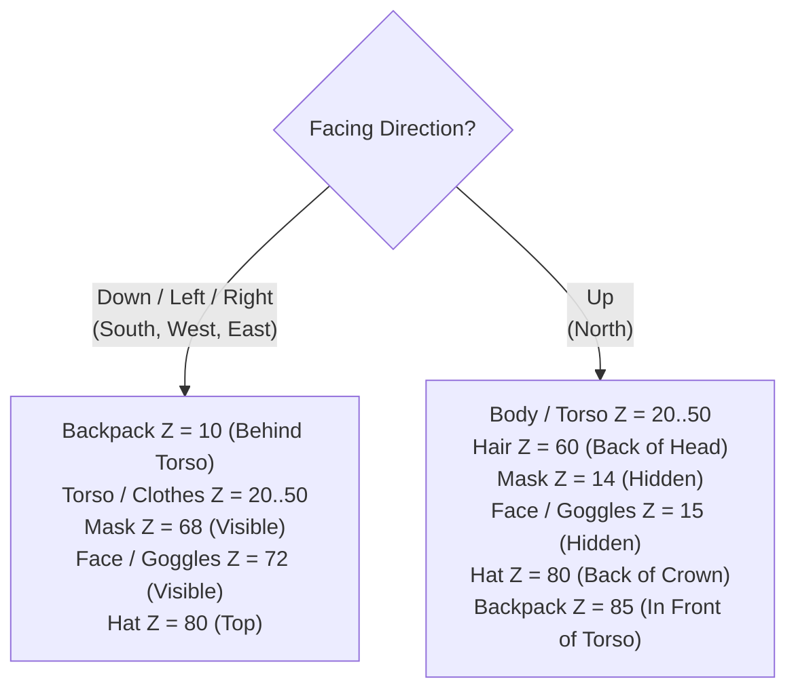

# Wildbound — Cosmetic Compatibility Matrix

## 1. Overview & Architectural Principles

The **Cosmetic Compatibility Matrix** defines how the 32 production cosmetic assets interact when equipped together. Rather than hardcoding exceptions across the rendering loop, compatibility and visual occlusion are governed by metadata-driven occlusion flags and dynamic directional layer sorting.

---

## 2. Category Inter-Compatibility Matrix

| Category A \ Category B | Hairstyles (5) | Shirts (5) | Pants (5) | Shoes (3) | Hats (5) | Goggles (3) | Masks (3) | Backpacks (3) |
| :--- | :---: | :---: | :---: | :---: | :---: | :---: | :---: | :---: |
| **Hairstyles** | **Exclusive** | Compatible | Compatible | Compatible | **Conditional** | Compatible | Compatible | Compatible |
| **Shirts** | Compatible | **Exclusive** | Compatible | Compatible | Compatible | Compatible | Compatible | **Layered** |
| **Pants** | Compatible | Compatible | **Exclusive** | **Layered** | Compatible | Compatible | Compatible | Compatible |
| **Shoes** | Compatible | Compatible | **Layered** | **Exclusive** | Compatible | Compatible | Compatible | Compatible |
| **Hats** | **Conditional**| Compatible | Compatible | Compatible | **Exclusive** | Compatible | Compatible | Compatible |
| **Goggles** | Compatible | Compatible | Compatible | Compatible | Compatible | **Exclusive** | **Conditional** | Compatible |
| **Masks** | Compatible | Compatible | Compatible | Compatible | Compatible | **Conditional**| **Exclusive** | Compatible |
| **Backpacks** | Compatible | **Layered** | Compatible | Compatible | Compatible | Compatible | Compatible | **Exclusive** |

### Legend:
- **Exclusive**: Single-item-per-slot restriction. Equipping an item in this category automatically replaces the currently equipped item.
- **Compatible**: Both items render simultaneously without visual conflicts across all four directions.
- **Layered**: Governed by strict Z-ordering (e.g. shoes render over trouser hems; backpacks invert depth depending on facing direction).
- **Conditional**: Governed by metadata occlusion flags (see Section 3).

---

## 3. Metadata Occlusion Flags & Rules

The engine evaluates three core occlusion flags defined in cosmetic metadata:

| Flag Name | Triggering Item | Suppressed Layer | Rationale & Visual Behavior |
| :--- | :--- | :--- | :--- |
| `hair_hide_all` | `hat_helmet_001` (Iron Helmet) | `CosmeticCategory::Hair` | Full enclosed medieval helmets enclose the entire head. Suppressing hair prevents strands and bangs from clipping through metallic surfaces. |
| `mask_hide_goggles` | `mask_mystic_001` (Mystic Mask) | `CosmeticCategory::Goggles` | The porcelain mystic mask covers the entire face. Eyewear cannot physically sit on top of the porcelain shell without clipping. |
| `robe_hide_pants` | Future floor-length robes | `CosmeticCategory::Pants` | Ankle-length heavy robes conceal trousers entirely; suppressing pants eliminates redundant draw calls. |

---

## 4. Directional Depth Inversion Rules

Dynamic layer sorting resolves front-to-back occlusion based on the character's facing direction:



### Detailed Directional Behavior:
1. **Backpacks (`backpack_traveler_001`, `backpack_leather_001`, `backpack_adventure_001`)**:
   - Facing **Down / Left / Right**: Renders behind the torso ($Z = 10$). Front shoulder straps and harness buckles render across the chest.
   - Facing **Up**: Renders in front of the torso ($Z = 85$). Full rucksack, bedroll, and canteen cover the character's upper back.
2. **Face Eyewear & Masks (`goggles_*`, `mask_*`)**:
   - Facing **Down / Left / Right**: Fully visible on the front/side profile ($Z = 68$ for masks, $Z = 72$ for goggles).
   - Facing **Up**: Marked `visible = false` and assigned $Z = 14 \dots 15$, completely hidden behind the skull and hair.

---

## 5. Conflict Resolution & Validation Logic

The [`CharacterEquipment::CheckCompatibility(item)`](file:///c:/dev/Wildbound/src/entities/ModularCharacter.cpp) method provides authoritative conflict validation:

```cpp
CompatibilityResult CharacterEquipment::CheckCompatibility(const CosmeticItem& item) const {
    CompatibilityResult res;
    // 1. Goggles vs Full-Face Mask conflict
    if (item.category == CosmeticCategory::Goggles || item.category == CosmeticCategory::Face) {
        if (HasOcclusionFlag("mask_hide_goggles")) {
            res.compatible = false;
            res.reason = "Equipped full-face mask prevents wearing eyewear/goggles.";
            return res;
        }
    }

    if (item.category == CosmeticCategory::Mask) {
        bool hidesGoggles = std::find(item.occlusionFlags.begin(),
                                      item.occlusionFlags.end(),
                                      "mask_hide_goggles") != item.occlusionFlags.end();
        if (hidesGoggles && (HasEquipped(CosmeticCategory::Goggles) || HasEquipped(CosmeticCategory::Face))) {
            res.compatible = false;
            res.reason = "Full-face mask conflicts with currently equipped eyewear/goggles.";
            return res;
        }
    }

    return res;
}
```

- **Graceful UI Feedback**: The DevUI Wardrobe displays live compatibility warnings when conflicting items are queried.
- **Authoritative Fallback**: If equipped via `Equip(item, force = true)`, the engine accepts the item and applies the occlusion flag automatically, hiding the conflicting layer without crashing or corrupting state.

