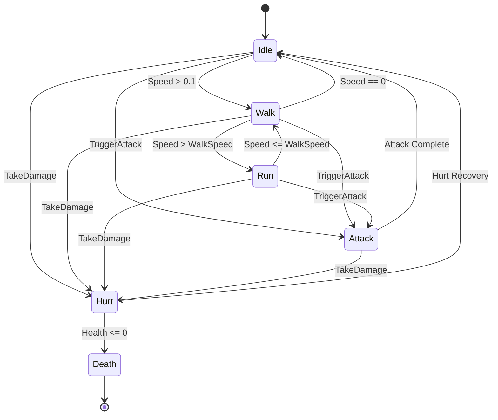

# Wildbound — Creature Animation Specification (Phase 9)

## 1. Architectural Foundation & Overview

Wildbound drives character and creature animations through the C++20 [`AnimationController`](file:///c:/dev/Wildbound/src/graphics/animation/AnimationController.hpp) and [`AnimationStateMachine`](file:///c:/dev/Wildbound/src/graphics/animation/AnimationStateMachine.hpp) systems.

This document establishes the official animation standards for hostile entities and ambient wildlife, covering clip naming conventions, directional mapping, frame rate standards, flying elevation offsets, and combat synchronization.

---

## 2. Animation Categories & State Conventions



### 2.1 Locomotion Cycles: Walk vs. Run
Wildbound creatures utilize distinct walk and run states:
- **Walk Cycles**: Represent cautious stalking or passive patrolling.
  - Frame Duration: $0.14\text{s}$ to $0.16\text{s}$ per frame ($\approx 6.25$ to $7.14$ fps).
  - Pacing: Measured, deliberate leg contact points.
- **Run Cycles**: Represent chase, charge, or aggressive pursuit.
  - Frame Duration: $0.08\text{s}$ to $0.09\text{s}$ per frame ($\approx 11.1$ to $12.5$ fps).
  - Dynamics: Reuses or accelerates motion frames with rapid displacement, matching AI pursuit velocities ($85$ to $110$ units/sec).

### 2.2 Attack Cycles & Hit Windows
Combat attacks feature a 4-frame progression carefully timed with the [Combat System](file:///c:/dev/Wildbound/docs/COMBAT_SYSTEM.md):
- **Frame 0 (Anticipation / Windup)**: Muscle flexion, weapon pull-back, or fang baring ($0.08\text{s}$ to $0.10\text{s}$).
- **Frame 1 (Active Hit Window)**: Maximum forward extension, jaw snap, or weapon arc. This frame triggers `HitDetection::RegisterHitbox()` ($0.08\text{s}$ to $0.10\text{s}$).
- **Frame 2 (Follow-Through)**: Dissipation of kinetic energy ($0.08\text{s}$ to $0.10\text{s}$).
- **Frame 3 (Recovery)**: Return to balance stance ($0.08\text{s}$ to $0.10\text{s}$).

### 2.3 Hurt & Death Sequences
- **Hurt**: Quick flinch/recoil animation (2 frames @ $0.10\text{s}$), signaling damage intake and triggering the white hit flash shader.
- **Death**: Collapse animation (4 frames @ $0.12\text{s}$, non-looping), ending in a static corpse frame before entity cleanup or fading.

---

## 3. Flying Entities & Aerial Conventions

Flying creatures (Dusk Bat, Small Songbird, Butterflies) follow specialized motion principles to convey depth in $2.5\text{D}$ space:

```
          [ Bat / Bird Sprite ]  <--- Visual Elevation Offset (8 to 16 px)
                   |
             (Air Space)
                   |
           [ Shadow Ellipse ]    <--- Ground Anchor (Depth Sorting & Collision)
```

1. **Elevation Offset**: The visual sprite is rendered with an elevation offset ($y_{\text{render}} = y_{\text{world}} - h_{\text{altitude}}$), while the ground anchor and shadow remain pinned at $y_{\text{world}}$.
2. **Hovering Oscillation**: Ambient hovering is achieved by modulating the elevation offset using a sinusoidal wave ($A \cdot \sin(2\pi f \cdot t)$), where $A = 2$ px and $f = 1.5$ Hz.
3. **Flap Frequency**:
   - Small Songbird: $0.08\text{s}$ per frame ($12.5$ fps) during flight.
   - Dusk Bat: $0.10\text{s}$ per frame ($10.0$ fps) during standard glide/flap.
   - Butterfly: $0.12\text{s}$ per frame ($8.3$ fps) irregular fluttering.
4. **Takeoff & Landing Transitions**:
   - `takeoff`: Crouch, wing burst, elevation rise (4 frames).
   - `landing`: Wing brake, descent, foot contact on branch/ground (4 frames).

---

## 4. Comprehensive Creature Animation Clip Matrix

### 4.1 Forest Goblin (`goblin`) — $32 \times 48$ px, 32 Frames
| Clip Name | Frames | Duration | Loop | Description |
| :--- | :---: | :---: | :---: | :--- |
| `goblin_idle_down` | `[0, 1, 2, 3]` | 0.20s | Yes | South breathing stance |
| `goblin_idle_up` | `[4, 5, 6, 7]` | 0.20s | Yes | North back-turned stance |
| `goblin_idle_left` | `[8, 9, 10, 11]` | 0.20s | Yes | West profile stance |
| `goblin_idle_right` | `[12, 13, 14, 15]` | 0.20s | Yes | East profile stance |
| `goblin_walk_down` | `[16, 17, 18, 19]` | 0.15s | Yes | South hunched walk |
| `goblin_walk_up` | `[20, 21, 22, 23]` | 0.15s | Yes | North hunched walk |
| `goblin_walk_left` | `[24, 25, 26, 27]` | 0.15s | Yes | West stalking walk |
| `goblin_walk_right` | `[28, 29, 30, 31]` | 0.15s | Yes | East stalking walk |
| `goblin_run_down` | `[16, 17, 18, 19]` | 0.09s | Yes | Accelerated pursuit sprint South |
| `goblin_run_up` | `[20, 21, 22, 23]` | 0.09s | Yes | Accelerated pursuit sprint North |
| `goblin_run_left` | `[24, 25, 26, 27]` | 0.09s | Yes | Accelerated pursuit sprint West |
| `goblin_run_right` | `[28, 29, 30, 31]` | 0.09s | Yes | Accelerated pursuit sprint East |
| `goblin_attack_down` | `[16, 17, 18, 19]` | 0.10s | No | Dagger thrust South |
| `goblin_attack_up` | `[20, 21, 22, 23]` | 0.10s | No | Dagger thrust North |
| `goblin_attack_left` | `[24, 25, 26, 27]` | 0.10s | No | Dagger lunge West |
| `goblin_attack_right` | `[28, 29, 30, 31]` | 0.10s | No | Dagger lunge East |
| `goblin_hurt_down` | `[0, 1]` | 0.10s | No | Flinch South |
| `goblin_hurt_up` | `[4, 5]` | 0.10s | No | Flinch North |
| `goblin_hurt_left` | `[8, 9]` | 0.10s | No | Flinch West |
| `goblin_hurt_right` | `[12, 13]` | 0.10s | No | Flinch East |
| `goblin_death_down` | `[0, 1, 2, 3]` | 0.12s | No | Collapse South |
| `goblin_death_up` | `[4, 5, 6, 7]` | 0.12s | No | Collapse North |
| `goblin_death_left` | `[8, 9, 10, 11]` | 0.12s | No | Collapse West |
| `goblin_death_right` | `[12, 13, 14, 15]` | 0.12s | No | Collapse East |

---

### 4.2 Undead Skeleton (`skeleton`) — $32 \times 48$ px, 32 Frames
| Clip Name | Frames | Duration | Loop | Description |
| :--- | :---: | :---: | :---: | :--- |
| `skeleton_idle_down` | `[0, 1, 2, 3]` | 0.20s | Yes | South sword ready stance |
| `skeleton_idle_up` | `[4, 5, 6, 7]` | 0.20s | Yes | North back stance |
| `skeleton_idle_left` | `[8, 9, 10, 11]` | 0.20s | Yes | West profile ready stance |
| `skeleton_idle_right` | `[12, 13, 14, 15]` | 0.20s | Yes | East profile ready stance |
| `skeleton_walk_down` | `[16, 17, 18, 19]` | 0.15s | Yes | Clattering march South |
| `skeleton_walk_up` | `[20, 21, 22, 23]` | 0.15s | Yes | Clattering march North |
| `skeleton_walk_left` | `[24, 25, 26, 27]` | 0.15s | Yes | Clattering march West |
| `skeleton_walk_right` | `[28, 29, 30, 31]` | 0.15s | Yes | Clattering march East |
| `skeleton_run_down` | `[16, 17, 18, 19]` | 0.09s | Yes | Aggressive charge South |
| `skeleton_run_up` | `[20, 21, 22, 23]` | 0.09s | Yes | Aggressive charge North |
| `skeleton_run_left` | `[24, 25, 26, 27]` | 0.09s | Yes | Aggressive charge West |
| `skeleton_run_right` | `[28, 29, 30, 31]` | 0.09s | Yes | Aggressive charge East |
| `skeleton_attack_down` | `[16, 17, 18, 19]` | 0.10s | No | Sword slash South |
| `skeleton_attack_up` | `[20, 21, 22, 23]` | 0.10s | No | Sword slash North |
| `skeleton_attack_left` | `[24, 25, 26, 27]` | 0.10s | No | Sword thrust West |
| `skeleton_attack_right` | `[28, 29, 30, 31]` | 0.10s | No | Sword thrust East |
| `skeleton_hurt_down` | `[0, 1]` | 0.10s | No | Bone jar recoil South |
| `skeleton_hurt_up` | `[4, 5]` | 0.10s | No | Bone jar recoil North |
| `skeleton_hurt_left` | `[8, 9]` | 0.10s | No | Bone jar recoil West |
| `skeleton_hurt_right` | `[12, 13]` | 0.10s | No | Bone jar recoil East |
| `skeleton_death_down` | `[0, 1, 2, 3]` | 0.12s | No | Bone pile collapse South |
| `skeleton_death_up` | `[4, 5, 6, 7]` | 0.12s | No | Bone pile collapse North |
| `skeleton_death_left` | `[8, 9, 10, 11]` | 0.12s | No | Bone pile collapse West |
| `skeleton_death_right` | `[12, 13, 14, 15]` | 0.12s | No | Bone pile collapse East |

---

### 4.3 Forest Wolf (`wolf`) — $48 \times 40$ px, 32 Frames
| Clip Name | Frames | Duration | Loop | Description |
| :--- | :---: | :---: | :---: | :--- |
| `wolf_idle_down` | `[0, 1, 2, 3]` | 0.18s | Yes | South alert standing pant |
| `wolf_idle_up` | `[4, 5, 6, 7]` | 0.18s | Yes | North tail twitch stance |
| `wolf_idle_left` | `[8, 9, 10, 11]` | 0.18s | Yes | West side alert stance |
| `wolf_idle_right` | `[12, 13, 14, 15]` | 0.18s | Yes | East side alert stance |
| `wolf_walk_down` | `[16, 17, 18, 19]` | 0.14s | Yes | Four-legged prowl South |
| `wolf_walk_up` | `[20, 21, 22, 23]` | 0.14s | Yes | Four-legged prowl North |
| `wolf_walk_left` | `[24, 25, 26, 27]` | 0.14s | Yes | Four-legged prowl West |
| `wolf_walk_right` | `[28, 29, 30, 31]` | 0.14s | Yes | Four-legged prowl East |
| `wolf_run_down` | `[16, 17, 18, 19]` | 0.08s | Yes | Full predatory gallop South |
| `wolf_run_up` | `[20, 21, 22, 23]` | 0.08s | Yes | Full predatory gallop North |
| `wolf_run_left` | `[24, 25, 26, 27]` | 0.08s | Yes | Full predatory gallop West |
| `wolf_run_right` | `[28, 29, 30, 31]` | 0.08s | Yes | Full predatory gallop East |
| `wolf_attack_down` | `[16, 17, 18, 19]` | 0.09s | No | Pounce & bite South |
| `wolf_attack_up` | `[20, 21, 22, 23]` | 0.09s | No | Pounce & bite North |
| `wolf_attack_left` | `[24, 25, 26, 27]` | 0.09s | No | Pounce & bite West |
| `wolf_attack_right` | `[28, 29, 30, 31]` | 0.09s | No | Pounce & bite East |
| `wolf_hurt_down` | `[0, 1]` | 0.10s | No | Recoil yelp South |
| `wolf_death_down` | `[0, 1, 2, 3]` | 0.12s | No | Collapse on flank |

---

### 4.4 Wild Boar (`wild_boar`) — $48 \times 40$ px, 32 Frames
| Clip Name | Frames | Duration | Loop | Description |
| :--- | :---: | :---: | :---: | :--- |
| `boar_idle_down` | `[0, 1, 2, 3]` | 0.20s | Yes | South heavy breathing |
| `boar_idle_up` | `[4, 5, 6, 7]` | 0.20s | Yes | North broad back stance |
| `boar_idle_left` | `[8, 9, 10, 11]` | 0.20s | Yes | West profile sniff |
| `boar_idle_right` | `[12, 13, 14, 15]` | 0.20s | Yes | East profile sniff |
| `boar_walk_down` | `[16, 17, 18, 19]` | 0.16s | Yes | Heavy plod South |
| `boar_walk_up` | `[20, 21, 22, 23]` | 0.16s | Yes | Heavy plod North |
| `boar_walk_left` | `[24, 25, 26, 27]` | 0.16s | Yes | Heavy plod West |
| `boar_walk_right` | `[28, 29, 30, 31]` | 0.16s | Yes | Heavy plod East |
| `boar_run_down` | `[16, 17, 18, 19]` | 0.09s | Yes | Head-down charge South |
| `boar_run_up` | `[20, 21, 22, 23]` | 0.09s | Yes | Head-down charge North |
| `boar_run_left` | `[24, 25, 26, 27]` | 0.09s | Yes | Head-down charge West |
| `boar_run_right` | `[28, 29, 30, 31]` | 0.09s | Yes | Head-down charge East |
| `boar_attack_down` | `[16, 17, 18, 19]` | 0.10s | No | Upward tusk gore South |
| `boar_attack_up` | `[20, 21, 22, 23]` | 0.10s | No | Upward tusk gore North |
| `boar_attack_left` | `[24, 25, 26, 27]` | 0.10s | No | Upward tusk gore West |
| `boar_attack_right` | `[28, 29, 30, 31]` | 0.10s | No | Upward tusk gore East |
| `boar_hurt_down` | `[0, 1]` | 0.10s | No | Heavy grunt recoil |
| `boar_death_down` | `[0, 1, 2, 3]` | 0.12s | No | Heavy side collapse |

---

### 4.5 Dusk Bat (`bat`) — $32 \times 32$ px, 32 Frames
| Clip Name | Frames | Duration | Loop | Description |
| :--- | :---: | :---: | :---: | :--- |
| `bat_fly_down` | `[0, 1, 2, 3]` | 0.10s | Yes | Wing flap facing South |
| `bat_fly_up` | `[4, 5, 6, 7]` | 0.10s | Yes | Wing flap facing North |
| `bat_fly_left` | `[8, 9, 10, 11]` | 0.10s | Yes | Side flap facing West |
| `bat_fly_right` | `[12, 13, 14, 15]` | 0.10s | Yes | Side flap facing East |
| `bat_move_down` | `[16, 17, 18, 19]` | 0.08s | Yes | Fast flight South |
| `bat_move_up` | `[20, 21, 22, 23]` | 0.08s | Yes | Fast flight North |
| `bat_move_left` | `[24, 25, 26, 27]` | 0.08s | Yes | Fast flight West |
| `bat_move_right` | `[28, 29, 30, 31]` | 0.08s | Yes | Fast flight East |
| `bat_attack_down` | `[16, 17, 18, 19]` | 0.08s | No | Aerial dive & bite South |
| `bat_attack_up` | `[20, 21, 22, 23]` | 0.08s | No | Aerial dive & bite North |
| `bat_attack_left` | `[24, 25, 26, 27]` | 0.08s | No | Aerial dive & bite West |
| `bat_attack_right` | `[28, 29, 30, 31]` | 0.08s | No | Aerial dive & bite East |
| `bat_hurt_down` | `[0, 1]` | 0.08s | No | Mid-air wing fold recoil |
| `bat_death_down` | `[0, 1, 2, 3]` | 0.10s | No | Spiral fall to ground |

---

### 4.6 Small Songbird (`small_bird`) — $24 \times 24$ px, 16 Frames
| Clip Name | Frames | Duration | Loop | Description |
| :--- | :---: | :---: | :---: | :--- |
| `bird_idle` | `[0, 1, 2, 3]` | 0.22s | Yes | Ground perch, peck seed, look around |
| `bird_fly` | `[4, 5, 6, 7]` | 0.08s | Yes | Rapid winged aerial flight |
| `bird_takeoff` | `[8, 9, 10, 11]` | 0.10s | No | Ground crouch to upward flap |
| `bird_landing` | `[12, 13, 14, 15]` | 0.10s | No | Glide deceleration to foot touch |

---

### 4.7 Butterflies (Forest, Blue, Golden) — $16 \times 16$ px, 8 Frames
| Clip Name | Frames | Duration | Loop | Description |
| :--- | :---: | :---: | :---: | :--- |
| `<variant>_resting` | `[0, 1, 2, 3]` | 0.25s | Yes | Gentle wing fold on plant or flower |
| `<variant>_fly` | `[4, 5, 6, 7]` | 0.12s | Yes | Erratic fluttering aerial path |

