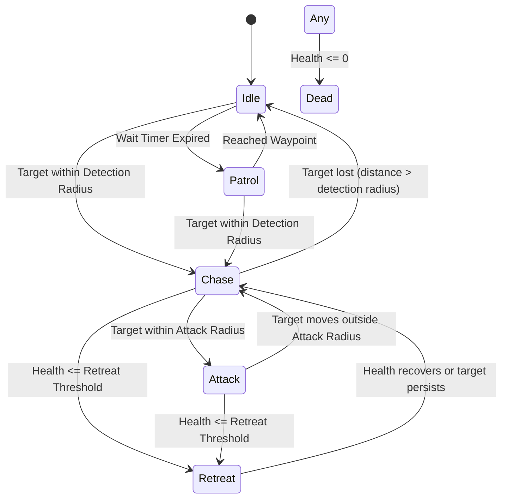

# Wildbound Enemy AI System

The Enemy AI System drives intelligent non-player behaviors through a dual-layer architecture: flexible Lua scripts for high-level tactical behaviors and deterministic C++ state machines for high-performance fallbacks.

---

## 1. AI State Machine

Hostile entities transition between the following states:

### State Descriptions:
- **`IDLE`**: Entity stands in place, playing idle animation while awaiting decision timer or patrol interval.
- **`PATROL`**: Entity wanders within `patrol_radius` of its spawn origin.
- **`DETECT_TARGET`**: Entity has noticed an opposing faction combatant.
- **`CHASE`**: Entity accelerates toward the target at `run_speed`, updating its facing direction.
- **`ATTACK`**: Entity is within melee attack reach, halts forward velocity, faces target, and requests attack execution.
- **`RETREAT`**: Entity health has fallen below `retreat_health_percent` (e.g. 20%). The entity flees in the opposite direction from the target at `run_speed`.
- **`DEAD`**: Entity is dead; all movement and AI processing is halted until destruction.

---

## 2. Decision Scheduling

Rather than evaluating full spatial queries and script execution every frame, enemy AI runs on an asynchronous decision interval (default **`0.2s`** / 5 Hz). Between decision ticks:
- The entity integrates the calculated velocity.
- Swept collision resolution slides against obstacles.
- Animation state machine updates facing and walk frames.

---

## 3. Dual-Layer AI Architecture

1. **Lua Script Evaluation**:
   When `LuaManager` is available, `Enemy::ExecuteAIDecision` packages an immutable context table into `wildbound.ai.update_enemy(context)`. The script computes the state transition and returns target intentions (`move_x`, `move_y`, `request_attack`).
2. **C++ Native Fallback**:
   If Lua is disabled, uninitialized, or an uncaught script exception occurs, `Enemy.cpp` instantly switches to its built-in native C++ state machine, ensuring entities never freeze in place.

