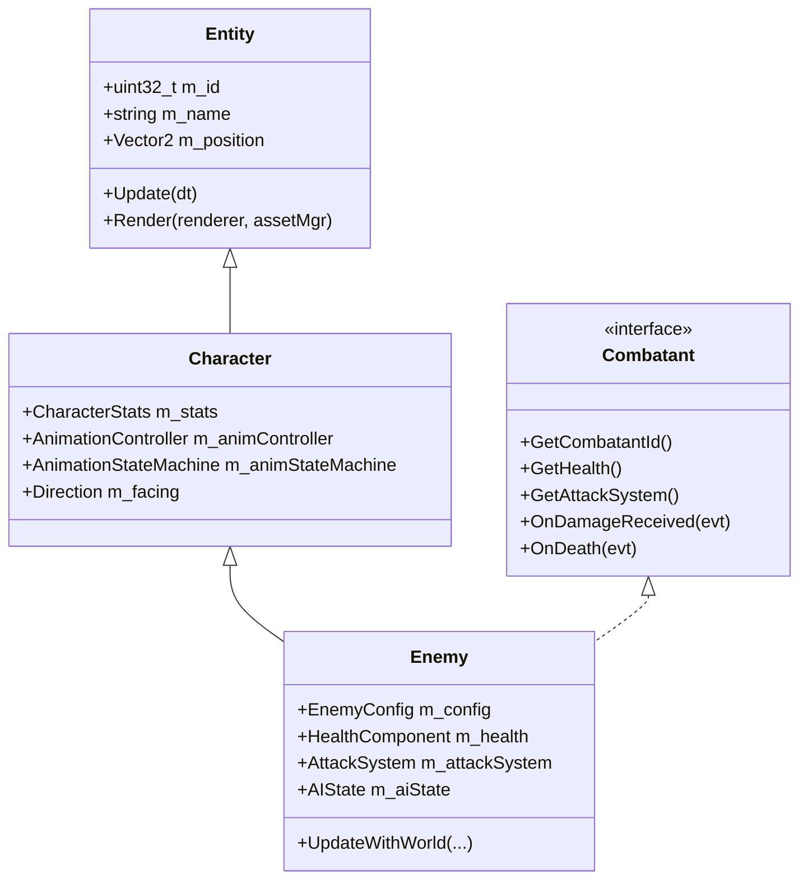

# Wildbound Enemy Subsystem

The Enemy Subsystem introduces autonomous hostile entities to the Wildbound world. Enemies feature full data-driven configuration, 4-directional animated spritesheets, collision against solid map tiles and environmental obstacles, and integrated combat components.

---

## 1. Class Hierarchy



---

## 2. Enemy Configuration (`EnemyConfig`)

Defined in [`src/entities/EnemyConfig.hpp`](file:///c:/dev/Wildbound/src/entities/EnemyConfig.hpp), enemy archetypes are loaded from JSON files under `data/characters/enemies/`.

### Goblin Schema (`data/characters/enemies/goblin.json`)
```json
{
  "id": "goblin",
  "name": "Forest Goblin",
  "type": "humanoid",
  "faction": "monsters",
  "spritesheet": "goblin_spritesheet",
  "stats": {
    "walk_speed": 65.0,
    "run_speed": 110.0,
    "normalize_diagonal": true
  },
  "health": {
    "max_health": 50.0,
    "initial_health": 50.0,
    "regeneration_enabled": false,
    "regeneration_rate": 0.0
  },
  "collision": {
    "enabled": true,
    "width": 16.0,
    "height": 12.0,
    "offset_x": 0.0,
    "offset_y": 0.0
  },
  "combat": {
    "default_attack": "goblin_club",
    "attack_cooldown": 1.0,
    "attack_range": 28.0
  },
  "ai": {
    "behavior_script": "scripts/gameplay/ai/enemy_base.lua",
    "detection_radius": 140.0,
    "attack_radius": 32.0,
    "retreat_health_percent": 0.2,
    "decision_interval": 0.2,
    "patrol_radius": 80.0
  }
}
```

---

## 3. Movement & Swept AABB Collision

Hostile entities use the identical collision response pipeline as the human player:
1. **X-Axis Integration & Resolution**: Movement along the X axis is checked against nearby solid collision boxes in the `World`. Solid collisions stop forward movement and slide along the wall.
2. **Y-Axis Integration & Resolution**: Movement along the Y axis is checked independently to permit frictionless wall sliding.
3. **World Boundary Clamping**: Enemies are clamped strictly within the navigable world bounds of the loaded tilemap.

---

## 4. Entity Lifecycle & Deferred Removal

When an enemy's health reaches zero:
1. The enemy transitions to `AIState::Dead`.
2. Velocity is zeroed (`m_velocity = {0, 0}`).
3. The death animation begins playing.
4. After `1.5` seconds (`m_deathTimer >= 1.5f`), `m_pendingDestruction` is set to `true`.
5. In the next frame, `EnemySpawner::Update` unregisters the entity from `CombatSystem` and safely deallocates the `std::unique_ptr<Enemy>`.

