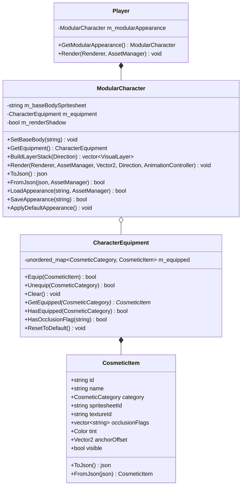
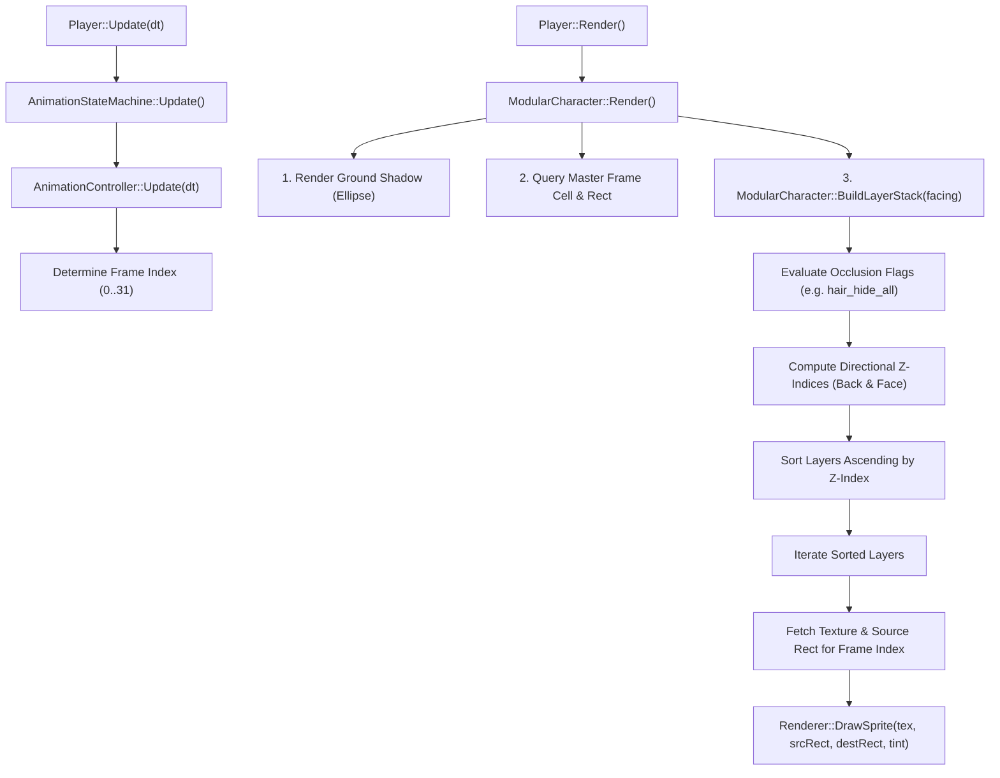

# Wildbound — Modular Character System

## 1. Overview & Architectural Goals

The **Modular Character System** in Wildbound provides a scalable, decoupled 2D paperdoll rendering and equipment architecture. Rather than generating monolithic combinatorial spritesheets for every possible combination of skin tone, hairstyle, clothing, armor, and accessories, Wildbound composites modular visual layers at runtime onto a shared $32 \times 48$ px humanoid frame grid.

### Key Architectural Objectives:
1. **Combinatorial Explosion Prevention**: By separating visual elements into discrete composable layers, $N$ skins, $H$ hairs, $S$ shirts, $P$ pants, and $A$ accessories yield $N \times H \times S \times P \times A$ possible visual configurations with only $N + H + S + P + A$ individual spritesheets.
2. **Zero-Desync Lockstep Animation**: All cosmetic spritesheets share an identical $32 \times 48$ px frame grid and frame indexing layout. The player's master [`AnimationController`](file:///c:/dev/Wildbound/src/graphics/animation/AnimationController.hpp) advances frame time and derives a single integer cell index ($0 \dots 31$), which is simultaneously applied across all equipped cosmetic layers.
3. **Directional Occlusion & Z-Sorting**: Dynamic layer depth sorting handles visual occlusion depending on the character's facing direction (Down/South, Up/North, Left/West, Right/East). For example, backpacks render behind the torso when facing South, but in front of the torso when facing North.
4. **Data-Driven Persistence & Serialization**: Appearance presets and character customizer loadouts serialize cleanly to and from JSON, enabling local persistence and seamless future network synchronization for multiplayer matches.

---

## 2. Core Architecture & Class Diagram

The modular system is implemented across three primary classes in `wildbound::entities`:

---

## 3. Cosmetic Categories

The engine defines nine discrete equipment slots via [`CosmeticCategory`](file:///c:/dev/Wildbound/src/entities/ModularCharacter.hpp):

| Category | String Identifier | Default Z-Index | Description |
| :--- | :--- | :--- | :--- |
| `Skin` | `"skin"` | 20 | Base humanoid mannequin body with skin tone |
| `Hair` | `"hair"` | 60 | Hair meshes, fringes, bangs, ponytails |
| `Shirt` | `"shirt"` | 50 | Tunics, vests, armor chestplates, robes |
| `Pants` | `"pants"` | 30 | Trousers, greaves undergarments, shorts |
| `Shoes` | `"shoes"` | 40 | Boots, leather wraps, armored sabatons |
| `Headwear` | `"headwear"` | 80 | Hoods, helmets, circlets, caps |
| `Face` | `"face"` | 70 | Eyepatches, explorer goggles, masks |
| `Back` | `"back"` | 10 / 85 | Backpacks, cloaks, quivers, shields |
| `Waist` | `"waist"` | 55 | Belts, sashes, utility pouches |

---

## 4. Pipeline & Rendering Execution Flow

---

## 5. File Locations

- Core Header: [`src/entities/ModularCharacter.hpp`](file:///c:/dev/Wildbound/src/entities/ModularCharacter.hpp)
- Core Implementation: [`src/entities/ModularCharacter.cpp`](file:///c:/dev/Wildbound/src/entities/ModularCharacter.cpp)
- Player Integration: [`src/entities/Player.hpp`](file:///c:/dev/Wildbound/src/entities/Player.hpp), [`src/entities/Player.cpp`](file:///c:/dev/Wildbound/src/entities/Player.cpp)
- Dev Wardrobe Suite: [`src/ui/DevUI.cpp`](file:///c:/dev/Wildbound/src/ui/DevUI.cpp)
- Default Configuration: [`data/characters/player_appearance.json`](file:///c:/dev/Wildbound/data/characters/player_appearance.json)
- Asset Generator: [`tools/generate_cosmetic_assets.py`](file:///c:/dev/Wildbound/tools/generate_cosmetic_assets.py)
- Unit Tests: [`tests/entities/test_modular_character.cpp`](file:///c:/dev/Wildbound/tests/entities/test_modular_character.cpp)

