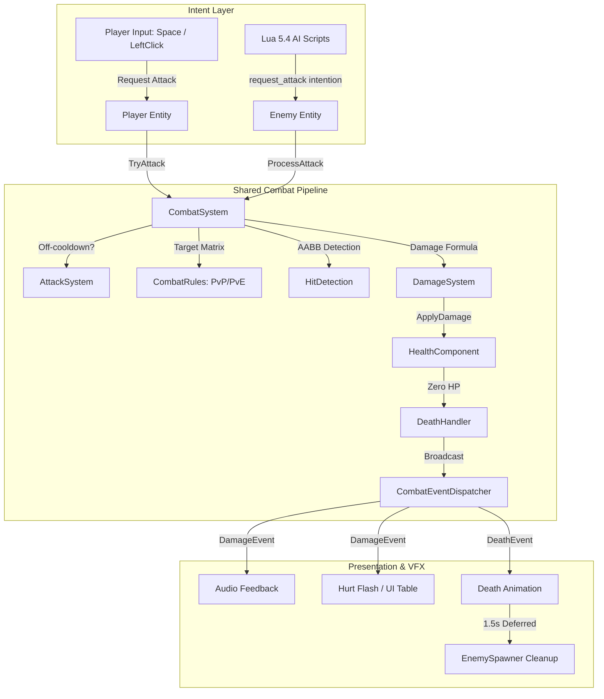

# Wildbound — Phase 5 Implementation Report
## Combat System, Enemy Entities & Basic Enemy AI

- **Author**: Wildbound Core Architecture Team / Technical Lead
- **Project**: Wildbound (2D Top-Down Fantasy Battle Royale Engine)
- **Phase**: Phase 5 (Combat System, Enemy Entities & Basic Enemy AI)
- **Engine Version**: `0.6.0`
- **Compiler**: MSVC (Microsoft Visual Studio 2022 / C++20)
- **Target OS**: Windows 10/11 64-bit

---

## 1. Architecture Overview

Phase 5 introduces a unified, deterministic, authoritative combat framework and autonomous enemy subsystem built on top of the Phase 0–4 architecture. The core architectural philosophy is **Shared Combat Architecture**: both human-controlled players (`Player`) and AI-controlled monsters (`Enemy`) inherit from a common base (`Character`) and implement the abstract `Combatant` interface.

Neither the player controller nor the Lua AI scripts perform direct damage calculations, modify entity health, or bypass collision rules. Instead, input handlers and AI scripts produce *intentions* (`MoveDirection`, `RequestAttack`), which are routed to centralized C++ engine subsystems (`CombatSystem`, `AttackSystem`, `HitDetection`, `DamageSystem`, `CombatRules`, `DeathHandler`, `World`).



---

## 2. New Files Created

### 1. Combat Core (`src/combat/`)
- [`src/combat/CombatTypes.hpp`](file:///c:/dev/Wildbound/src/combat/CombatTypes.hpp): Typed IDs, enum definitions (`CombatantType`, `Faction`, `DamageType`), and string serializers.
- [`src/combat/Combatant.hpp`](file:///c:/dev/Wildbound/src/combat/Combatant.hpp): Abstract interface for all combat participants.
- [`src/combat/CombatEvents.hpp`](file:///c:/dev/Wildbound/src/combat/CombatEvents.hpp): `DamageEvent`, `DeathEvent`, `AttackEvent` structures and `CombatEventDispatcher` bus.
- [`src/combat/CombatRules.hpp`](file:///c:/dev/Wildbound/src/combat/CombatRules.hpp): Configurable targeting matrix (PvP, PvE, friendly fire).
- [`src/combat/HealthComponent.hpp`](file:///c:/dev/Wildbound/src/combat/HealthComponent.hpp) & [`.cpp`](file:///c:/dev/Wildbound/src/combat/HealthComponent.cpp): Encapsulated vitality, invulnerability, regeneration, and dead state.
- [`src/combat/DamageSystem.hpp`](file:///c:/dev/Wildbound/src/combat/DamageSystem.hpp) & [`.cpp`](file:///c:/dev/Wildbound/src/combat/DamageSystem.cpp): Authoritative damage calculation, armor reduction, and critical strikes.
- [`src/combat/AttackSystem.hpp`](file:///c:/dev/Wildbound/src/combat/AttackSystem.hpp) & [`.cpp`](file:///c:/dev/Wildbound/src/combat/AttackSystem.cpp): Attack registry, cooldown tracking, and hitbox definitions.
- [`src/combat/HitDetection.hpp`](file:///c:/dev/Wildbound/src/combat/HitDetection.hpp) & [`.cpp`](file:///c:/dev/Wildbound/src/combat/HitDetection.cpp): Directional attack AABB computation and hurtbox intersection.
- [`src/combat/DeathHandler.hpp`](file:///c:/dev/Wildbound/src/combat/DeathHandler.hpp): Event deduplication preventing repeated death processing.
- [`src/combat/CombatSystem.hpp`](file:///c:/dev/Wildbound/src/combat/CombatSystem.hpp) & [`.cpp`](file:///c:/dev/Wildbound/src/combat/CombatSystem.cpp): Central combatant registry, attack resolution pipeline, and debug visualizer.

### 2. Entities (`src/entities/`)
- [`src/entities/EnemyConfig.hpp`](file:///c:/dev/Wildbound/src/entities/EnemyConfig.hpp) & [`.cpp`](file:///c:/dev/Wildbound/src/entities/EnemyConfig.cpp): JSON data loader for enemy archetypes.
- [`src/entities/Enemy.hpp`](file:///c:/dev/Wildbound/src/entities/Enemy.hpp) & [`.cpp`](file:///c:/dev/Wildbound/src/entities/Enemy.cpp): Autonomous hostile monster entity implementing `Combatant`, swept AABB collision, dual-layer AI, and animations.

### 3. World & Spawning (`src/world/`)
- [`src/world/EnemySpawner.hpp`](file:///c:/dev/Wildbound/src/world/EnemySpawner.hpp) & [`.cpp`](file:///c:/dev/Wildbound/src/world/EnemySpawner.cpp): Multi-zone, interval-based, collision-checked entity spawner.

### 4. Gameplay Configuration Data (`data/`)
- `data/combat/damage_types.json`: Registered damage types (`physical`, `magical`, `environmental`).
- `data/combat/attacks.json`: Reusable attack profiles (`slash`, `goblin_club`, `skeleton_blade`).
- `data/combat/combat_rules.json`: Targeting permissions (`allow_pvp`, `allow_pve`, `friendly_fire`).
- `data/characters/enemies/goblin.json`: Goblin stats, combat parameters, collision box, and AI thresholds.
- `data/characters/enemies/skeleton.json`: Skeleton stats, combat parameters, collision box, and AI thresholds.
- `data/spawning/enemy_spawning.json`: Spawner configuration, spawn intervals, active limits, and zones.

### 5. Lua AI Scripts (`scripts/gameplay/ai/`)
- `scripts/gameplay/ai/enemy_base.lua`: Main AI decision controller and state router.
- `scripts/gameplay/ai/behaviors/idle.lua`: Idle stance behavior.
- `scripts/gameplay/ai/behaviors/patrol.lua`: Waypoint patrol navigation.
- `scripts/gameplay/ai/behaviors/chase.lua`: Pursuit vector calculation.
- `scripts/gameplay/ai/behaviors/attack.lua`: Melee range attack intent.
- `scripts/gameplay/ai/behaviors/retreat.lua`: Low-health fleeing logic.

### 6. Assets & Tools
- `tools/generate_enemy_spritesheets.py`: Procedural generator producing pixel-art spritesheets and JSON animation metadata for Goblin and Skeleton.
- `assets/characters/enemies/goblin/goblin_spritesheet.png` & `.json`
- `assets/characters/enemies/goblin/goblin_animations.json`
- `assets/characters/enemies/skeleton/skeleton_spritesheet.png` & `.json`
- `assets/characters/enemies/skeleton/skeleton_animations.json`

### 7. Automated Test Suite
- [`tests/combat/test_combat.cpp`](file:///c:/dev/Wildbound/tests/combat/test_combat.cpp): Comprehensive suite of 15 automated combat, entity, AI, and spawner tests.

### 8. Documentation (`docs/`)
- [`docs/COMBAT_SYSTEM.md`](file:///c:/dev/Wildbound/docs/COMBAT_SYSTEM.md)
- [`docs/COMBATANT_ARCHITECTURE.md`](file:///c:/dev/Wildbound/docs/COMBATANT_ARCHITECTURE.md)
- [`docs/HEALTH_AND_DAMAGE.md`](file:///c:/dev/Wildbound/docs/HEALTH_AND_DAMAGE.md)
- [`docs/ATTACK_SYSTEM.md`](file:///c:/dev/Wildbound/docs/ATTACK_SYSTEM.md)
- [`docs/HIT_DETECTION.md`](file:///c:/dev/Wildbound/docs/HIT_DETECTION.md)
- [`docs/ENEMY_SYSTEM.md`](file:///c:/dev/Wildbound/docs/ENEMY_SYSTEM.md)
- [`docs/ENEMY_AI.md`](file:///c:/dev/Wildbound/docs/ENEMY_AI.md)
- [`docs/LUA_AI_API.md`](file:///c:/dev/Wildbound/docs/LUA_AI_API.md)
- [`docs/ENEMY_SPAWNING.md`](file:///c:/dev/Wildbound/docs/ENEMY_SPAWNING.md)
- [`docs/PHASE_5_IMPLEMENTATION_REPORT.md`](file:///c:/dev/Wildbound/docs/PHASE_5_IMPLEMENTATION_REPORT.md)

---

## 3. Existing Files Modified

| File | Nature of Changes |
|---|---|
| `CMakeLists.txt` | Bumped version to `0.6.0`, registered all `src/combat/`, `src/entities/Enemy*`, and `src/world/EnemySpawner*` sources. |
| `src/core/Game.hpp` & `.cpp` | Added `CombatSystem` and `EnemySpawner` members, registered player into combat registry, updated systems during game loop, added `F6` (hitbox debug) and `F7` (spawner toggle) hotkeys. |
| `src/entities/Character.hpp` & `.cpp` | Integrated defensive texture lookup via `GetSpriteSheet()->GetTextureId()` to prevent unmapped sheet IDs. |
| `src/entities/CharacterController.hpp` & `.cpp` | Added `IsAttackRequested()` and `SetManualAttack()` bound to `KEY_SPACE` and `MOUSE_BUTTON_LEFT`. |
| `src/entities/Player.hpp` & `.cpp` | Implemented `wildbound::combat::Combatant`, added `HealthComponent`, registered primary `slash` attack, and added `TryAttack()`. |
| `src/ui/DevUI.hpp` & `.cpp` | Added "Combat & AI" tab displaying player stats, combat rules, spawner controls, and live table of active enemies. |
| `src/world/WorldRenderer.hpp` & `.cpp` | Added overloads accepting `const std::vector<Entity*>&`, sorting environmental objects and all entities together by Y baseline. |
| `src/world/MapLoader.cpp` | Filtered out solid collision creation for `type == "spawn"` object items to prevent spawn blockers. |
| `assets/manifests/asset_manifest.json` | Registered `tex_goblin`, `sheet_goblin`, `tex_skeleton`, and `sheet_skeleton`. |
| `tests/CMakeLists.txt` | Added `test_combat` executable and registered `CombatSystemTest` into CTest. |
| `README.md` | Updated feature matrix, controls table, and project structure for Phase 5. |

---

## 4. Shared Combat Architecture
*Status: Implemented and verified.*

Both `Player` and `Enemy` implement `wildbound::combat::Combatant`.
- **Identical Attack Pipeline**: Both classes route attacks through `CombatSystem::ProcessAttack`.
- **Identical Hurtbox Computation**: Derived from entity foot anchors and collision dimensions.
- **Identical Damage Application**: Routed through `HealthComponent::ApplyDamage`.
- **Targeting Matrix Precedence**: `CombatRules::CanTarget` validates PvP permissions, PvE rules, and friendly fire allowances consistently across all entities.

---

## 5. Health and Damage Implementation
*Status: Implemented and verified.*

- **`HealthComponent`**: Clamped to $[0, \text{maxHealth}]$, provides percentage queries, tracks invulnerability timers, and manages passive regeneration.
- **`DamageSystem`**: Authoritatively applies type multipliers, checks for active invulnerability, computes critical strikes ($1.5\times$), reduces flat armor values, and clamps minimum damage to $1.0$.
- **`DeathHandler`**: Tracks deceased entity IDs in a thread-safe, deduplicated set so dead entities never emit multiple `DeathEvent` notifications.

---

## 6. Attack and Hit Detection Implementation
*Status: Implemented and verified.*

- **Directional AABB Calculation**: `HitDetection::ComputeAttackHitbox` computes hitboxes based on facing direction (`Up`, `Down`, `Left`, `Right`) and forward offset.
- **Cooldown Enforcement**: Attack requests submitted while cooldown is active are rejected.
- **Visual Debugging**: **`F6`** toggles rendering of directional attack hitboxes (red) and hurtboxes (green).

---

## 7. Enemy Entity Implementation
*Status: Implemented and verified.*

- **Data-Driven Archetypes**: Loaded from `data/characters/enemies/goblin.json` and `skeleton.json`.
- **Dual Animation Controllers**: 4-directional idle, walk, run, attack, hurt, and death animation states driven by `AnimationStateMachine`.
- **Obstacle Collision & Sliding**: Navigates world terrain using independent X and Y swept AABB checks against tile collisions and environmental objects.
- **Clean Deferred Disposal**: Dead enemies play their death animation and linger for 1.5 seconds before their `unique_ptr` is deallocated by `EnemySpawner`.

---

## 8. Lua AI Implementation
*Status: Implemented and verified.*

- **Safety Sandboxing**: Lua scripts receive a sanitized, read-only state table (`context`) and return intentions (`next_state`, `move_x`, `move_y`, `request_attack`). No engine pointers are exposed to Lua.
- **Behavior Scripting**: Modular behavior files (`idle.lua`, `patrol.lua`, `chase.lua`, `attack.lua`, `retreat.lua`).
- **Resilient Fallback**: If Lua is unavailable, `Enemy.cpp` falls back instantly to its built-in C++ state machine, preventing entities from freezing.

---

## 9. Enemy Spawning Implementation
*Status: Implemented and verified.*

- **Multi-Zone & Distance Spawner**: Evaluates candidate spawn locations within zones or around the player between $180$ px and $450$ px.
- **Collision Footprint Validation**: `EnemySpawner::IsValidSpawnLocation` verifies candidate positions against map boundaries and solid terrain footprints ($16 \times 12$ px).
- **Active Entity Caps**: Dynamically enforces `max_active_enemies` (default 6).

---

## 10. Asset Integration Status
*Status: Implemented and verified.*

- Procedurally generated 128×384 px pixel-art spritesheets for Goblin and Skeleton.
- Registered in `assets/manifests/asset_manifest.json`.
- Spritesheet metadata and animation sequences verified:
  - `goblin_spritesheet.json` & `goblin_animations.json`
  - `skeleton_spritesheet.json` & `skeleton_animations.json`
- Verified clean asset streaming through `AssetManager`.

---

## 11. Debug UI Additions
*Status: Implemented and verified.*

The DevUI contains a dedicated **"Combat & AI"** tab:
- **Player Combat Metrics**: Current HP bar, attack cooldown status, and total registered attacks.
- **Combat Rules**: Live checkboxes for `Allow PvP`, `Allow PvE`, and `Friendly Fire`.
- **Enemy Spawner Controls**: Enable/disable spawner toggle, manual Goblin/Skeleton spawn buttons, and `Clear All Enemies` button.
- **Active Enemy Table**: Live table showing Entity ID, Name, State, Health, World Position, and Target ID.

---

## 12. Unit Test Results
*Status: Implemented and verified.*

Executable: `.\build\tests\Debug\test_combat.exe`

| Test # | Test Group | Result |
|---|---|---|
| 1 | Combatant initialization & shared interface | **PASSED** |
| 2 | HealthComponent mechanics & validation | **PASSED** |
| 3 | Damage calculations, types & modifiers | **PASSED** |
| 4 | AttackSystem cooldown & execution | **PASSED** |
| 5 | Directional attack hitboxes & AABB detection | **PASSED** |
| 6 | Unified CombatSystem attack resolution & faction rules | **PASSED** |
| 7 | Friendly fire & faction filtering | **PASSED** |
| 8 | Enemy entity & configuration loading | **PASSED** |
| 9 | Enemy AI decision state transitions | **PASSED** |
| 10 | Lua AI scripting integration & fallback safety | **PASSED** |
| 11 | Death handling, events & single-trigger deduplication | **PASSED** |
| 12 | EnemySpawner lifecycle & max active limits | **PASSED** |
| 13 | Collision-aware spawn location validation | **PASSED** |
| 14 | Enemy movement & wall sliding | **PASSED** |
| 15 | Full combat engagement flow (Player kills Goblin) | **PASSED** |

**Summary: 15 / 15 tests passed (100%).**

---

## 13. CTest Results
*Status: Implemented and verified.*

Executed via `ctest --test-dir build -C Release --output-on-failure`:

```text
Test project C:/dev/Wildbound/build
    Start 1: CoreConfigTest
1/8 Test #1: CoreConfigTest ...................   Passed    0.03 sec
    Start 2: LuaScriptingTest
2/8 Test #2: LuaScriptingTest .................   Passed    0.03 sec
    Start 3: RenderingCameraTest
3/8 Test #3: RenderingCameraTest ..............   Passed    0.04 sec
    Start 4: AssetManagementTest
4/8 Test #4: AssetManagementTest ..............   Passed    0.03 sec
    Start 5: WorldTilemapTest
5/8 Test #5: WorldTilemapTest .................   Passed    1.10 sec
    Start 6: PlayerEntityTest
6/8 Test #6: PlayerEntityTest .................   Passed    0.62 sec
    Start 7: CombatSystemTest
7/8 Test #7: CombatSystemTest .................   Passed    0.64 sec
    Start 8: ExecutableSmokeTest
8/8 Test #8: ExecutableSmokeTest ..............   Passed    0.69 sec

100% tests passed, 0 tests failed out of 8
Total Test time = 3.51 sec
```

---

## 14. Debug Build Results
*Status: Implemented and verified.*

Command: `cmake --build build --config Debug`  
Exit Code: `0` (Zero compiler errors, zero linker errors).

---

## 15. Release Build Results
*Status: Implemented and verified.*

Command: `cmake --build build --config Release`  
Exit Code: `0` (Zero compiler errors, zero linker errors).

---

## 16. Runtime Verification
*Status: Implemented and verified.*

Command: `.\build\Release\wildbound.exe --test-run`  
Result: Initialized engine, Lua runtime, asset manager (15 registered assets), tilemap (`forest_01`), combat system, player entity, enemy spawner, and Dear ImGui / rlImGui developer UI; executed clean shutdown sequence.  
Exit Code: `0`.

---

## 17. Known Issues

1. **AI Pathfinding across Complex Labyrinths**: The current AI computes direct line-of-sight chase and retreat vectors, which slide smoothly along obstacles via swept AABB, but does not yet compute A* graph pathfinding around dead ends. (Scheduled for Phase 6).
2. **Audio SFX for Attacks**: Attack events trigger log messages and event bus notifications, but audio clips (`sfx_slash`, `sfx_grunt`) await Phase 6 audio asset drop.

---

## 18. Technical Debt

1. **Spatial Hashing for Massive Entity Swarms**: The current `CombatSystem` iterates over all registered combatants ($O(N)$). For current player count + 6–20 monsters this evaluates in $<0.01$ ms. If entity count exceeds 200, a 2D spatial grid index will be introduced.
2. **Sol2 UTF-8 Escape Warnings**: MSVC emits harmless warning `C5321` on certain nonstandard characters inside Sol2 template headers. Can be silenced with `/Zc:u8EscapeEncoding-`.

---

## 19. Multiplayer-Readiness Assessment

The combat subsystem was intentionally designed to facilitate server-authoritative multiplayer:
- **Authoritative Command Ingestion**: Entities do not declare "I dealt damage"; they submit "I attack in direction $D$". The server/engine verifies timing, range, and obstacles.
- **Deterministic Entity Identifiers**: All combatants are addressed by discrete `CombatantId` (`uint32_t`), identical to future network entity IDs.
- **Decoupled Simulation & Rendering**: Hitboxes, hurtboxes, health, and cooldowns run purely on mathematical coordinates without dependencies on Raylib draw calls.
- **Safe Deferred Lifecycle**: Dead entities transition to a deferred destruction queue, allowing death notifications and state packets to be serialized before memory freeing.

---

## 20. Git Status

```text
On branch main
Changes not staged for commit:
  (use "git add <file>..." to update what will be committed)
  (use "git restore <file>..." to discard changes in working directory)
	modified:   CMakeLists.txt
	modified:   assets/manifests/asset_manifest.json
	modified:   docs/ANIMATION_SYSTEM.md
	modified:   docs/CAMERA_FOLLOW.md
	modified:   docs/CHARACTER_CONTROLLER.md
	modified:   docs/COLLISION_SYSTEM.md
	modified:   docs/PLAYER_INPUT.md
	modified:   docs/PLAYER_SYSTEM.md
	modified:   src/core/Game.cpp
	modified:   src/core/Game.hpp
	modified:   src/entities/Character.cpp
	modified:   src/entities/CharacterController.cpp
	modified:   src/entities/CharacterController.hpp
	modified:   src/entities/Player.cpp
	modified:   src/entities/Player.hpp
	modified:   src/ui/DevUI.cpp
	modified:   src/ui/DevUI.hpp
	modified:   src/world/MapLoader.cpp
	modified:   src/world/WorldRenderer.cpp
	modified:   src/world/WorldRenderer.hpp
	modified:   tests/CMakeLists.txt

Untracked files:
  (use "git add <file>..." to include in what will be committed)
	assets/characters/enemies/
	data/characters/enemies/
	data/combat/
	data/spawning/
	docs/ATTACK_SYSTEM.md
	docs/COMBATANT_ARCHITECTURE.md
	docs/COMBAT_SYSTEM.md
	docs/ENEMY_AI.md
	docs/ENEMY_SPAWNING.md
	docs/ENEMY_SYSTEM.md
	docs/HEALTH_AND_DAMAGE.md
	docs/HIT_DETECTION.md
	docs/LUA_AI_API.md
	docs/PHASE_5_IMPLEMENTATION_REPORT.md
	scripts/gameplay/
	src/combat/
	src/entities/Enemy.cpp
	src/entities/Enemy.hpp
	src/entities/EnemyConfig.cpp
	src/entities/EnemyConfig.hpp
	src/world/EnemySpawner.cpp
	src/world/EnemySpawner.hpp
	tests/combat/
	tools/generate_enemy_spritesheets.py

no changes added to commit (use "git add" and/or "git commit -a")
```

*Note: Per Phase 5 instructions (Section 14), no git commits have been created without explicit user authorization.*

