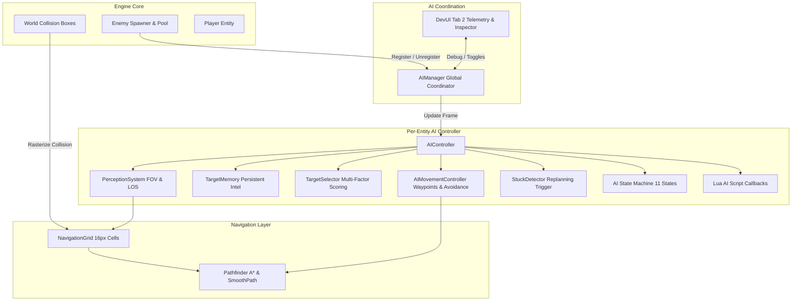

# Wildbound — AI Architecture

## 1. Overview & System Purpose

The Wildbound Artificial Intelligence (AI) architecture provides intelligent, autonomous, and reactive decision-making and locomotion for non-player entities (hostile enemies, neutral beasts, and wildlife). Built entirely within C++20 and raylib 5.5, the system integrates seamlessly with the existing modular entity lifecycle, World collision representation, 2D sprite animation pipelines, combat registries, and Lua 5.4 scripting hooks.

The architecture emphasizes modularity, determinism, spatial efficiency, and computational scalability. It supports multi-tiered decision hierarchies, A* grid pathfinding, local steering forces, and data-driven configuration without commercial middleware dependencies.

---

## 2. Architectural Blueprint

The AI system is structured across four primary layers:



---

## 3. Core Subsystems

### 3.1 Global Coordination (`AIManager`)
`wildbound::ai::AIManager` acts as the single point of contact between the game loop and AI agents.
- **Navigation Lifecycle**: Holds and maintains the central `NavigationGrid`. Rasterizes static world collision bounding boxes on map load or geometry change.
- **Agent Registry**: Automatically registers and deregisters `AIController` instances attached to `Enemy` entities spawned by `EnemySpawner`.
- **Spatial Queries**: Delivers fast, threat-weighted target queries for players, pets, and conflicting creature factions.
- **DevUI Inspection**: Exposes debug visualization hooks (paths, grids, perception cones, target vectors) to Dear ImGui Tab 2.

### 3.2 Navigation & Pathfinding Layer
- **`NavigationGrid`**: Discretizes 2D world space into uniform 16px $\times$ 16px grid cells. Stores walkable flags, cost modifiers, and dynamic entity occupation masks. Implements Bresenham line-of-sight raycasts with strict diagonal corner-cutting prevention.
- **`Pathfinder`**: Implements 8-direction and 4-direction A* graph search utilizing octile and Manhattan distance heuristics. Generates optimal grid-node sequences and applies line-of-sight path smoothing (`SmoothPath`) to eliminate robotic grid staircasing.

### 3.3 Movement & Locomotion Layer
- **`AIMovementController`**: Waypoint progression, arrival tolerance checks, directional heading derivation (`Direction` enum), and velocity application.
- **`ObstacleAvoidance`**: Computes inverse-distance repulsive steering vectors away from neighboring dynamic entities to prevent crowding and stacking.
- **`StuckDetector`**: Monitors cumulative spatial displacement across sliding time windows. If movement stalls against dynamic geometry, triggers path recalculation or lateral avoidance shunts.

### 3.4 Perception & Intel Layer
- **`PerceptionSystem`**: Evaluates targets across sensory criteria: radial proximity, forward field-of-view (FOV) directional cones, and raycast line-of-sight occlusion through `NavigationGrid`.
- **`TargetMemory`**: Stores target entity identifiers, last confirmed world positions, line-of-sight loss timestamps, and threat scores with decaying confidence timers.
- **`TargetSelector`**: Computes threat evaluations balancing raw Euclidean distance, recent damage inflicted on the AI, target remaining health percentages, and path reachability.

### 3.5 Tactical Behavior & FSM Layer
- **`AIController`**: Central agent mind evaluating sensory stimuli, updating behavioral state machines (`wildbound::entities::AIState`), coordinating melee/ranged attacks, and invoking scriptable Lua callbacks.

---

## 4. Class Organization & Source Layout

```
src/ai/
├── AIManager.hpp / .cpp               # Global AI and navigation manager
├── core/
│   ├── AITypes.hpp                    # Enums, structs, Math helpers
│   ├── AIConfiguration.hpp / .cpp     # Creature JSON archetype profiles
│   └── AIController.hpp / .cpp        # Per-agent coordinator and FSM
├── navigation/
│   ├── NavigationQuery.hpp            # GridCoord, PathNode, PathResult
│   ├── NavigationGrid.hpp / .cpp      # 16px rasterized spatial grid
│   └── Pathfinding.hpp / .cpp         # A* algorithm & path smoothing
├── movement/
│   ├── AIMovementController.hpp /.cpp # Waypoint follower and steering
│   ├── ObstacleAvoidance.hpp / .cpp   # Entity separation forces
│   └── StuckDetector.hpp / .cpp       # Stuck tracking and replanning
├── targeting/
│   ├── PerceptionSystem.hpp / .cpp    # Proximity, FOV, and LOS raycast
│   ├── TargetMemory.hpp / .cpp        # Persistent target intel & decay
│   └── TargetSelector.hpp / .cpp      # Threat prioritization scoring
└── behaviours/
    ├── PatrolBehaviour.hpp / .cpp     # Waypoint patrol and wander fallback
    └── InvestigateBehaviour.hpp /.cpp # Suspicious noise/sighting search
```

---

## 5. Memory Management & Performance Guarantees

1. **Zero Runtime Allocation in Fast Paths**:
   - `NavigationGrid` allocates cell storage once upon map initialization via a contiguous `std::vector<GridCell>`.
   - Node lookups and coordinates use arithmetic indexing: $\text{index} = y \times \text{width} + x$.
2. **Deterministic Update Order**:
   - AI updates run sequentially within the main simulation loop before physics collision resolution and rendering:
     $$\text{Input} \longrightarrow \textbf{AI Update} \longrightarrow \text{Physics / Movement} \longrightarrow \text{Combat / Hits} \longrightarrow \text{Animation} \longrightarrow \text{Render}$$
3. **Budgeted Search Intervals**:
   - Path recalculation is throttled (default 0.25s per entity) to avoid redundant per-frame A* computations.
   - Per-frame entity counts up to 50 active enemies achieve aggregate pathfinding times well below 2.0 ms.

