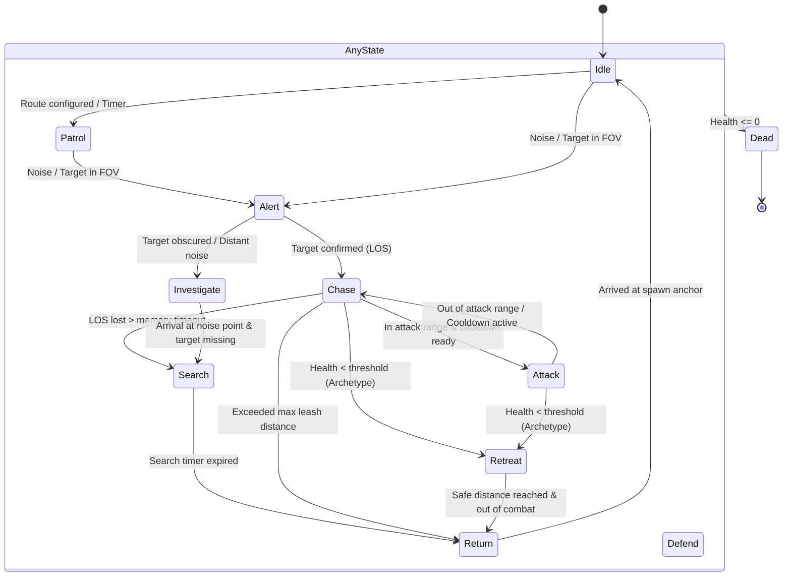

# Wildbound — AI State Machine

## 1. Overview & Enumerated States

Wildbound implements a high-performance finite state machine (FSM) governing enemy behavioral transitions. In Phase 29, the core `wildbound::entities::AIState` enumeration was systematically expanded from 6 legacy states to 11 comprehensive operational states:

| State | Enumerator Value | Description |
|---|---|---|
| **Idle** | `AIState::Idle` | Entity remains stationary, conserving energy, observing environment within baseline FOV cone. |
| **Patrol** | `AIState::Patrol` | Entity moves along assigned waypoints or performs circular wander around spawn origin. |
| **Investigate** | `AIState::Investigate` | Moves to last known target position or suspicious stimulus point; executes multi-directional scanning. |
| **Alert** | `AIState::Alert` | Target detected in peripheral vision or auditory range; entity faces stimulus, locks onto target. |
| **Chase** | `AIState::Chase` | Direct pursuit of active target using smoothed A* navigation and dynamic avoidance forces. |
| **Attack** | `AIState::Attack` | Within attack range and weapon cooldown satisfied; initiates primary or special combat action. |
| **Defend** | `AIState::Defend` | Defensive circling or guarding behavior (e.g. Wolf pack stalking, Boar territorial posturing). |
| **Retreat** | `AIState::Retreat` | Health falls below courage threshold (e.g. Goblin < 20% HP); flees along vectors opposite to threat. |
| **Search** | `AIState::Search` | Lost visual contact; entity sweeps nearby walkable cells looking for clues. |
| **Return** | `AIState::Return` | Pursuit leash distance exceeded or search timed out; entity navigates back to spawn anchor. |
| **Dead** | `AIState::Dead` | Entity destroyed; AI controller disabled, physics neutralized, loot dropped. |

---

## 2. State Transition Graph



---

## 3. Transition Conditions & Logic

### 3.1 Idle $\longleftrightarrow$ Patrol
- **Condition**: If an entity has a configured patrol route (`PatrolBehaviour::SetWaypoints`) or `can_wander` is enabled in its creature profile, a randomized timer ($1.0\text{s} - 3.5\text{s}$) transitions from `Idle` to `Patrol`.
- **Exit**: Upon reaching a patrol waypoint, the entity transitions to `Idle` for the specified `dwell_time`.

### 3.2 Detection & Awareness $\longrightarrow$ Alert / Chase
- **Peripheral / Audio Sighting**: Target enters perception radius $R_{\text{detect}}$ without direct line of sight or within peripheral angle ($\theta > \text{FOV} / 2$): state becomes `Alert`. Entity turns to face stimulus.
- **Direct Line-of-Sight**: Target within $R_{\text{detect}}$, within forward FOV cone ($\pm 45^\circ$), and unoccluded by `NavigationGrid`: state immediately becomes `Chase`.

### 3.3 Chase $\longleftrightarrow$ Attack
- **Attack Entry**: $\text{Distance}(E, T) \le R_{\text{attack}}$ AND line-of-sight is unobstructed AND weapon/cooldown timer $\ge t_{\text{cooldown}}$.
- **Attack Exit**: Cooldown reset, target moves beyond $R_{\text{attack}} + \epsilon$, or attack animation completes.

### 3.4 Chase $\longrightarrow$ Search / Return
- **Target Lost**: Target breaks line of sight. `TargetMemory` preserves last known position for $t_{\text{memory}}$ seconds (default 3.0s - 5.0s). The entity chases the last known position.
- **Search Entry**: Upon reaching the last known position without reacquiring visual contact, state becomes `Search`. The entity scans cardinal directions.
- **Leash Exceeded**: If $\text{Distance}(E, P_{\text{spawn}}) > D_{\text{leash}}$, the entity drops pursuit and enters `Return`.

### 3.5 HP Threshold $\longrightarrow$ Retreat
- Goblins and Wildlife possess non-zero retreat thresholds ($0.20$ and $1.00$ respectively). When $\text{HP} / \text{MaxHP} \le \text{Threshold}$, entity enters `Retreat`.
- Undead entities (Skeletons) have a retreat threshold of $0.00$ and remain aggressive until destroyed.

---

## 4. Execution Pipeline & State Processing

Each tick of `AIController::Update(deltaTime)`:

```cpp
void AIController::Update(float dt) {
    if (m_state == AIState::Dead) return;

    // 1. Sensory Update
    UpdatePerception(dt);

    // 2. Target Evaluation & Memory Decay
    UpdateTargeting(dt);

    // 3. Finite State Machine Evaluation
    EvaluateStateTransitions(dt);

    // 4. Locomotion & Steering Update
    UpdateMovement(dt);

    // 5. Stuck Detection & Navigation Recovery
    UpdateStuckDetection(dt);

    // 6. Action Execution (Attack / Defend)
    ExecuteStateAction(dt);
}
```

