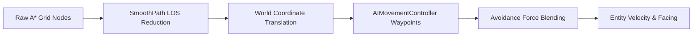

# Wildbound — Path Following & Smoothing

## 1. Overview & Pipeline

Raw A* output produces a sequence of grid-aligned cell coordinates. Direct navigation along raw grid cells results in unnatural 90-degree zig-zags and stair-stepped entity movement.

To produce natural, fluid trajectories, Wildbound applies a two-stage post-processing pipeline:
1. **Geometric Path Smoothing (`Pathfinder::SmoothPath`)**: Uses line-of-sight shortcutting to eliminate redundant intermediate waypoints across open spaces.
2. **Dynamic Locomotion Steering (`AIMovementController`)**: Follows waypoints smoothly with arrival deceleration, continuous orientation derivation, and avoidance blending.



---

## 2. Line-of-Sight Shortcut Smoothing (`SmoothPath`)

The smoothing algorithm uses a greedy forward-raycast technique across the node list:

```cpp
std::vector<GridCoord> Pathfinder::SmoothPath(const std::vector<GridCoord>& rawPath, const NavigationGrid& grid) {
    if (rawPath.size() <= 2) return rawPath;

    std::vector<GridCoord> smoothed;
    smoothed.push_back(rawPath.front());

    size_t anchorIdx = 0;
    while (anchorIdx < rawPath.size() - 1) {
        size_t furthestIdx = anchorIdx + 1;

        // Look as far ahead along rawPath as possible
        for (size_t probeIdx = rawPath.size() - 1; probeIdx > anchorIdx + 1; --probeIdx) {
            RaycastResult rayResult;
            if (grid.Raycast(rawPath[anchorIdx], rawPath[probeIdx], rayResult)) {
                furthestIdx = probeIdx;
                break; // Found furthest directly visible node
            }
        }

        smoothed.push_back(rawPath[furthestIdx]);
        anchorIdx = furthestIdx;
    }

    return smoothed;
}
```

### Benefits
- **Waypoint Reduction**: Compresses 20-30 node paths into 3-5 key inflection waypoints across open clearings.
- **Natural Diagonals**: Agents cut straight lines directly across rooms and hallways rather than walking alongside wall boundaries.
- **Zero Corner Clipping**: Because `NavigationGrid::Raycast` enforces strict corner-cutting validation, smoothed paths never bypass collision geometry.

---

## 3. Movement Controller & Waypoint Progression

The `wildbound::ai::AIMovementController` executes real-time locomotion:

### 3.1 Arrival Radius & Progression
- Each waypoint has an acceptance radius $R_{\text{arrival}} \approx 8.0\text{px}$ (half a grid tile).
- When $\text{Distance}(\mathbf{p}_{\text{entity}}, \mathbf{w}_i) \le R_{\text{arrival}}$, the controller advances to waypoint $i+1$.
- Upon reaching the final waypoint, the controller reports `PathStatus::Completed` and decelerates to zero velocity.

### 3.2 Facing Direction Derivation
As the entity moves, heading vectors map directly to the engine's 4-directional and 8-directional sprite animation sets (`Direction` enum):

$$\theta = \text{atan2}(v_y, v_x)$$

$$\text{Direction} = \begin{cases}
\text{Right} & -\pi/4 \le \theta < \pi/4 \\
\text{Down} & \pi/4 \le \theta < 3\pi/4 \\
\text{Left} & \theta \ge 3\pi/4 \text{ or } \theta < -3\pi/4 \\
\text{Up} & -3\pi/4 \le \theta < -\pi/4
\end{cases}$$

