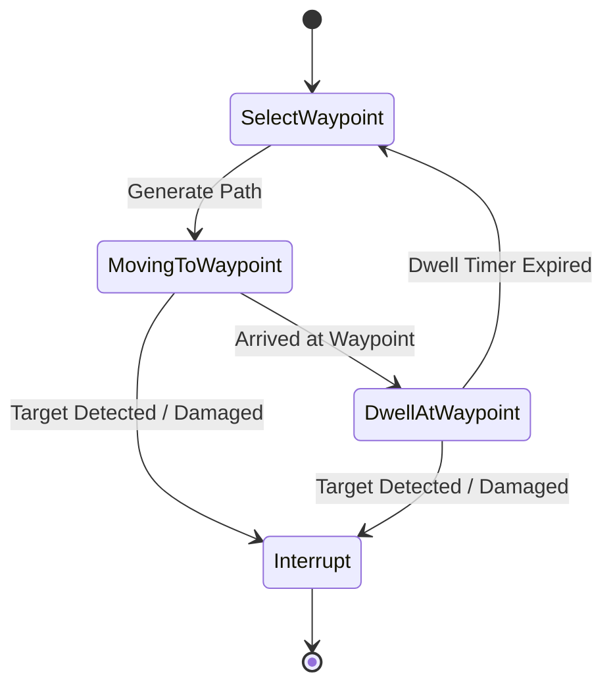

# Wildbound — Patrol Behaviour

## 1. Overview & Operational Modes

Patrol behaviour provides lifelike, non-combat locomotion for idle enemies and ambient wildlife. Implemented in `wildbound::ai::PatrolBehaviour`, it supports two primary operational modes:

1. **Fixed Route Patrol**: Sequence of designer-placed or map-defined world coordinate waypoints with dwell times and loop/ping-pong modes.
2. **Circular Wander Fallback**: Automatic procedural wandering within an anchor leash radius ($R_{\text{wander}} \approx 100.0\text{px}$) when no explicit route is specified.

---

## 2. State & Execution Lifecycle

### 2.1 Route Traversal
- **Loop Mode**: Traverses $W_0 \rightarrow W_1 \rightarrow \dots \rightarrow W_N \rightarrow W_0$.
- **Ping-Pong Mode**: Traverses $W_0 \rightarrow W_1 \rightarrow \dots \rightarrow W_N \rightarrow W_{N-1} \rightarrow \dots \rightarrow W_0$.
- **Arrival Detection**: Triggered when Euclidean distance between entity center and current waypoint is $\le 10.0$ pixels.

### 2.2 Dwell Timing
Upon arrival at a waypoint:
- Movement controller stops velocity.
- Sprite transitions to `Idle` animation facing the direction of the waypoint or route normal.
- A dwell timer runs for $t_{\text{dwell}} \in [1.0\text{s}, 4.0\text{s}]$.
- Upon expiration, the next waypoint index is selected.

---

## 3. Procedural Wander Fallback

When entities lack fixed script waypoints:
1. An anchor point $\mathbf{p}_{\text{anchor}}$ is saved at entity spawn time.
2. Every $3.0\text{s} - 6.0\text{s}$, a candidate target is sampled uniformly within a circle:
   $$\mathbf{p}_{\text{cand}} = \mathbf{p}_{\text{anchor}} + (R \cos\phi, R \sin\phi), \quad R \le R_{\text{wander}}, \ \phi \in [0, 2\pi)$$
3. The candidate coordinate is checked against `NavigationGrid::IsWalkable`.
4. If walkable, an A* path is requested; if blocked, the closest walkable cell within 2 tiles is substituted.

