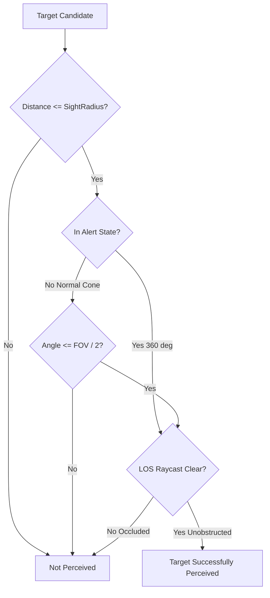

# Wildbound — Perception & Line of Sight

## 1. Overview & Sensory Criteria

The Wildbound Perception System (`wildbound::ai::PerceptionSystem`) provides multi-modal sensory evaluation for AI agents. Rather than giving enemies omniscient vision, agents detect potential targets through three realistic sensory layers:

1. **Distance Proximity Check**: Target must be within the creature's sight range ($R_{\text{sight}}$).
2. **Field-of-View (FOV) Directional Cone**: Target must lie within the entity's angular viewing cone relative to its current facing direction.
3. **Occlusion Raycast (Line of Sight)**: The direct line between agent and target must be clear of solid terrain collision cells.

---

## 2. Geometric & Mathematical Formulation

### 2.1 Distance Radius
$$\|\mathbf{p}_{\text{target}} - \mathbf{p}_{\text{agent}}\| \le R_{\text{sight}}$$

### 2.2 Field-of-View Angle Cone
Let $\hat{\mathbf{f}}$ be the normalized facing direction vector of the agent (derived via `wildbound::graphics::animation::DirectionToVector`).
Let $\hat{\mathbf{v}}$ be the normalized vector from the agent to the target:

$$\hat{\mathbf{v}} = \frac{\mathbf{p}_{\text{target}} - \mathbf{p}_{\text{agent}}}{\|\mathbf{p}_{\text{target}} - \mathbf{p}_{\text{agent}}\|}$$

$$\cos(\theta) = \hat{\mathbf{f}} \cdot \hat{\mathbf{v}}$$

The target is inside the FOV cone if:
$$\theta \le \frac{\text{FOV}_{\text{degrees}}}{2} \iff \cos(\theta) \ge \cos\left(\frac{\text{FOV}_{\text{degrees}}}{2}\right)$$

### 2.3 Alert State 360-Degree Awareness
When an agent enters the `Alert` state (e.g. from hearing combat nearby or receiving damage), its sensory cone expands to an omnidirectional $360^\circ$ circle. Any target within line-of-sight distance is immediately registered.

### 2.4 Raycast Line-of-Sight Check
Even if a target is within the FOV cone, walls and solid map tiles block vision. A Bresenham line-of-sight raycast is executed on `NavigationGrid`. If any cell along the ray is solid, the check returns `false` (occluded).

---

## 3. Auditory Perception & Combat Alerts

In addition to visual cones, the system supports auditory stimuli:
- Weapon discharges, footstep alerts, and combat impact events generate noise pulses with an auditory radius $R_{\text{audio}}$.
- Agents within $R_{\text{audio}}$ transition immediately from `Idle`/`Patrol` to `Alert` or `Investigate`, facing the origin coordinate of the sound.

