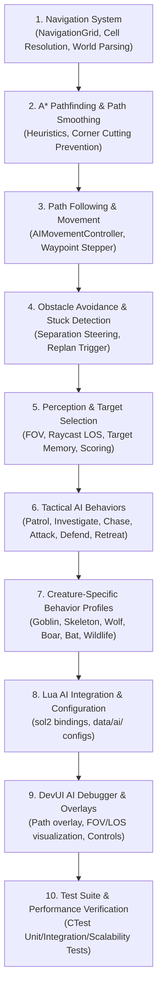

# WILDBOUND — PHASE 29: AI & NAVIGATION EXPANSION
## Comprehensive Repository Audit & Architectural Gap Analysis

---

## 1. Executive Summary

Phase 29 expands Wildbound's enemy AI and navigation architecture from a rudimentary straight-line state machine into an intelligent, data-driven, perception-aware, and pathfinding-capable tactical system.

This audit evaluates the codebase's existing infrastructure across:
- **Phase 3**: World & Tiled Map subsystem (`Tilemap`, `TileLayer`, `CollisionMetadata`).
- **Phase 4**: Entity lifecycle & character movement (`Character`, `CharacterController`, `AnimationStateMachine`).
- **Phase 5**: Combat, enemies & baseline AI (`Enemy`, `EnemyConfig`, `EnemySpawner`, `Combatant`, `LuaManager`).
- **Phase 9**: Creature & wildlife assets (Goblin, Skeleton, Wolf, Wild Boar, Bat, Small Bird, Butterflies).
- **Phase 20**: Physics & collision (`CollisionManager`, `Collider`, spatial queries).
- **Phase 22**: Interaction & targeting discovery (`InteractionManager`, candidate ranking).
- **Phase 24**: Weapons & combat ranges (`WeaponDefinition`, `AttackDefinition`).
- **Phase 28**: Audio integration (creature alerts, attacks, hurts, deaths, ambient sounds).

---

## 2. Audit of Existing AI & Navigation Infrastructure

### 2.1 Existing AI Implementation (`src/entities/Enemy.cpp`, `Enemy.hpp`, `EnemyConfig.hpp`)
- **State Machine**: Defined `enum class AIState { Idle, Patrol, DetectTarget, Chase, Attack, Retreat, Dead }`.
- **Decision Loop**: Updated at fixed interval (`m_config.ai.decisionInterval`, default $0.2\text{ s}$).
- **Target Acquisition**: Calls `combatSys.FindClosestTarget(pos, radius, faction)`.
- **Movement Execution**: Directly computes Euclidean delta $(\Delta x, \Delta y)$, normalizes, and multiplies by `runSpeed` or `walkSpeed`.
- **Collision Resolution**: Moves entity and calls `ResolveMovement(delta, world)` which performs axis-separated AABB clamping against `world.GetCollisionBoxes()`.
- **Critical Limitations Found**:
  1. **No Pathfinding**: Enemies cannot navigate around obstacles (trees, rocks, walls, fences, buildings). If an obstacle is between the enemy and its target, the enemy pushes straight against the collider and remains permanently stuck.
  2. **No Perception or Line of Sight**: Enemies detect the player purely based on distance ($d \le \text{detectionRadius}$), detecting and aggroing through solid walls and opaque obstacles.
  3. **No Target Memory**: The moment a target exits detection radius, the enemy immediately resets to Idle or Patrol. It has no memory of the target's last known position and cannot investigate.
  4. **No Obstacle Avoidance or Separation**: Multiple enemies chasing the player collapse into a single overlapping point.
  5. **No Stuck Detection**: If an enemy gets blocked by geometry or other entities, it has no mechanism to recognize lack of progress or replan.
  6. **Primitive Patrol**: "Patrol" is currently a simple leash returning to spawn origin if distance $> \text{patrolRadius}$. There are no patrol routes, waypoints, or wait times.

### 2.2 Existing Lua AI Scripts (`scripts/gameplay/ai/`)
- `enemy_base.lua`: Baseline script with `AI.update_enemy(ctx)`. Evaluates state, retreat HP, target distance, and returns `move_x`, `move_y`, `request_attack`.
- `behaviors/`:
  - `attack.lua`: Returns `request_attack = true`, zero velocity.
  - `chase.lua`: Returns straight delta vector.
  - `idle.lua`: Returns zero velocity.
  - `patrol.lua`: Returns vector toward spawn origin.
  - `retreat.lua`: Returns inverse vector away from target.
- **Critical Limitations Found**:
  1. Scripts only compute straight-line directions.
  2. No concept of waypoints, navigation queries, or tactical positioning.
  3. Lua scripts are not differentiated per archetype (Goblin, Skeleton, Wolf, Boar, Bat all share identical logic).

### 2.3 World & Map Navigation Data (`src/world/`)
- `Tilemap`: Holds width, height, tile dimensions ($32\times 32$), layers, tilesets, and environmental objects.
- `World::GetCollisionBoxes(queryArea)`: Returns collision boxes from tile layers (`"Collision Metadata"`, `"Collision"`) and solid objects.
- `World::CheckCollision(queryBox)`: Authoritative static collision tester.
- **Findings**:
  - The static collision cache in `World` provides all data needed to construct a discrete navigation grid.
  - A resolution of $16\times 16$ or $32\times 32$ pixels per navigation cell accurately captures environmental geometry while maintaining low memory and fast search times.

### 2.4 Creature Archetypes & Assets (`data/characters/enemies/`, `assets/characters/`)
All creature assets and configs exist and have been validated:
1. **Goblin**: Melee humanoid (`goblin_club`), fast walk/run, retreat at 20% HP.
2. **Skeleton**: Melee humanoid (`skeleton_blade`), high health, relentless pursuit.
3. **Wolf**: Fast predatory beast (`wolf_bite`), high run speed ($135\text{ px/s}$), leaping/aggressive.
4. **Wild Boar**: Heavy territorial beast (`boar_tusk`), charge capabilities, defensive territory.
5. **Bat**: Flying/erratic creature (`bat_bite`), swooping evasion.
6. **Ambient Wildlife**:
   - `small_bird`: Idle, hop, peck, takeoff, fly, land.
   - `butterflies` (`forest_butterfly`, `blue_butterfly`, `golden_butterfly`): Ambient fluttering.

### 2.5 Physics & Collision System (`src/physics/`)
- `CollisionManager`: Supports bilateral layer masks, dynamic colliders, and AABB queries (`QueryAABB`, `HasOverlap`).
- Provides dynamic entity query capability for dynamic obstacle avoidance.

### 2.6 Audio System (`src/audio/`)
- Registered creature audio events:
  - `creature.goblin.*` (alert, attack, hurt, death, groan)
  - `creature.skeleton.*` (alert, attack, hurt, death, step)
  - `creature.wolf.*` (alert, attack, hurt, death, howl)
  - `creature.boar.*` (alert, attack, hurt, death, snort)
  - `creature.bat.*` (flutter, screech)
  - Ambient: `sfx_bird_takeoff`, `sfx_bird_landing`, `sfx_butterfly_flutter`
- AI state transitions can and should dispatch these spatial audio events.

---

## 3. Architectural Gap Analysis & Technical Debt

| Subsystem | Existing State | Required Phase 29 State | Gap Severity |
| :--- | :--- | :--- | :--- |
| **Navigation Representation** | None (Ad-hoc collision queries) | Grid-based `NavigationGrid` with configurable cell resolution, walkable/blocked indexing | Critical |
| **Pathfinding** | Straight-line delta $(\Delta x, \Delta y)$ | Optimal A* pathfinder with 4-way/8-way movement, corner-cutting prevention, path smoothing | Critical |
| **Path Following** | Direct velocity setting | Waypoint navigator, arrival detection, corner tolerance, replan triggers | Critical |
| **Obstacle Avoidance** | Hard wall sliding only | Dynamic steering separation force against nearby entities and dynamic obstacles | High |
| **Stuck Detection** | None (can remain stuck forever) | Position history tracking, lack of progress detection, replanning fallback | High |
| **Perception** | Pure radius distance ($d \le R$) | Distance, Field of View (cone angle), Line of Sight (raycasting against collision geometry) | High |
| **Target Memory** | Instant memory loss on exit | Last known position tracking with configurable memory duration and search state | Medium |
| **Patrol System** | Single leash to spawn origin | Data-driven patrol profiles with multi-waypoint routes, wait timers, return logic | High |
| **Tactical Behaviors** | Hardcoded Chase/Attack/Retreat | Modular behaviors: Patrol, Investigate, Chase, Attack, Defend/Kite, Retreat, Return | High |
| **Creature Diversity** | Uniform behavior across all archetypes | Distinct profiles for Goblin, Skeleton, Wolf, Boar, Bat, Ambient Wildlife | High |
| **Developer Tools** | Basic enemy table in DevUI | Interactive AI Debugger: entity inspector, path overlay, FOV/LOS rays, AI pause/step | Medium |

---

## 4. Dependencies & Constraints

1. **No External Libraries**: All pathfinding and navigation must use C++20 standard library algorithms and data structures.
2. **C++ Authority**: C++ remains strictly authoritative for positions, collisions, navigation validation, and combat damage.
3. **Safe Sol2 Integration**: Protected calls, fallback logic if script is missing or raises an error.
4. **Collision Fidelity**: Navigation must derive its blocking data from actual `World` collision bounds, ensuring AI never walks through trees, walls, or buildings.
5. **Memory & Performance**:
   - Reusable node pools and priority queues to avoid heap allocation spikes during pathfinding.
   - Throttled path recalculations (event-driven or interval-based, not every frame).
   - Spatial perception queries to scale gracefully from 5 to 50 active entities.

---

## 5. Recommended Implementation Sequence

---

## 6. Audit Conclusion & Sign-Off

The existing repository architecture is solid and clean. The tilemap loader, collision system, combat system, audio engine, and entity lifecycle provide all required foundations. No blocking prerequisites are missing. Phase 29 can proceed systematically following the recommended sequence.

