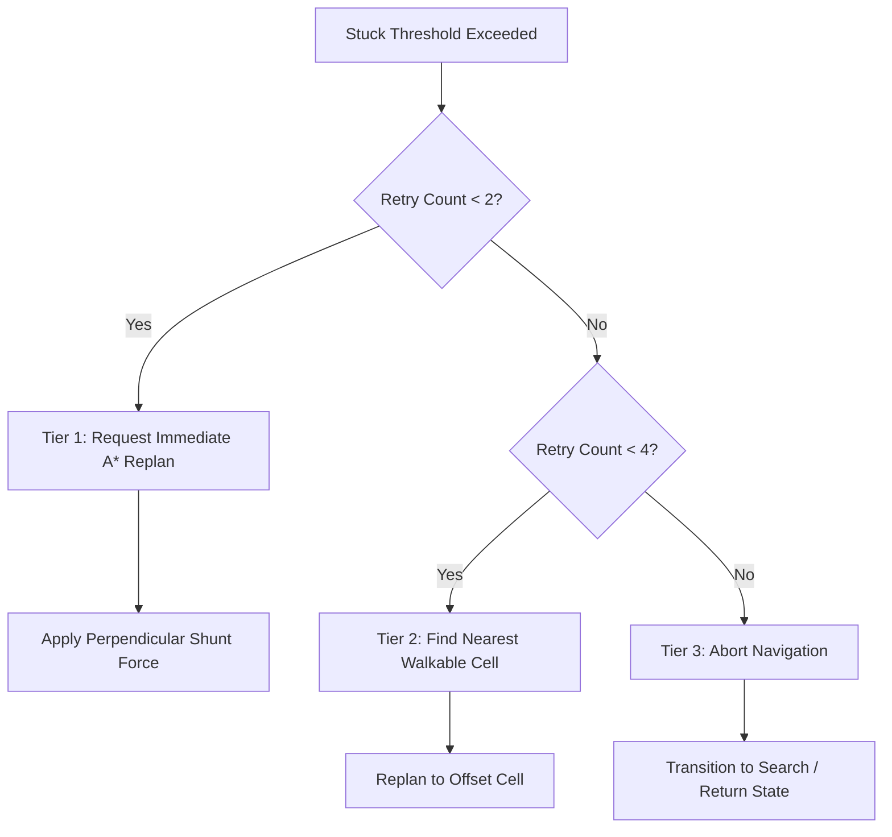

# Wildbound — Stuck Detection & Replanning

## 1. Overview & Problem Definition

In dynamic game environments, AI agents may become temporarily obstructed by non-navmesh obstacles, closing doors, colliding agents, or unexpected geometry corner traps. Without stuck detection, agents may walk continuously into a wall while their destination lies behind it.

Wildbound integrates a real-time displacement-based stuck detection and recovery system implemented in `wildbound::ai::StuckDetector`.

---

## 2. Detection Algorithm & Metrics

The `StuckDetector` operates on a sliding temporal window:
- **Evaluation Interval ($t_{\text{interval}}$)**: Default 0.5 seconds.
- **Minimum Expected Distance ($D_{\min}$)**:
  $$D_{\min} = V_{\text{expected}} \times t_{\text{interval}} \times 0.25$$
  If an entity is commanded to move at full speed but achieves less than 25% of expected physical translation, it is flagged as potentially stalled.

```cpp
void StuckDetector::Update(Vector2 currentPos, Vector2 intendedVelocity, float dt) {
    float intendedSpeed = VectorLength(intendedVelocity);
    if (intendedSpeed < 1.0f) {
        // Agent is stationary or idling; reset accumulation
        m_stuckTimer = 0.0f;
        m_lastPos = currentPos;
        return;
    }

    m_sampleTimer += dt;
    if (m_sampleTimer >= m_sampleInterval) {
        float displacement = VectorDistance(currentPos, m_lastPos);
        float minRequired = (intendedSpeed * m_sampleInterval) * m_displacementThresholdRatio;

        if (displacement < minRequired) {
            m_stuckTimer += m_sampleInterval;
        } else {
            m_stuckTimer = std::max(0.0f, m_stuckTimer - m_sampleInterval);
        }

        m_lastPos = currentPos;
        m_sampleTimer = 0.0f;
    }
}
```

---

## 3. Recovery Protocol & Replanning Hierarchy

When $t_{\text{stuck}} \ge T_{\text{threshold}}$ (default 1.0 - 1.5 seconds), the detector triggers the three-tier recovery protocol:



### Tier 1: Local Replanning & Jitter Shunt
The agent recalculates an A* path from its current grid cell. Concurrently, a small perpendicular impulse vector ($90^\circ$ to goal heading) is injected for $0.2\text{s}$ to slide the entity off the collision corner.

### Tier 2: Goal Offset Spiral
If path recalculation fails or progress remains blocked, the agent calls `NavigationGrid::FindNearestWalkableCell` with an increased clearance radius ($R = 32.0\text{px}$) to select an alternate waypoint.

### Tier 3: State Abort & Return
If 4 consecutive replanning cycles fail over 4.0 seconds, the agent aborts pursuit, clears its navigation queue, and transitions to `AIState::Search` or `AIState::Return`.

