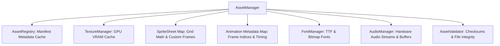
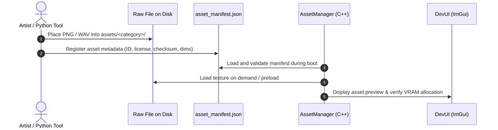

# Asset Management System (AMS) Integration Specification

## 1. Existing AMS Capabilities Review

The Wildbound Asset Management System ([`src/resources/AssetManager.hpp`](file:///c:/dev/Wildbound/src/resources/AssetManager.hpp)) provides a centralized, deterministic resource loading and caching infrastructure.



### 1.1 Support Status Matrix

| Subsystem Capability | Current Implementation Status | Architectural Assessment |
|---|---|---|
| **Manifest Parsing** | **Fully Supported** | Parses `asset_manifest.json`, validates types, checksums, and paths. |
| **Texture Caching** | **Fully Supported** | `TextureManager` prevents duplicate GPU uploads; queries by asset ID or file path. |
| **Spritesheet Math** | **Fully Supported** | Computes frame rectangles from column/row grids and origins (`bottom_center`, `center`). |
| **Animation Clips** | **Fully Supported** | `AnimationClip` manages frames, frame duration, and looping parameters. |
| **Validation Suite** | **Fully Supported** | `AssetValidator::ValidateAll` verifies file presence, header sanity, and checksums. |
| **DevUI Asset Browser** | **Fully Supported** | Real-time texture viewer, dimensions, VRAM footprint, and manifest inspect table. |
| **Multi-Layer Compositing** | **Partially Supported** | `Character::Render` makes one draw call for base spritesheet; layering logic needed. |
| **Roof Alpha Fading** | **Not Implemented** | Buildings render as single solid textures; cutaway roof alpha transitions needed. |
| **Runtime Texture Atlasing**| **Not Implemented** | Each texture is loaded as an individual OpenGL texture; acceptable for 2D canvas. |
| **Color Palette Shader LUT**| **Not Implemented** | Currently relies on unique PNGs or uniform `Color` tinting. |

---

## 2. Ingestion Pipeline for New Assets

When adding new biomes, monsters, or cosmetics to Wildbound, authors must follow the 4-step ingestion pipeline:



### 2.1 Step 1: Physical Placement
Place assets into their standardized directories adhering to [`ASSET_NAMING_AND_DIRECTORY_STANDARDS.md`](file:///c:/dev/Wildbound/docs/art/ASSET_NAMING_AND_DIRECTORY_STANDARDS.md) (e.g. `assets/characters/cosmetics/hats/sheet_wizard_hat.png`).

### 2.2 Step 2: Manifest Declaration
Append the legal and technical metadata to `assets/manifests/asset_manifest.json`:
```json
{
  "id": "sheet_wizard_hat_blue",
  "file": "characters/cosmetics/hats/sheet_wizard_hat_blue.png",
  "type": "spritesheet",
  "category": "characters/cosmetics/hats",
  "source": "Wildbound Development Studio",
  "author": "Wildbound Art Team",
  "license": "CC0 1.0 Universal",
  "commercial_use": true,
  "attribution_required": false,
  "checksum": "whb01hat",
  "width": 32,
  "height": 48,
  "status": "approved"
}
```

### 2.3 Step 3: Spritesheet & Animation Metadata Registration
Create the corresponding JSON metadata file declaring grid metrics and load it during engine initialization in `Game.cpp`:
```cpp
m_assetManager->LoadSpriteSheetMetadata("characters/cosmetics/hats/sheet_wizard_hat_blue.json");
m_assetManager->LoadAnimationMetadata("characters/cosmetics/hats/anim_wizard_hat_blue.json");
```

### 2.4 Step 4: Verification via Automated Suite & DevUI
Run `ctest` to ensure `AssetManagementTest` passes without broken file references. Open the game and press **`F1`** to view the texture in the DevUI Asset Browser.

---

## 3. Recommended Future AMS Enhancements (Roadmap)

To fully unlock Phase 6 specifications without rewriting the AMS:
1. **Multi-Layer Sprite Compositor**:
   - Extend `Character::Render` to iterate through an `std::vector<std::string> m_equippedCosmetics` list and invoke `renderer.DrawSprite` sequentially in Z-order.
2. **Dynamic Roof Trigger Component**:
   - Introduce `BuildingComponent` in `WorldRenderer` that monitors the player's bounding box and smoothly lerps roof opacity from $1.0$ to $0.0$.
3. **Palette Swap Fragment Shader**:
   - Add a lightweight GLSL fragment shader (`frag_palette_swap.fs`) that samples a 4-color horizontal LUT texture, enabling instant cosmetic recoloring.

