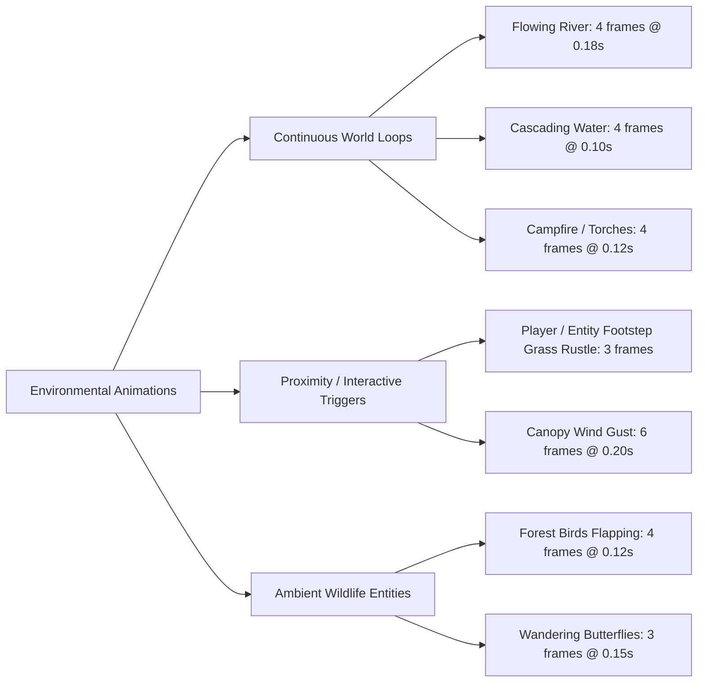
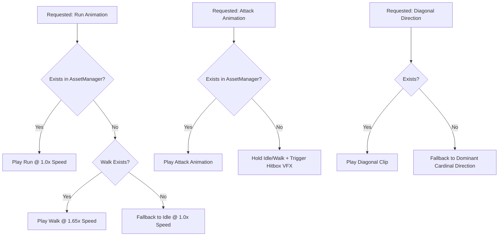

# Wildbound Animation Production Standards

## 1. Core Principles of 2D Animation in Wildbound

Wildbound's animation philosophy balances expressive character acting with immediate gameplay responsiveness. In a competitive fantasy battle royale, animation priority and readability must strictly supersede decorative flourishes.

### 1.1 The Golden Rules
1. **Zero Input Latency on Windup**:
   Attack hitboxes must generate on active frames (Frames 1–2). An attack with excessive startup lag feels sluggish in 2D top-down melee combat.
2. **Synchronized Multi-Layer Compositing**:
   Because characters wear modular cosmetics, every frame in a locomotion cycle must maintain consistent head, torso, and foot anchor positions across all equipment layers.
3. **Framerate-Independent Delta Ticking**:
   All animations advance based on elapsed wall-clock seconds (`float dt`), ensuring silky-smooth cycle playback regardless of 60 FPS, 144 FPS, or minor frame drops.

---

## 2. Animation Categories & Timing Specifications

### 2.1 Player & Humanoid Animations

| Animation Clip | Frame Count | Duration / Frame | Total Cycle | Looping? | Description & Keyframe Posing |
|---|---|---|---|---|---|
| **`idle`** | 4 frames | $0.20$ s ($5$ FPS) | $0.80$ s | Yes | Subtle 1-pixel breathing bob at torso; slight hand/weapon shift. |
| **`walk`** | 4 frames | $0.14$ s ($\approx 7$ FPS) | $0.56$ s | Yes | Frame 0: Contact Left; Frame 1: Passing; Frame 2: Contact Right; Frame 3: Passing. |
| **`run`** | 4 frames | $0.085$ s ($\approx 12$ FPS) | $0.34$ s | Yes | Exaggerated forward lean, higher knee lift, 2-pixel head dip. |
| **`attack`** | 4 frames | $0.08$–$0.10$ s ($10$–$12$ FPS)| $0.32$–$0.40$ s | **No** | Frame 0: Anticipation/draw; Frame 1: Impact/forward thrust; Frame 2: Follow-through; Frame 3: Recovery. |
| **`hurt`** | 2 frames | $0.12$ s ($\approx 8$ FPS) | $0.24$ s | **No** | Frame 0: Backward recoil & red/white flash; Frame 1: Stagger recovery. |
| **`death`** | 3–4 frames | $0.20$–$0.25$ s ($4$–$5$ FPS) | $0.75$–$1.00$ s | **No** | Knees buckle, torso collapses downward, rests motionless on ground. |
| **`dodge / roll`** | 4 frames | $0.075$ s ($\approx 13$ FPS)| $0.30$ s | **No** | Fast tucked roll along ground; grants invulnerability frames. |
| **`interact`** | 3 frames | $0.15$ s ($\approx 6$ FPS) | $0.45$ s | **No** | Arms reach forward towards chest, door, or harvestable node. |

---

### 2.2 Monster & Creature Animations

| Archetype | Special Animation Needs | Frame Count & Cadence | Behavior Notes |
|---|---|---|---|
| **Forest Goblin** | Skulking, frantic walk | Walk: 4 frames @ 0.15s; Attack: 4 frames @ 0.10s | Swings wooden club down with heavy forward lunge; scuttles erratically. |
| **Skeleton Warrior**| Rigid, clattering march | Walk: 4 frames @ 0.15s; Attack: 4 frames @ 0.10s | Stiff mechanical posture; broad sweeping iron blade arc. |
| **Dire Wolf** | Quadruped sprint & pounce | Walk: 4 frames @ 0.12s; Run: 4 frames @ 0.08s | Low-slung spine, rhythmic spine flex, sudden leaping bite. |
| **Forest Treant** | Slow, ponderous thuds | Walk: 6 frames @ 0.25s; Slam: 6 frames @ 0.15s | Massive weight; ground-shaking footfalls and overhead root slam. |

---

### 2.3 Environmental & World Animations

Environmental animations add vitality to the forest without distracting from combat:

---

## 3. Modular Animation Synchronization

When a player equips a helmet, armor, boots, and a cape, **all cosmetic layers must advance in exact lockstep**:

1. **Shared Time Accumulator**:
   The entity's central `AnimationController` owns the single authoritative `float m_elapsedTime` and `int m_currentFrameIndex`.
2. **Synchronous Frame Fetching**:
   During the render pass, the engine evaluates `controller.GetCurrentFrameIndex()` once, and uses that exact index across the base mesh, shirt, pants, and hat layers.
3. **Anchor Zeroing**:
   Every layer uses the identical foot anchor $(16, 48)$, meaning cosmetics do not need local offset math; they naturally align pixel-for-pixel over the body.

---

## 4. Fallback Hierarchy for Missing Animations

To allow rapid prototyping and partial asset drops, Wildbound enforces a robust fallback hierarchy in [`AnimationStateMachine.cpp`](file:///c:/dev/Wildbound/src/graphics/animation/AnimationStateMachine.cpp):

### Fallback Matrix:
- **Missing `run`**: Accelerates `walk` cycle by $1.65\times$ playback speed. (Already implemented in C++).
- **Missing `attack`**: Maintains current locomotion frame while generating the world-space attack hitbox and weapon swing slash particle.
- **Missing `hurt`**: Retains current frame and activates a 2-frame pure white silhouette shader flash.
- **Missing directional clip (e.g. Left)**: Flips the opposite cardinal clip (Right) horizontally with origin inverted.

