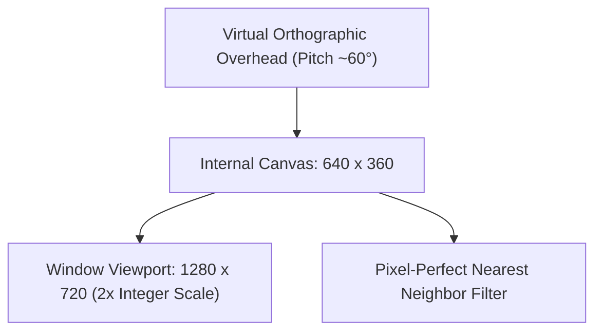

# Wildbound Art Direction & Visual Style Guide

## 1. Vision & Core Aesthetic

**Wildbound** is a 2D top-down fantasy battle royale and survival adventure game rendered with a dedicated, handcrafted pixel-art visual identity. The world evokes the mystery, danger, and pastoral charm of classic European medieval fantasy blended with high-tension survival gameplay.

### 1.1 The Visual Pillars
1. **Readable Lethality (Gameplay First)**:
   In a battle royale, silhouettes, telegraphs, and terrain boundaries must be instantly decipherable within milliseconds. Environmental clutter must never obscure character footprints, attack hitboxes, or projectile paths.
2. **Atmospheric Fantasy Realism**:
   The world balances vibrant natural environments with grounded medieval construction. Colors are rich but harmonious; materials look tactile (weathered timber, cold granite, oxidized iron, coarse linen).
3. **Pixel Purity & Consistent Resolution**:
   Every visual asset conforms to a strict $1:1$ internal texel-to-pixel ratio on the virtual $640 \times 360$ canvas. There is no subpixel rotation, no mixed pixel densities ("mixels"), and no vector-style smooth scaling.

---

## 2. Perspective & Projection Standard

Wildbound uses a **3/4 Top-Down Oblique Perspective** (often referred to as classical RPG top-down):
- **Ground / Floor Surfaces**: Projected as a flat planar surface from an overhead angle ($\approx 60^\circ$ pitch).
- **Vertical Surfaces (Walls, Characters, Trees, Props)**: Display vertical height directly upright (facing south towards the camera). A wall standing 32 pixels high represents approximately 2.0 meters of elevation.
- **Horizontal Aspect Ratio**: Standard Cartesian grid with square $32 \times 32$ pixel base tiles.



---

## 3. Pixel Consistency & Rendering Rules

### 3.1 Pixel Density ("No Mixels")
- Internal Resolution: $640 \times 360$.
- Display Window: $1280 \times 720$ ($2\times$ base scale) or $1920 \times 1080$ ($3\times$ letterboxed).
- **Rule**: 1 art pixel = 1 virtual screen pixel. All spritesheets, tilesets, and UI icons must be drawn at native $1\times$ resolution. Never scale assets by fractional amounts (e.g. $1.5\times$).

### 3.2 Outlines & Silhouettes
- **Characters & Active Entities**:
  - Bound by a distinct **selective outline** (sel-out) or dark tint outline (`#1b1c2b` or darkened local color).
  - Outlines are 1 pixel thick. Pure `#000000` is reserved only for deep crevices and pupil dots.
  - Ensures characters pop cleanly against dense forest ground or dark stone.
- **Environmental Objects (Trees, Rocks, Structures)**:
  - Outer silhouettes use colored, contextual edge shading rather than harsh black borders.
- **Ground Tiles**:
  - Zero harsh outlines. Ground borders use dithered edge transitions or organic tile masks.

### 3.3 Shading & Color Clustering
- **Tone Steps**: Use 3 to 4 tones per material ramp (Base, Shadow, Deep Shadow, Highlight). Avoid pillow shading.
- **Clustering**: Pixels must be grouped into deliberate geometric clusters. Single orphaned pixels ("noise") are strictly prohibited unless representing atmospheric dust or spark particles.
- **Anti-Aliasing**: Manual sub-pixel anti-aliasing is permissible inside sprite silhouettes using intermediate palette shades, but exterior edges must remain crisp for clean alpha blending.

---

## 4. Master Color System & Palette Standards

The Wildbound color palette is designed for readability, mood, and biome distinction while sharing a cohesive color temperature matrix.

### 4.1 Master Swatches

```text
================================================================================
WILDBOUND CORE COLOR MATRIX
================================================================================
Role               Hex Code      RGB              Purpose
--------------------------------------------------------------------------------
Deep Void Shadow   #0c0f1d     (12, 15, 29)      Universal ground contact shadows & crevices
Cold Steel Dark    #1e2337     (30, 35, 55)      Armor shadows, cold stonework, UI backings
Slate Blue         #3b4261     (59, 66, 97)      Iron blades, stone midtones, slate roofs
Pewter Grey        #707a9c     (112, 122, 156)   Stone highlights, weathered metal
Linen Off-White    #d5dbe8     (213, 219, 232)   Cloth highlights, bone, parchment

Forest Deep Shade  #14281d     (20, 40, 29)      Forest tree underbellies, deep brush
Verdant Canopy     #285934     (40, 89, 52)      Pine foliage, dark moss
Meadow Green       #4f8f42     (79, 143, 66)     Standard grass base, leaf midtones
Sunlit Foliage     #8dc44f     (141, 196, 79)    Sunlit grass, shrub highlights

Rich Earth         #3d251e     (61, 37, 30)      Moist soil, dark tree bark, leather boots
Timber Brown       #66432c     (102, 67, 44)     Wooden planks, fence posts, oak trunks
Warm Leather       #9e6e44     (158, 110, 68)    Jerkins, straps, dry dirt paths
Golden Straw       #cf9f5d     (207, 159, 93)    Thatch roofs, wheat, rope

Deep River         #16334a     (22, 51, 74)      Deep river channels, lake beds
Shallow Brook      #27637a     (39, 99, 122)     River shallows, shorelines
Foam & Sparkle     #7bc9c4     (123, 201, 196)   Water splashes, wave crests, ice reflections

Crimson Threat     #a8222c     (168, 34, 44)     Goblin eyes, hostile telegraphs, blood VFX
Ember Orange       #e66427     (230, 100, 39)    Campfires, torches, warning hitboxes
Gold Treasure      #f2b93b     (242, 185, 59)    Rare loot, coins, UI active borders
Mana Arcana        #7344c4     (115, 68, 196)    Magical spells, corruption storm boundary
================================================================================
```

### 4.2 Contrast Hierarchy
1. **Tier 1 (Highest Contrast)**: Player, Enemies, Active Projectiles, Combat Hitboxes.
2. **Tier 2 (Medium-High Contrast)**: Interactive items, chests, doors, harvestable nodes.
3. **Tier 3 (Medium Contrast)**: Solid obstacles (trees, boulders, fences, building walls).
4. **Tier 4 (Low Contrast / Subdued)**: Navigable ground terrain, dirt paths, water shallows.

---

## 5. Lighting & Shadow Model

### 5.1 Environmental Light Direction
- **Key Light Angle**: The sun/moon is positioned from the **Top-Left (North-West) at approximately $45^\circ$**.
- Highlights appear on the northern and western faces of objects, roofs, and shoulders.
- Shadows fall to the **South-East**.

### 5.2 Cast Shadows & Drop Shadows
- **Character Ground Shadows**:
  - Every mobile entity casts an elliptical drop shadow directly below its feet.
  - Standard humanoid footprint: $20 \times 8$ px ellipse centered at foot anchor $(x, y)$.
  - Color: `#0c0f1d` with $45\%$ opacity (`rgba(12, 15, 29, 115)`).
- **Structure & Tree Cast Shadows**:
  - Tall objects cast soft diagonal cast shadows onto the ground to ground them into the tilemap.
  - Hard contact ambient occlusion occurs at the precise seam where buildings meet soil.

### 5.3 Local & Emissive Light Sources
- **Torches & Campfires**: Warm amber radial glow with a soft 3-tier stepped alpha falloff.
- **Corruption Storm**: Deep violet emissive pulsing wall with atmospheric edge distortion.
- **Day/Night Palette Shifting**: Engine uses color tint multiplication (`Color` overlay in raylib) rather than dynamic pixel recalculation, preserving crisp contrast.

