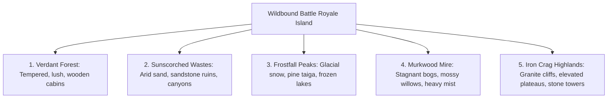

# Wildbound Biome Visual Guidelines & World Design

To support large-scale Battle Royale match variety and tactical depth, the world of Wildbound is divided into **Five Distinct Environmental Biomes**. Each biome possesses a unique color palette, structural architecture, atmospheric effects, and ambient wildlife.

---

## 1. Biome Comparison Matrix

---

## 2. Biome 1: Verdant Forest (The Baseline Biome)

The starting region and baseline archetype currently instantiated in `maps/forest/forest_01.json`.

- **Visual Tone**: Lush, temperate, welcoming yet perilous; dappled sunlight filtering through ancient canopies.
- **Color Palette**:
  - Grass / Foliage: Emerald Green (`#285934`), Meadow Green (`#4f8f42`), Sunlit Leaf (`#8dc44f`).
  - Bark & Soil: Earth Brown (`#3d251e`), Warm Timber (`#66432c`), Loam Dirt (`#543725`).
  - Clear Waters: Azure Brook (`#27637a`), Riverbed Pebbles (`#707a9c`).
- **Vegetation**: Majestic English Oaks, towering Scots Pines, hazel bushes, wild ferns, red toadstools.
- **Architectural Style**: Split-log woodcutter cabins, thatch-roof cottages, timber watch posts, cobblestone foundations.
- **Water Appearance**: Rapidly moving clear mountain streams with white foam edges.
- **Atmospheric Effects**: Dappled god-rays through branches, drifting pollen specks, gentle canopy leaves falling.
- **Native Wildlife**: Flying thrushes, brown rabbits, amber butterflies, red foxes.

---

## 3. Biome 2: Sunscorched Wastes (Desert & Canyons)

An arid expanse of shifting dunes, rocky arroyos, and forgotten empire remnants.

- **Visual Tone**: Harsh, unforgiving, high contrast; blinding noon sun and stark purple-black shadows.
- **Color Palette**:
  - Sand & Stone: Bleached Dune (`#e2bb7b`), Baked Sandstone (`#b57b42`), Terra Cotta (`#8c4d29`).
  - Arid Foliage: Dusty Olive (`#626b47`), Desiccated Cactus (`#7d8c52`), Dry Brush (`#a88c59`).
  - Sky & Shadows: Sunbleached White (`#fff3d1`), Harsh Clay Shadow (`#3b1c1c`).
- **Vegetation**: Saguaro cacti, prickly pear clusters, desiccated tumbleweeds, sparse spiky scrub grass.
- **Architectural Style**: Adobe clay compounds, flat-roof sandstone outposts, canvas shade tarps, crumbling columned ruins.
- **Water Appearance**: Rare stagnant oases with turquoise-green mineral edges; dry cracked mud riverbeds.
- **Atmospheric Effects**: Heat shimmer distortion, sweeping dust devils / wind gust sand particles, blinding sun glints.
- **Native Wildlife**: Circling vultures, horned vipers, desert scorpions, sand lizards.

---

## 4. Biome 3: Frostfall Taiga (Snow & Ice Plains)

A sub-zero northern wilderness where frozen lakes and snowdrifts impede movement and combat.

- **Visual Tone**: Crisp, crystalline, biting cold; muffled soundscapes and reflective white fields.
- **Color Palette**:
  - Snow & Ice: Fresh Powder (`#eef3fa`), Glacial Cyan (`#93c5d6`), Deep Fissure Blue (`#335f7a`).
  - Bark & Stone: Frozen Granite (`#4a5463`), Dark Frost Pine (`#182924`), Cold Slate (`#222a36`).
  - Lighting: Pale Winter Sunlight (`#f5f8ff`), Cold Night Indigo (`#11162b`).
- **Vegetation**: Heavy snow-laden spruce trees, bare frozen birch trunks, resilient blue alpine lichen.
- **Architectural Style**: Heavy timber log halls, steep-pitched A-frame roofs to shed snow, stone hearth chimneys with rising smoke.
- **Water Appearance**: Thick blue ice sheets (walkable, slippery) with dangerous open black water leads.
- **Atmospheric Effects**: Drifting snow flurries, heavy blizzard whiteouts, visible character breath plumes, footprint trails in snow.
- **Native Wildlife**: Snow owls, white hares, dire wolves, frozen wraiths.

---

## 5. Biome 4: Murkwood Mire (Swamp & Boglands)

A treacherous, decaying marsh where waterlogged soil slows sprint speeds and toxic vapors cling to the ground.

- **Visual Tone**: Melancholic, claustrophobic, decayed; filtered stagnant light and perpetual dampness.
- **Color Palette**:
  - Slime & Muck: Fetid Algae (`#3a4d29`), Deep Silt (`#222119`), Ooze Green (`#597334`).
  - Rot & Wood: Waterlogged Oak (`#2a221b`), Peat Moss (`#3b3823`), Fungus Violet (`#573459`).
  - Murky Water: Black Bog (`#171c14`), Chemical Slick (`#4d613e`).
- **Vegetation**: Twisted weeping willows draped in hanging moss, hollow rotten cypress stumps, bioluminescent marsh mushrooms, cattails.
- **Architectural Style**: Rickety stilt shacks elevated above the water, sunken rope bridges, rotting driftwood duckboards.
- **Water Appearance**: Dark brown/green stagnant water with floating lily pads and bubbling gas vents.
- **Atmospheric Effects**: Low-hanging creeping ground fog, glowing firefly swarms, soft dripping water condensation.
- **Native Wildlife**: Giant bullfrogs, marsh bats, leeches, submerged bog lurkers.

---

## 6. Biome 5: Iron Crag Highlands (Mountains & Plateaus)

A towering vertical biome composed of stepped granite terraces, windswept ridges, and perilous cliffside pathways.

- **Visual Tone**: Grand, rugged, exposed, vertigo-inducing; weathered stone and howling winds.
- **Color Palette**:
  - Stone & Ore: Iron Granite (`#5a636e`), Basalt Dark (`#2b2f36`), Iron Rust Ore (`#914b30`).
  - Highlands Turf: Windblown Rye (`#8c8a56`), Mountain Heather (`#784c68`), Lichen Gold (`#b59a38`).
  - Sky Contrast: Highland Mist (`#b0c3d9`), Deep Valley Shadow (`#141724`).
- **Vegetation**: Gnarled wind-warped bristlecone pines, low mountain heather shrubs, alpine moss carpets.
- **Architectural Style**: Fortress stone battlements, cut-rock ramparts, suspension wooden rope bridges spanning chasms.
- **Water Appearance**: Rushing white-water torrents, misting cascades, icy mountain tarns.
- **Atmospheric Effects**: Fast-moving wispy mountain cloud strata, howling wind dust trails, falling pebble debris.
- **Native Wildlife**: Mountain goats, golden eagles, cliff wyverns.

