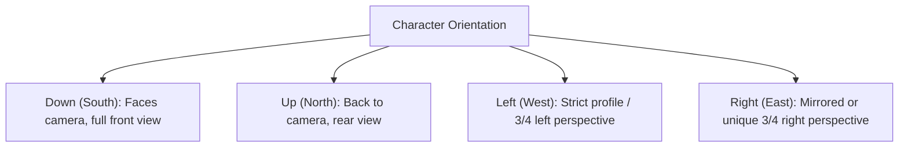

# Wildbound Character Sprite Technical Specification

## 1. Dimensional Standards & Canvas Metrics

To maintain pixel-perfect alignment across locomotion, animation, collision, and modular cosmetics, all humanoid characters adhere to a strict coordinate and bounding convention.

```text
+-----------------------+ Y = 0 (Top of sprite frame)
|       [Padding]       |
|      .-------.        | Y = 8  (Top of head / helm)
|     /  Head   \       |
|    |   Face    |      | Y = 16 (Eye line)
|     \  Neck   /       | Y = 20 (Chin line)
|    .-----------.      | Y = 22 (Shoulder seam)
|   / |  Torso  | \     |
|  |  |  Chest  |  |    | Y = 28 (Waistline / Belt)
|   \ |  Hips   | /     | Y = 34 (Groin / Pelvis)
|     |---|---|         |
|     | L | R |         | Y = 40 (Knees)
|     | e | e |         |
|     | g | g |         |
|     |===|===|         | Y = 48 (Feet baseline / ANCHOR POINT)
+-----------------------+ Y = 48 (Bottom of frame)
X=0   X=16    X=32
```

### 1.1 Standard Humanoid Metric
- **Frame Canvas Width**: $32$ pixels.
- **Frame Canvas Height**: $48$ pixels.
- **Logical Anchor Point (Pivot)**: Bottom-Center $(X = 16.0,\; Y = 48.0)$.
- **Head Size**: Approximately $12 \times 12$ pixels.
- **Torso Size**: Approximately $12 \times 12$ pixels.
- **Leg Length**: Approximately $14$ pixels.
- **Standing Eye-Level**: $Y = 16$ from top ($32$ px above feet baseline).

### 1.2 Entity Sizing Tiers

| Tier Name | Canvas Dimensions | Anchor Point $(X, Y)$ | Collision Footprint | Example Archetypes |
|---|---|---|---|---|
| **Small** | $24 \times 32$ px | $(12.0,\; 32.0)$ | $12 \times 8$ px | Rats, rabbits, fairies, small goblins |
| **Standard (Humanoid)** | $32 \times 48$ px | $(16.0,\; 48.0)$ | $16 \times 12$ px | Player, Skeleton, Forest Goblin, Villager |
| **Large** | $48 \times 64$ px | $(24.0,\; 64.0)$ | $24 \times 16$ px | Orc warrior, dire wolf, bear, heavy golem |
| **Huge** | $64 \times 96$ px | $(32.0,\; 96.0)$ | $36 \times 24$ px | Forest troll, ogre, mounted knight |
| **Colossal (Boss)** | $96 \times 128$ px | $(48.0,\; 128.0)$ | $48 \times 32$ px | Ancient Treant, Dragon spawn, Dungeon Boss |

*Rule: Regardless of canvas height, the logical world position of any character represents the exact center of their feet at the ground contact baseline.*

---

## 2. Collision & Hurtbox Relationship

1. **Collision Box (Feet Footprint)**:
   - Width: $16.0$ px.
   - Height: $12.0$ px.
   - Offset: Centered horizontally at $X = 0$, sitting directly on the ground baseline $Y \in [-12, 0]$ relative to anchor.
   - Used exclusively for physics, obstacle pushout, and tilemap collision.
2. **Hurtbox (Damage Volume)**:
   - Covers the full physical body: $X \in [-10, +10]$, $Y \in [-44, 0]$ ($20 \times 44$ px).
   - Used for attack hitbox intersection.

---

## 3. Directional Coverage Standard

Wildbound requires **4-Directional Spritesheets** with strict orientation conventions:



### 3.1 Orientation Rules
- **Down (South)**: Direct visual connection with the player. Facial features, chest emblems, and front buckles are visible.
- **Up (North)**: Rear perspective. Quivers, capes, backpacks, and hair backs dominate. Facial features hidden.
- **Left / Right (West / East)**:
  - Asymmetric equipment (e.g. single pauldron, shield on left hand, eyepatch) requires **unique frames** rather than pure horizontal sprite flipping.
  - Symmetrical base bodies may reuse flipped frames to conserve VRAM if asymmetry metadata is absent.

### 3.2 Future Diagonal Consideration
The engine's `Direction` enum supports `Down`, `Up`, `Left`, `Right`. Locomotion currently normalizes diagonal vectors to the dominant axis. When 8-directional rendering is introduced:
- Diagonal frames will occupy supplementary rows (`Down-Right`, `Down-Left`, `Up-Right`, `Up-Left`).
- If diagonal frames are missing, the engine automatically falls back to the nearest cardinal direction without artifacting.

---

## 4. Modular Character Layering Specification

To enable thousands of player customization options without generating bloated monolithic spritesheets, all humanoid characters use a **Decoupled Z-Ordered Layering Pipeline**.

### 4.1 Layer Order (Back to Front)

```text
Layer Index   Layer Name            Description
--------------------------------------------------------------------------------
0             layer_shadow          Ground contact ellipse shadow (20x8 px)
1             layer_back_behind     Backpack / cape / quiver (WHEN facing Down/Side)
2             layer_body_base       Nude base mesh (skin tones, musculature)
3             layer_underwear       Base undergarment layer
4             layer_feet            Boots, shoes, sandals, greaves
5             layer_legs            Pants, trousers, skirts, leg armor
6             layer_torso           Shirts, tunics, chainmail, breastplates
7             layer_hair_back       Long hair falling behind shoulders (facing South)
8             layer_head_base       Ears, facial structure
9             layer_hair_front      Bangs, short hair, beard, mustache
10            layer_face_acc        Glasses, goggles, eyepatches, face masks
11            layer_headwear        Caps, helms, crowns, hoods
12            layer_back_over       Cape draped over shoulders / collar
13            layer_hand_main       Primary weapon (sword, staff, axe)
14            layer_hand_off        Offhand weapon / shield
--------------------------------------------------------------------------------
```

### 4.2 Facing-Dependent Layer Flipping (Occlusion Resolution)

Certain items must dynamically alter their draw order based on the character's facing direction:
- **Hair**:
  - *Facing South (Down)*: Back hair renders *behind* the shoulders (Layer 7); bangs render *in front* of the face (Layer 9).
  - *Facing North (Up)*: All hair renders *in front* of the head and face, covering the chin and neck.
- **Backpacks & Quivers**:
  - *Facing South (Down)*: Renders *behind* the torso (Layer 1).
  - *Facing North (Up)*: Renders *in front* of the torso and cape (Layer 12).
- **Two-Handed Weapons**:
  - *Facing South*: Weapon held across chest (Layer 13).
  - *Facing North*: Weapon swung behind back or obscured by torso.

---

## 5. Compatibility & Clipping Rules

1. **Shared Master Skeleton**:
   All wearable cosmetics must be mapped onto the identical $32 \times 48$ px coordinate canvas and follow identical frame pacing.
2. **Headwear Occlusion Flags**:
   - `hair_hide_all`: For full enclosed plate helmets (e.g. Great Helm). Automatically suppresses Layer 7 and 9.
   - `hair_hide_top`: For hats/caps. Renders bangs and long ponytail while clipping the crown of the hair.
3. **Pants / Boots Seam**:
   - High boots automatically clip the lower 6 pixels of pant legs to eliminate overlapping pixel flicker.

