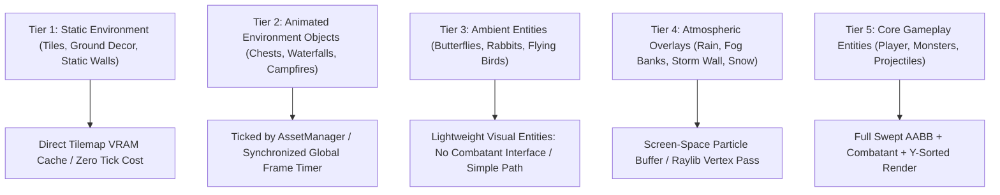

# Wildbound Environmental Animation Technical Specification

## 1. Architectural Classification

To keep the game running at a deterministic 60+ FPS without bloating CPU entity lists or causing rendering stalls, all dynamic elements in the game world are divided into **Five Architectural Tiers**:



---

## 2. Animated Nature & Water Specifications

### 2.1 Water Surfaces & Waterfalls
- **Flowing Streams & Ponds**:
  - Authored as 4-frame animated tiles in `tilesets/forest/` ($32 \times 32$ px per tile).
  - Frame Duration: $0.18$ seconds per frame ($5.5$ FPS) looping continuously.
  - Advance via global synchronized timer in `Renderer` (all water tiles tick on the same frame, preventing seam artifacts).
- **Waterfalls**:
  - Multi-tile vertical animated slices ($32 \times 32$ or $32 \times 64$ px).
  - Frame Duration: $0.09$ seconds ($11$ FPS) with high-contrast white foam ridges tumbling downward.
  - Foot of Waterfall: 3-frame splash mist particle generator emitting soft circular foam sprites.

### 2.2 Swaying Tree Canopies & Foliage
- To avoid redrawing massive tree sprites frame-by-frame:
  - **Option A (Sprite Sheets)**: Reserved only for landmark hero trees (4 frames of gentle wind sway @ 0.20s/frame).
  - **Option B (Vertex / UV Sway Shader)**: A lightweight GPU vertex shader that gently sways pixels above $Y < \text{anchor} - 32$ px using a low-frequency sine wave based on `sin(time * 1.5 + worldPos.x * 0.1) * 2.0`.
  - Characters still collide with the static trunk baseline at $Y = 80$.

### 2.3 Interactive Footstep Foliage (Grass Bending)
- When a `Character` moves through tall grass tiles:
  - Triggers a transient 3-frame sprite animation (`grass_bend_down`, `grass_bend_left`, etc.) lasting $0.20$ seconds.
  - Provides instant tactile locomotion feedback and visual tracking of fleeing opponents in battle royale matches.

---

## 3. Ambient Wildlife Systems

Ambient creatures bring the wilderness to life and provide subtle gameplay cues (e.g., birds scattering reveals an approaching enemy squad).

| Creature | Classification | Canvas Size | Animation Cadence | Behavioral Routine |
|---|---|---|---|---|
| **Forest Thrush / Raven** | Ambient Entity (Tier 3) | $16 \times 16$ px | Fly: 4 frames @ 0.10s; Perch: 3 frames @ 0.30s | Perches on roofs/branches; scatters into the sky when a player approaches within 80 pixels. |
| **Meadow Butterfly** | Ambient Entity (Tier 3) | $12 \times 12$ px | Flutter: 3 frames @ 0.12s | Erratic Perlin noise drift around wildflowers; despawns after 15 seconds. |
| **Cave / Swamp Bat** | Ambient Entity (Tier 3) | $16 \times 16$ px | Flap: 4 frames @ 0.08s | Roosts on ceilings/dark branches; swoops overhead in low-light biomes. |
| **Pond Frog** | Ambient Entity (Tier 3) | $12 \times 12$ px | Hop: 3 frames @ 0.15s; Idle: 2 frames @ 0.40s | Sits at water edges; leaps into river shallows with a splash when startled. |

---

## 4. Atmospheric Weather & Particle Overlays

Atmospheric effects are managed by a single unified **Fullscreen Weather Pass** rendered after all world layers and entities, but before the game UI.

```text
[World Terrain] -> [Y-Sorted Entities & Trees] -> [Atmospheric Weather Layer] -> [Canvas HUD / UI]
```

### 4.1 Weather Profiles
1. **Forest Rain**:
   - Particle velocity: $(-30 \text{ px/s X},\; +240 \text{ px/s Y})$.
   - Drops: $1 \times 4$ px translucent cyan-blue streaks (`#7bc9c4` @ $40\%$ alpha).
   - Ground Splashes: 2-frame circular ripple on contact with terrain tiles.
2. **Creeping Swamp Fog**:
   - Low-frequency procedural noise texture scrolling slowly horizontally across the bottom $40\%$ of the screen.
   - Tint: Pale Olive Green (`#4d613e` @ $25\%$ alpha).
3. **Desert Sandstorm**:
   - High-velocity horizontal amber particle streaks with a dynamic screen-tint multiplier darkening distant vision.
4. **Frost Taiga Blizzard**:
   - Multi-layered snow: slow drifting foreground flakes ($2 \times 2$ px) and fast background snow dust ($1 \times 1$ px).

---

## 5. Distant Environmental Events (Battle Royale Telegraphed Events)

Wildbound incorporates high-altitude and distant environmental cues:
- **Supply Drop Airships / Great Rocs**:
  - Giant mythical flying entity or clockwork airship casting a massive, slow-moving shadow across the terrain ($160 \times 96$ px shadow).
  - Drops a golden supply crate attached to a parachute that drifts to the ground over 10 seconds.
- **Distant Lightning & Thunder**:
  - Sudden 1-frame screen flash (`WHITE` tint at $60\%$ opacity) followed $1.2$ seconds later by spatialized low thunder rumble.

