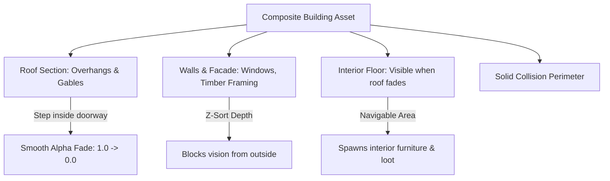

# Wildbound Environment & Building Technical Specification

## 1. Environmental Architecture Overview

The Wildbound world is assembled from a combination of modular $32 \times 32$ pixel ground tilesets, multi-tile static environmental props, and large structural buildings. All assets must integrate seamlessly with the engine's Y-sorted depth queue ([`WorldRenderer.cpp`](file:///c:/dev/Wildbound/src/world/WorldRenderer.cpp)).

---

## 2. Natural Assets & Vegetation Specifications

### 2.1 Trees & Foliage

```text
    / \         Y = 0  (Canopy Peak)
   /   \
  /     \       Y-Sorting Boundary:
 /       \      Characters standing north of baseline Y=80
|  CANOPY |     render BEHIND this tree canopy.
 \       /      Characters standing south of baseline Y=80
  \     /       render IN FRONT of the trunk.
   |   |        Y = 64 (Trunk base begins)
   |===|        Y = 80 (Ground Baseline / ANCHOR POINT)
```

| Asset ID | Dimensions | Canvas Size | Anchor Point | Collision Box | Rendering Layer / Z-Order |
|---|---|---|---|---|---|
| **`tex_oak_tree`** | $48 \times 64$ px | $48 \times 64$ px | $(24.0,\; 64.0)$ | $16 \times 12$ px at trunk base | Y-sorted baseline $Y = 64.0$ |
| **`tex_pine_tree`** | $48 \times 80$ px | $48 \times 80$ px | $(24.0,\; 80.0)$ | $16 \times 12$ px at trunk base | Y-sorted baseline $Y = 80.0$ |
| **`tex_willow_tree`**| $96 \times 96$ px | $96 \times 96$ px | $(48.0,\; 96.0)$ | $24 \times 16$ px at trunk base | Y-sorted baseline $Y = 96.0$ |
| **`tex_birch_tree`** | $40 \times 72$ px | $40 \times 72$ px | $(20.0,\; 72.0)$ | $14 \times 10$ px at trunk base | Y-sorted baseline $Y = 72.0$ |
| **`tex_bush_large`** | $48 \times 36$ px | $48 \times 36$ px | $(24.0,\; 36.0)$ | $36 \times 14$ px | Y-sorted baseline $Y = 36.0$ |
| **`tex_rock_large`** | $64 \times 48$ px | $64 \times 48$ px | $(32.0,\; 48.0)$ | $52 \times 24$ px | Y-sorted baseline $Y = 48.0$ |

### 2.2 Ground Clutter & Non-Solid Decor
- **Pebbles, Fallen Leaves, Wildflowers, Small Mushrooms**:
  - Rendered directly onto Layer 3 (`Ground Decorations`) in Tiled.
  - Zero collision. Does not enter the Y-sort queue, saving CPU overhead.
  - Flat projection; characters walk directly over them.

---

## 3. Structural Buildings & Settlements

Buildings are composite structural assets combining solid walls, pitched roofs, and navigable doorways.

### 3.1 Standard Architectural Dimensions

| Structure Type | Footprint (Tiles) | Pixel Dimensions | Wall Height | Roof Pitch Height | Entrance Doorway |
|---|---|---|---|---|---|
| **Woodcutter Cabin** | $4 \times 4$ tiles | $128 \times 128$ px | $48$ px | $64$ px | Center South, $32 \times 40$ px |
| **Village Cottage** | $5 \times 4$ tiles | $160 \times 128$ px | $48$ px | $64$ px | Center South, $32 \times 40$ px |
| **Blacksmith Forge** | $6 \times 5$ tiles | $192 \times 160$ px | $56$ px | $80$ px | Open South archway, $48 \times 48$ px |
| **Stone Watchtower** | $3 \times 3$ tiles | $96 \times 160$ px | $96$ px | $48$ px | South wooden door, $24 \times 36$ px |
| **Town Tavern** | $8 \times 6$ tiles | $256 \times 192$ px | $64$ px | $96$ px | Double doors, $48 \times 48$ px |



### 3.2 Interior / Exterior Transition System (Roof Fading)
To allow seamless battle royale combat inside cabins, taverns, and bunkers without jarring loading screens:
1. **Cutaway Roof Overlay**:
   - The building roof is rendered on a dedicated foreground layer (`Roof Overlay`) or as a distinct sub-object.
2. **Interior Trigger Volume**:
   - Tiled map object defines a trigger rectangle covering the interior rooms.
3. **Alpha Transition**:
   - When the player's bounding box enters the trigger volume, the roof layer fades smoothly from $100\%$ opacity (`alpha = 1.0`) to $0\%$ opacity (`alpha = 0.0`) over $0.25$ seconds.
   - Reveals the detailed interior floor tiles, furniture, and indoor loot chests.
   - When exiting through the doorway, the roof fades back to $100\%$.

### 3.3 Doorway & Window Ingress/Egress
- **Doorways**: Sized to a minimum of $32 \times 36$ px (1 full tile wide) to prevent player collision sticking during high-speed combat.
- **Windows**: $16 \times 16$ px openings. Clear glass/open shutters permit ranged projectile penetration (arrows, spells) while blocking character movement.

---

## 4. Environmental Props & Reusable Interactables

| Prop Archetype | Dimensions | Collision Box | Purpose & Gameplay Role |
|---|---|---|---|
| **Wooden Storage Crate** | $32 \times 32$ px | $28 \times 24$ px | Destructible prop; drops low-tier consumables when struck. |
| **Ale Barrel** | $24 \times 32$ px | $20 \times 20$ px | Destructible obstacle; rolling physics in Phase 6. |
| **Ironbound Treasure Chest**| $32 \times 24$ px | $30 \times 18$ px | Interactable container; animated lid open (3 frames). |
| **Village Stone Well** | $48 \times 48$ px | $40 \times 40$ px | Solid stone obstacle; water source for alchemy. |
| **Wooden Fence Segment** | $32 \times 24$ px | $32 \times 8$ px | Connectable linear fencing; vaulted over in Phase 6. |
| **Street Oil Lantern** | $16 \times 40$ px | $12 \times 12$ px (base) | Emits warm radial point light ($R = 64$ px) at night. |
| **Signpost** | $24 \times 32$ px | $12 \times 8$ px (base) | Interactable direction marker for POI lore. |
| **Blacksmith Anvil** | $24 \times 20$ px | $22 \times 16$ px | Crafting station for weapon upgrades. |

