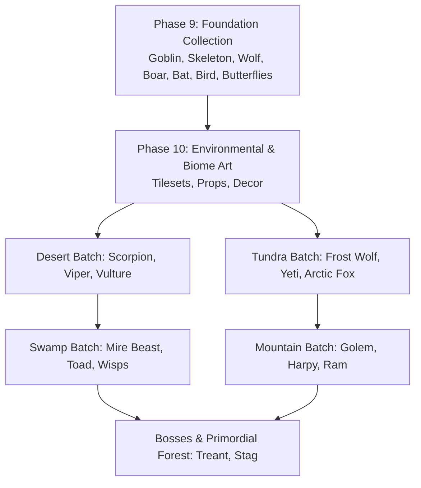

# Wildbound — Future Creature & Wildlife Catalogue (Biomes & Roadmap)

## 1. Overview & Artistic Vision

This document details the **Category C — Future Biome Creature Specification** for **Wildbound**.

As Wildbound expands beyond the initial temperate forest into diverse environmental biomes, each biome will feature native hostile adversaries, apex predators, neutral fauna, and atmospheric ambient wildlife.

All future creature concepts adhere to:
- **Perspective**: $2.5\text{D}$ top-down orthographic ($45^\circ$ to $60^\circ$ camera pitch).
- **Pixel Art Standards**: [Wildbound Art Bible](file:///c:/dev/Wildbound/docs/art/WILDBOUND_ART_BIBLE.md) rules regarding restricted palette ramp, no sub-pixel placement, and clear silhouette reads.
- **Unified Engine Integration**: Native compatibility with the C++20 `AssetManager`, `AnimationController`, and `CombatSystem`.

---

## 2. Biome 1 — Arid Desert & Sunken Ruins

```
          [ Desert Sun & Scorched Dunes ]
         /               |              \
   [ Sand Viper ]   [ Giant Scorpion ]   [ Dune Vulture ]
    (Ambush Prey)    (Armored Bruiser)   (Circling Scavenger)
```

The Desert biome features blistering sun, shifting dunes, cracked sandstone gulches, and crumbling tomb complexes. Color tones favor sun-bleached yellows `#E6C878`, terra cotta reds `#A04632`, dusty slate shadows `#50463C`, and vibrant turquoise `#14B4B4` jewelry accents.

### 2.1 Giant Sand Scorpion (`desert_scorpion`)
- **Role**: Armored Bruiser / Hostile Melee.
- **Target Dimensions**: $48 \times 48$ px (Sheet: $192 \times 384$ px, 32 frames).
- **Movement**: Scuttling ground quadruped / multi-leg ($v = 70$ px/s).
- **Palette**: Chitin Brown `#825028`, Toxic Amber `#E6961E`, Stinger Green `#50B428`.
- **Anchor & Collision**: Anchor $(24, 46)$, Collision $26 \times 20$ px.
- **Planned Animations**: `scorpion_idle_[4]`, `scorpion_walk_[4]`, `scorpion_sting_[4]`, `scorpion_pincer_[4]`, `scorpion_burrow`, `scorpion_hurt`, `scorpion_death`.
- **Behavior Concept**: Burrows beneath sand dunes; bursts out in ambush when players pass within detection radius.

### 2.2 Horned Sand Viper (`sand_viper`)
- **Role**: Fast Ambush Predator / Hostile.
- **Target Dimensions**: $40 \times 24$ px (Sheet: $160 \times 192$ px, 32 frames).
- **Movement**: Slithering lateral undulation ($v = 95$ px/s).
- **Palette**: Scaled Sand `#D2AA64`, Diamond Dorsal Pattern `#5A3C1E`, Crimson Tongue `#C8283C`.
- **Anchor & Collision**: Anchor $(20, 22)$, Collision $18 \times 10$ px.
- **Planned Animations**: `viper_idle_[4]`, `viper_slither_[4]`, `viper_strike_[4]`, `viper_coil`, `viper_hurt`, `viper_death`.
- **Behavior Concept**: High evasion, fast coiled strike that applies lingering poison damage over time.

### 2.3 Dune Vulture (`dune_vulture`)
- **Role**: Aerial Scavenger / Semi-Hostile.
- **Target Dimensions**: $36 \times 36$ px (Sheet: $144 \times 288$ px, 32 frames).
- **Movement**: High altitude aerial glide ($v = 80$ px/s).
- **Palette**: Scavenger Slate `#3C3741`, Feather White `#DCD7D2`, Naked Red Neck `#B43232`.
- **Anchor & Collision**: Anchor $(18, 32)$ shadow ground contact, visual elevation $z = 18$ px.
- **Planned Animations**: `vulture_circle`, `vulture_fly_[4]`, `vulture_dive_attack`, `vulture_perch`, `vulture_eat`.
- **Behavior Concept**: Circles combat arenas where players or creatures take damage; dives down to finish wounded targets.

---

## 3. Biome 2 — Frozen Tundra & Glacial Peaks

The Tundra features ice sheets, frozen pines, snowdrifts, and howling blizzards. Palettes center on glacial cyan `#78C8E6`, deep arctic navy `#1E2846`, fur white `#F0F5FA`, and weathered pine grey `#5A6E78`.

### 3.1 Frost Wolf / Arctic Direwolf (`frost_wolf`)
- **Role**: Pack Hunter / Hostile.
- **Target Dimensions**: $52 \times 44$ px (Sheet: $208 \times 352$ px, 32 frames).
- **Movement**: Fast snow gallop ($v = 115$ px/s, unaffected by snow slow-down).
- **Palette**: Arctic White Fur `#EEF5FF`, Ice Blue Shading `#8CA0BE`, Frost Eyes `#32DCFF`.
- **Anchor & Collision**: Anchor $(26, 44)$, Collision $28 \times 16$ px.
- **Planned Animations**: `frost_wolf_idle_[4]`, `frost_wolf_stalk_[4]`, `frost_wolf_run_[4]`, `frost_wolf_howl`, `frost_wolf_bite_[4]`, `frost_wolf_death`.
- **Behavior Concept**: Howls to buff surrounding pack members with increased movement speed before coordinated charges.

### 3.2 Glacial Yeti (`glacial_yeti`)
- **Role**: Biome Mini-Boss / Heavy Enforcer.
- **Target Dimensions**: $64 \times 64$ px (Sheet: $256 \times 512$ px, 32 frames).
- **Movement**: Lumbering bipedal strides ($v = 55$ px/s).
- **Palette**: Heavy White Pelt `#E1EBF5`, Slate Skin `#4B5A6E`, Horn Charcoal `#232832`.
- **Anchor & Collision**: Anchor $(32, 62)$, Collision $34 \times 24$ px.
- **Planned Animations**: `yeti_idle_[4]`, `yeti_walk_[4]`, `yeti_slam_[4]`, `yeti_snow_throw`, `yeti_roar`, `yeti_hurt`, `yeti_death`.
- **Behavior Concept**: Ground-slam creates shockwaves with frost patches that snare player boots.

### 3.3 Arctic Snow Fox (`arctic_fox`)
- **Role**: Ambient Wildlife.
- **Target Dimensions**: $28 \times 24$ px (Sheet: $112 \times 96$ px, 16 frames).
- **Movement**: Nimble bounding ($v = 90$ px/s).
- **Palette**: Snow Pelt `#FFFFFF`, Dark Ear Tips `#282832`, Black Nose `#141414`.
- **Anchor & Collision**: Anchor $(14, 23)$, Collision $12 \times 8$ px.
- **Planned Animations**: `fox_idle`, `fox_pounce_snow`, `fox_run`, `fox_flee`.
- **Behavior Concept**: Dives headfirst into snow piles hunting mice; flees at high velocity when approached.

---

## 4. Biome 3 — Murky Swamp & Festering Fen

The Swamp biome features murky stagnant pools, weeping willows, hanging Spanish moss, bubbling bogs, and toxic mists. Palettes employ olive drab `#465A28`, stagnant water teal `#1E463C`, rotten bark `#322319`, bioluminescent fungi violet `#9632C8`, and bile yellow `#C8BE32`.

### 4.1 Mire Beast / Bog Lurker (`mire_beast`)
- **Role**: Submerged Hostile / Tank.
- **Target Dimensions**: $56 \times 48$ px (Sheet: $224 \times 384$ px, 32 frames).
- **Movement**: Slow wading / amphibious crawl ($v = 50$ px/s).
- **Palette**: Mud Moss `#3C4B28`, Rot Bark `#281E14`, Fungus Violet `#B446DC`.
- **Anchor & Collision**: Anchor $(28, 46)$, Collision $30 \times 20$ px.
- **Planned Animations**: `mire_submerged_idle`, `mire_emerge`, `mire_walk_[4]`, `mire_slam_[4]`, `mire_submerge`.
- **Behavior Concept**: Appears as innocent floating swamp reeds until triggered by proximity, bursting out with mud splash.

### 4.2 Toxic Marsh Toad (`poison_toad`)
- **Role**: Ranged Area-Denial / Hostile.
- **Target Dimensions**: $36 \times 32$ px (Sheet: $144 \times 256$ px, 32 frames).
- **Movement**: Hopping quadruped ($v = 60$ px/s bursts).
- **Palette**: Wart Olive `#5A732D`, Warning Belly `#E6A01E`, Bile Spittle `#96DC28`.
- **Anchor & Collision**: Anchor $(18, 30)$, Collision $20 \times 16$ px.
- **Planned Animations**: `toad_idle_[4]`, `toad_hop_[4]`, `toad_spit_[4]`, `toad_puff`, `toad_hurt`, `toad_death`.
- **Behavior Concept**: Puffs vocal sac before launching glob of toxic slime leaving lingering acid pools on the terrain.

### 4.3 Swamp Fireflies / Will-o'-the-Wisp (`wisp_ambient`)
- **Role**: Ambient Wildlife / Atmospheric FX.
- **Target Dimensions**: $16 \times 16$ px (Sheet: $64 \times 32$ px, 8 frames).
- **Movement**: Floating undulating wander.
- **Palette**: Glowing Cyan-Green `#50FFAA`, Luminescent Core `#FFFFFF`.
- **Anchor & Collision**: Anchor $(8, 12)$, No physical collision.
- **Planned Animations**: `wisp_drift`, `wisp_pulse`.
- **Behavior Concept**: Glows gently in fog, illuminating pitch-black swamp paths; dissipates if struck.

---

## 5. Biome 4 — Jagged Peaks & Volcanic Crags

The Mountain biome is characterized by steep granite cliffs, screeching thermal winds, scree fields, and volcanic caldera cracks. Palettes use slate granite `#646973`, basalt black `#232328`, molten magma orange `#FF5014`, and brass gold `#DCB43C`.

### 5.1 Stone Golem / Crag Elemental (`crag_golem`)
- **Role**: Heavy Armored Juggernaut / Hostile.
- **Target Dimensions**: $64 \times 64$ px (Sheet: $256 \times 512$ px, 32 frames).
- **Movement**: Crushing heavy steps ($v = 45$ px/s, knockback immune).
- **Palette**: Granite Stone `#5A646E`, Moss Lichen `#465A3C`, Magma Heart `#FF5A1E`.
- **Anchor & Collision**: Anchor $(32, 62)$, Collision $32 \times 24$ px.
- **Planned Animations**: `golem_dormant`, `golem_awaken`, `golem_walk_[4]`, `golem_punch_[4]`, `golem_boulder_throw`, `golem_shatter_death`.
- **Behavior Concept**: Resembles an ordinary rock boulder until disturbed; high armor rating with immense physical power.

### 5.2 Cliff Harpy (`cliff_harpy`)
- **Role**: Fast Flying Skirmisher / Hostile.
- **Target Dimensions**: $40 \times 44$ px (Sheet: $160 \times 352$ px, 32 frames).
- **Movement**: Swooping aerial flight ($v = 100$ px/s).
- **Palette**: Talon Slate `#323741`, Feather Russet `#783C28`, Screech Face `#D2C8BE`.
- **Anchor & Collision**: Anchor $(20, 36)$ shadow, $z = 16$ px elevation. Collision $18 \times 18$ px.
- **Planned Animations**: `harpy_fly_[4]`, `harpy_dive_[4]`, `harpy_talon_rake_[4]`, `harpy_screech`, `harpy_death`.
- **Behavior Concept**: Emits a disorienting screech before performing rapid strafing dives across the player's path.

### 5.3 Mountain Ram (`mountain_ram`)
- **Role**: Neutral Wildlife.
- **Target Dimensions**: $44 \times 36$ px (Sheet: $176 \times 288$ px, 32 frames).
- **Movement**: High cliff jumping and galloping ($v = 85$ px/s).
- **Palette**: Thick Wool `#DCD7C8`, Spiral Horns `#6E5032`, Hoof Iron `#282828`.
- **Anchor & Collision**: Anchor $(22, 35)$, Collision $22 \times 14$ px.
- **Planned Animations**: `ram_graze`, `ram_idle_[4]`, `ram_charge_[4]`, `ram_headbutt_[4]`, `ram_flee`.
- **Behavior Concept**: Docile when unprovoked; counter-charges with a massive knockback headbutt if damaged.

---

## 6. Biome 5 — Deep Ancient Forest (Expansion)

Extending the starter forest into untamed, primordial wilderness dominated by colossal redwoods, overgrown ruins, and ancient canopy groves.

### 6.1 Ancient Treant / Grove Warden (`ancient_treant`)
- **Role**: Ancient Grove Guardian / Biome Boss.
- **Target Dimensions**: $80 \times 80$ px (Sheet: $320 \times 640$ px, 32 frames).
- **Movement**: Colossal root striding ($v = 35$ px/s).
- **Palette**: Ancient Bark `#3C2819`, Foliage Emerald `#1E6E32`, Runic Amber `#FFB41E`.
- **Anchor & Collision**: Anchor $(40, 78)$, Collision $48 \times 32$ px.
- **Planned Animations**: `treant_idle_[4]`, `treant_stride_[4]`, `treant_root_sweep_[4]`, `treant_acorn_burst`, `treant_stomp`, `treant_death`.
- **Behavior Concept**: Summons entangling roots from beneath the ground to immobilize players within its grove.

### 6.2 Forest Stag (`forest_stag`)
- **Role**: Majestic Neutral Wildlife.
- **Target Dimensions**: $48 \times 48$ px (Sheet: $192 \times 384$ px, 32 frames).
- **Movement**: Graceful high-stepping trot and sprint ($v = 110$ px/s).
- **Palette**: Chestnut Coat `#784628`, White Dappled Spots `#E6DCC8`, Antler Crown `#967850`.
- **Anchor & Collision**: Anchor $(24, 46)$, Collision $24 \times 14$ px.
- **Planned Animations**: `stag_graze`, `stag_alert_[4]`, `stag_trot_[4]`, `stag_gallop_[4]`, `stag_antler_jab_[4]`.
- **Behavior Concept**: High vigilance radius ($250$ px); alerts other nearby wildlife and enemies when running away.

---

## 7. Implementation Roadmap & Production Priority



1. **Immediate Focus (Phase 9 & 10)**: Establish biome tilesets and environmental props before introducing biome-specific creature populations.
2. **Phase 11 (Desert & Tundra Expansions)**: Implement Sand Scorpion, Frost Wolf, and Arctic Fox alongside initial biome expansions.
3. **Phase 12 (Swamp & Mountain Expansions)**: Implement Mire Beast, Toxic Marsh Toad, Crag Golem, and Cliff Harpy.
4. **Phase 13 (Biome Bosses & Guardians)**: Implement Ancient Treant, Glacial Yeti, and large-format guardian entities.

