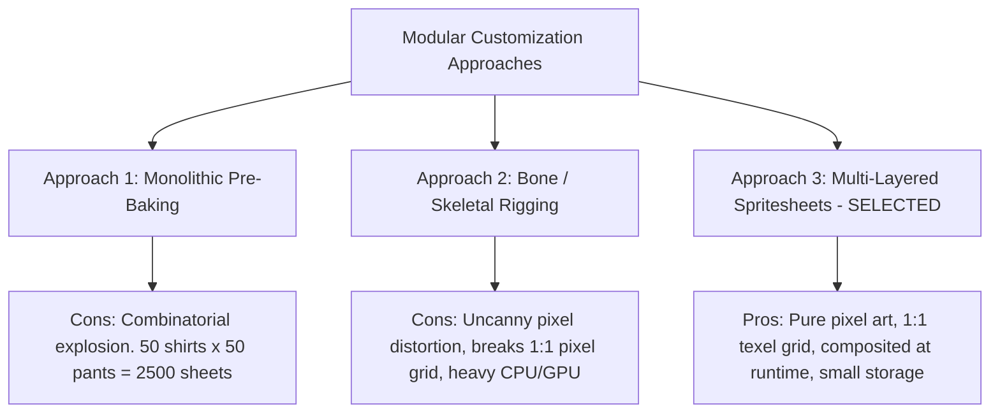

# Wildbound Modular Cosmetic Technical Specification

## 1. Architectural Strategy & Trade-Off Analysis

A core goal for Wildbound's fantasy battle royale experience is deep player character customization (hairstyles, armor pieces, cloaks, vanity cosmetics) that can be seamlessly previewed, equipped, and synchronized across multiplayer matches.

### 1.1 Evaluated Approaches



### 1.2 Selected Standard: Layered Spritesheet Compositing
Every cosmetic item is authored as an isolated, transparent spritesheet matching the exact $32 \times 48$ px humanoid frame dimensions.
- **Rendering**: In `Character::Render`, rather than making a single `DrawTextureRec` call, the engine renders the active base body followed by equipped cosmetic layers in strict Z-index sequence using the character's active animation frame index.
- **Memory Footprint**: An isolated cosmetic spritesheet takes only $2 \text{ to } 4 \text{ KB}$ of VRAM (compressed PNG). 100 cosmetic items take $<400 \text{ KB}$, enabling instantaneous runtime swapping.

---

## 2. Cosmetic Categories & Technical Metrics

| Category | Typical Coverage | Layer ID | Default Anchor | Special Behavior & Flags |
|---|---|---|---|---|
| **`hair`** | Crown, bangs, ponytails | `layer_hair_front` / `layer_hair_back` | $(16, 48)$ | Supports `hair_color` tinting; clipped by `hair_hide_all` / `hair_hide_top` |
| **`hat`** | Caps, helmets, crowns | `layer_headwear` | $(16, 48)$ | Emits `hair_hide_*` occlusion flags; overrides facial accessories if full helm |
| **`face`** | Goggles, masks, eyepatches | `layer_face_acc` | $(16, 48)$ | Aligned to eye level ($Y=16$); moves with head bob |
| **`shirt`** | Tunics, plate armor, robes | `layer_torso` | $(16, 48)$ | Covers chest and arms; sleeves sync with arm swing |
| **`pants`** | Trousers, shorts, chain chausses| `layer_legs` | $(16, 48)$ | Covers hips to ankles; tucks into tall boots |
| **`shoes`** | Boots, shoes, sandals | `layer_feet` | $(16, 48)$ | Anchored at ground baseline; overrides lower pant cuff |
| **`back`** | Cloaks, capes, backpacks, quivers | `layer_back_behind` / `layer_back_over` | $(16, 48)$ | Swaps Z-depth when facing North vs South |
| **`waist`** | Belts, sash, coin pouches, scabbard | `layer_waist` | $(16, 48)$ | Aligned to beltline ($Y=28$) |

---

## 3. Frame Layout & Grid Standardization

To guarantee that any shirt, hat, or pair of boots fits any animation state, **every cosmetic spritesheet must mirror the Master Humanoid Frame Grid**:

```text
Row 0: Idle Down    (Cols 0..3) -> Frames  0,  1,  2,  3
Row 1: Idle Up      (Cols 0..3) -> Frames  4,  5,  6,  7
Row 2: Idle Left    (Cols 0..3) -> Frames  8,  9, 10, 11
Row 3: Idle Right   (Cols 0..3) -> Frames 12, 13, 14, 15
Row 4: Walk Down    (Cols 0..3) -> Frames 16, 17, 18, 19
Row 5: Walk Up      (Cols 0..3) -> Frames 20, 21, 22, 23
Row 6: Walk Left    (Cols 0..3) -> Frames 24, 25, 26, 27
Row 7: Walk Right   (Cols 0..3) -> Frames 28, 29, 30, 31
Row 8: Attack Down  (Cols 0..3) -> Frames 32, 33, 34, 35
Row 9: Attack Up    (Cols 0..3) -> Frames 36, 37, 38, 39
Row 10: Attack Left (Cols 0..3) -> Frames 40, 41, 42, 43
Row 11: Attack Right(Cols 0..3) -> Frames 44, 45, 46, 47
Row 12: Hurt / Death(Cols 0..3) -> Frames 48, 49, 50, 51
```
- **Total Master Sheet**: 4 columns $\times$ 13 rows ($128 \times 624$ pixels).
- **Phased Support**: Cosmetics currently supporting Phase 4/5 baseline need only the first 8 rows ($128 \times 384$ px). The additional rows are added as attack frames are authored.

---

## 4. Palette Swapping & Color Variation System

To avoid creating duplicate image files for color variants (e.g., Red Tunic, Blue Tunic, Green Tunic), Wildbound uses a **Grayscale Master + Color Ramp Lookup (LUT)** system:

1. **Greyscale Source**:
   - The cosmetic PNG is drawn using a normalized 4-step grayscale ramp:
     - Highlight: `#ffffff` ($100\%$)
     - Midtone: `#b4b4b4` ($70\%$)
     - Shadow: `#646464` ($40\%$)
     - Deep Shadow: `#282828` ($15\%$)
2. **Color Ramp Application**:
   - At load time or via shader tinting, the 4 grayscale indices are mapped to a target color palette (e.g. Forest Green, Royal Crimson, Midnight Black).
   - Enables unlimited cosmetic color combinations with zero extra texture memory.

---

## 5. Incompatible Combinations & Conflict Rules

The cosmetic manager evaluates conflict tags before rendering:

```json
{
  "item_id": "helm_iron_full_001",
  "category": "hat",
  "conflicts": {
    "suppress_categories": ["face"],
    "occlusion_flags": ["hair_hide_all"],
    "required_body_type": "humanoid"
  }
}
```

### Conflict Enforcement Matrix:
- **`hair_hide_all`**: If active, completely bypasses rendering the hair spritesheet.
- **`hair_hide_top`**: Replaces standard hair clip with a low-ponytail / cropped variant.
- **`sleeves_hide_gloves`**: If a heavy robe has wide flowing sleeves, forearm bracers are suppressed to prevent clipping.
- **`robe_hide_pants`**: Floor-length wizard robes suppress the pants layer to save rendering passes.

