# The Wildbound Art Bible
## Official Visual & Asset Production Specification

- **Project**: Wildbound (2D Top-Down Fantasy Battle Royale & Adventure)
- **Engine**: C++20 / raylib 5.5 / Custom Asset Management System
- **Specification Version**: `1.0.0`
- **Status**: Authoritative Master Reference

---

## Executive Summary & Vision

The **Wildbound Art Bible** establishes the visual identity, dimensional standards, animation principles, biome aesthetics, and metadata specifications for all current and future asset production in the Wildbound universe. 

Wildbound blends the strategic readability of classic top-down adventure games with the high-stakes intensity of medieval fantasy survival. Every visual asset must obey the dual imperatives of **tactical gameplay clarity** and **uncompromising pixel-art purity**.

```mermaid
graph TD
    Bible[Wildbound Art Bible] --> Direction[Art Direction & Palette]
    Bible --> Characters[Character & Cosmetic Standards]
    Bible --> Animation[Animation Timing & Sync]
    Bible --> Environment[Environment, Biomes & Buildings]
    Bible --> TechStandards[Naming, Metadata & AMS Pipeline]

    Direction --> doc1[ART_DIRECTION.md]
    Characters --> doc2[CHARACTER_SPRITE_SPECIFICATION.md]
    Characters --> doc3[MODULAR_COSMETIC_SPECIFICATION.md]
    Animation --> doc4[ANIMATION_STANDARDS.md]
    Animation --> doc5[ENVIRONMENT_ANIMATION_SPECIFICATION.md]
    Environment --> doc6[ENVIRONMENT_ASSET_SPECIFICATION.md]
    Environment --> doc7[BIOME_VISUAL_GUIDELINES.md]
    TechStandards --> doc8[ASSET_NAMING_AND_DIRECTORY_STANDARDS.md]
    TechStandards --> doc9[ASSET_METADATA_SCHEMA.md]
    TechStandards --> doc10[ASSET_LICENSING_AND_PROVENANCE.md]
    TechStandards --> doc11[AMS_ASSET_INTEGRATION_SPECIFICATION.md]
```



---

## Core Specification Index

### 1. Visual Style & Global Aesthetic
* **Document**: [`docs/art/ART_DIRECTION.md`](file:///c:/dev/Wildbound/docs/art/ART_DIRECTION.md)
* **Summary**: Defines the 3/4 top-down oblique perspective, strict 1:1 internal pixel density ($640 \times 360$ canvas), zero-mixels rule, selective outline conventions, top-left $45^\circ$ lighting direction, and master 20-color master fantasy palette.

### 2. Character Sprite Architecture
* **Document**: [`docs/art/CHARACTER_SPRITE_SPECIFICATION.md`](file:///c:/dev/Wildbound/docs/art/CHARACTER_SPRITE_SPECIFICATION.md)
* **Summary**: Establishes standard humanoid dimensions ($32 \times 48$ px frame), bottom-center foot anchor $(16, 48)$, feet collision footprint ($16 \times 12$ px), 5 entity sizing tiers (Small, Standard, Large, Huge, Colossal), and 4-directional orientation rules.

### 3. Modular Cosmetics & Customization
* **Document**: [`docs/art/MODULAR_COSMETIC_SPECIFICATION.md`](file:///c:/dev/Wildbound/docs/art/MODULAR_COSMETIC_SPECIFICATION.md)
* **Summary**: Outlines the runtime layered spritesheet compositing pipeline across 8 equipment categories (Hair, Hat, Face, Torso, Legs, Feet, Back, Waist). Details occlusion sorting, facing-dependent depth flipping, and conflict suppression flags.

### 4. Animation Conventions & Timing
* **Document**: [`docs/art/ANIMATION_STANDARDS.md`](file:///c:/dev/Wildbound/docs/art/ANIMATION_STANDARDS.md)
* **Summary**: Codifies frame counts, durations, and keyframe mechanics for Locomotion (Idle 5 FPS, Walk 7 FPS, Run 12 FPS), Combat (Attack 10–12 FPS, Hurt, Death), and World Loops. Specifies lockstep modular sync and missing-animation fallback rules.

### 5. Environmental Architecture & Buildings
* **Document**: [`docs/art/ENVIRONMENT_ASSET_SPECIFICATION.md`](file:///c:/dev/Wildbound/docs/art/ENVIRONMENT_ASSET_SPECIFICATION.md)
* **Summary**: Details dimensions, collision boundaries, and Y-sort baselines for vegetation (Oaks, Pines, Willows), modular buildings (Cabins, Cottages, Watchtowers), and props (Chests, Crates, Barrels). Introduces the seamless indoor/exterior cutaway roof fading system.

### 6. World Biomes & Environmental Variety
* **Document**: [`docs/art/BIOME_VISUAL_GUIDELINES.md`](file:///c:/dev/Wildbound/docs/art/BIOME_VISUAL_GUIDELINES.md)
* **Summary**: Detailed aesthetic and palette breakdown for all five battle royale biomes: Verdant Forest (baseline), Sunscorched Wastes (desert), Frostfall Taiga (snow/ice), Murkwood Mire (swamp), and Iron Crag Highlands (mountains).

### 7. Living World & Environmental Animations
* **Document**: [`docs/art/ENVIRONMENT_ANIMATION_SPECIFICATION.md`](file:///c:/dev/Wildbound/docs/art/ENVIRONMENT_ANIMATION_SPECIFICATION.md)
* **Summary**: Categorizes dynamic world elements into 5 architectural tiers (Static Tiles, Animated Objects, Ambient Wildlife, Atmospheric Particle Overlays, Gameplay Entities) to maintain 60 FPS performance without CPU overhead.

### 8. Directory Organization & Naming Standards
* **Document**: [`docs/art/ASSET_NAMING_AND_DIRECTORY_STANDARDS.md`](file:///c:/dev/Wildbound/docs/art/ASSET_NAMING_AND_DIRECTORY_STANDARDS.md)
* **Summary**: Establishes directory organization and strict snake_case naming rules with standardized prefixes (`tex_`, `sheet_`, `anim_`, `sfx_`, `bgm_`, `ts_`, `map_`) and unique gameplay IDs (`cos_`, `enemy_`, `wpn_`).

### 9. JSON Metadata Schema
* **Document**: [`docs/art/ASSET_METADATA_SCHEMA.md`](file:///c:/dev/Wildbound/docs/art/ASSET_METADATA_SCHEMA.md)
* **Summary**: Authoritative schemas and concrete JSON documents for cosmetics, characters, animation clips, props, buildings, biomes, and wildlife. Built for validation and future multiplayer network replication.

### 10. Legal Licensing & Provenance
* **Document**: [`docs/art/ASSET_LICENSING_AND_PROVENANCE.md`](file:///c:/dev/Wildbound/docs/art/ASSET_LICENSING_AND_PROVENANCE.md)
* **Summary**: Defines studio intellectual property policies, permitted commercial licenses (CC0, MIT, Commercial Royalty-Free), prohibited copyleft/non-commercial licenses, and manifest attribution schema.

### 11. AMS Pipeline Integration
* **Document**: [`docs/art/AMS_ASSET_INTEGRATION_SPECIFICATION.md`](file:///c:/dev/Wildbound/docs/art/AMS_ASSET_INTEGRATION_SPECIFICATION.md)
* **Summary**: Maps how new assets flow through the existing C++ Asset Management System (`AssetManager`, `TextureManager`, `SpriteSheet`, `AssetValidator`) and outlines future engine enhancements.

---

## Technical Baseline Constants

```cpp
namespace wildbound::art {
    constexpr int VIRTUAL_CANVAS_WIDTH       = 640;
    constexpr int VIRTUAL_CANVAS_HEIGHT      = 360;
    constexpr int BASE_TILE_SIZE             = 32;
    constexpr int STANDARD_FRAME_WIDTH       = 32;
    constexpr int STANDARD_FRAME_HEIGHT      = 48;
    constexpr float STANDARD_ANCHOR_X        = 16.0f;
    constexpr float STANDARD_ANCHOR_Y        = 48.0f;
    constexpr float COLLISION_FOOTPRINT_W    = 16.0f;
    constexpr float COLLISION_FOOTPRINT_H    = 12.0f;
}
```

