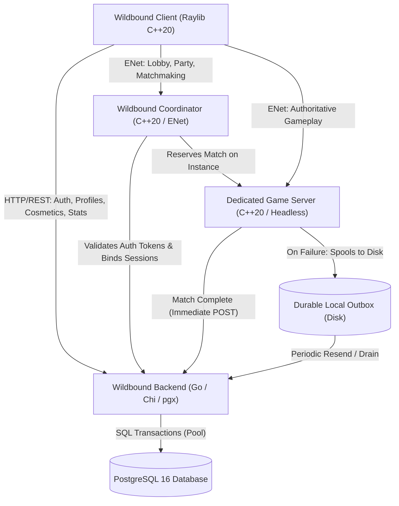

# Wildbound — Phase 42: Backend Architecture

## 1. System Overview

The Wildbound Persistent Backend is a production-grade, service-oriented subsystem designed to provide persistent identity, profile management, cosmetic ownership, match history ingestion, and player progression statistics. It decouples long-term transactional state from the ephemeral gameplay execution handled by `WildboundServer` and pre-match coordination handled by `WildboundCoordinator`.

## 2. Core Responsibilities & Boundaries

| Component | Technology | Primary Authority & Ownership | Strict Non-Responsibilities |
|---|---|---|---|
| **Wildbound Backend** | Go 1.26, PostgreSQL 16, pgx/v5, chi/v5 | Persistent accounts, password hashing (Argon2id), JWT issuance, refresh token rotation, player profiles, cosmetic catalogue & ownership, match record storage, player aggregate statistics | Gameplay simulation, physics, combat resolution, hit registration, movement interpolation, matchmaking queue formation |
| **Wildbound Coordinator** | C++20, ENet | Ephemeral player lobbies, party formation, queue management, dedicated server heartbeat tracking, match reservation and redirection | Persistent database storage, password verification, combat simulation, cosmetic authorization |
| **Wildbound Server** | C++20, ENet, Headless Raylib | Authoritative game simulation, hit registration, physics, storm progression, loot spawning, victory condition detection | Account registration, token minting, long-term stat calculation |
| **Wildbound Client** | C++20, Raylib, WinHTTP / Sockets | UI presentation, non-blocking HTTP REST calls, client prediction, player input transmission | Authoritative game state, match outcome determination |

## 3. Communication Patterns

### 3.1 Client-to-Backend (REST / JSON)
- Base URL: `/api/v1`
- Content Type: `application/json; charset=utf-8`
- Envelope: Standardized JSON envelope containing `success`, `data`, and `error` objects.
- Authentication: Bearer token in the `Authorization` header (`Bearer <access_token>`).

### 3.2 Server-to-Backend (Internal Ingestion)
- Endpoint: `POST /api/v1/internal/matches/results`
- Authentication: Internal shared secret passed via `X-Server-Token`.
- Resilience: Idempotent match ingestion with durable local file outbox (`user_data/outbox/`).

### 3.3 Coordinator-to-Backend (Identity Verification)
- Authentication: Token validation via `X-Coordinator-Token`.
- Association: Binds ephemeral `SessionId` with persistent `userId`.

