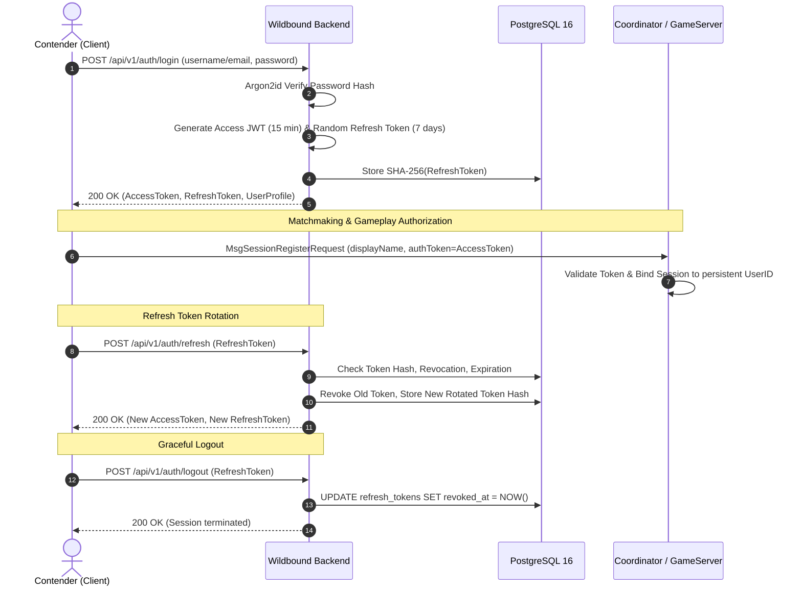

# Wildbound — Phase 42: Authentication & Identity

## 1. Authentication Architecture

Wildbound uses a dual-token authentication model combining **short-lived JSON Web Tokens (JWT)** for stateless request authorization and **opaque rotating refresh tokens** for long-lived session persistence.

## 2. Password Hashing Specification

- **Algorithm:** Argon2id (RFC 9106 recommended configuration).
- **Time Cost ($t$):** 3 iterations.
- **Memory Cost ($m$):** 64 MiB (65,536 KiB).
- **Parallelism ($p$):** 4 threads.
- **Salt:** 16 cryptographically random bytes via `crypto/rand`.
- **Key Length:** 32 bytes digest.
- **Verification:** Constant-time comparison via `subtle.ConstantTimeCompare` prevents timing side-channel attacks.

## 3. JWT Access Token Specification

- **Signing Algorithm:** HMAC-SHA256 (`HS256`).
- **Validity Window:** 15 minutes (`AccessTTLMinutes: 15`).
- **Standard Claims:**
  - `iss`: `"wildbound"`
  - `aud`: `"wildbound-client"`
  - `sub`: Player UUID
  - `iat`: Issuance timestamp (Unix seconds)
  - `exp`: Expiration timestamp (Unix seconds)
  - `jti`: Unique token UUID
- **Custom Claims:**
  - `user_id`: UUID string
  - `username`: Contender handle string

## 4. Refresh Token Security & Rotation

- **Entropy:** 32 cryptographically secure random bytes generated with OS CSPRNG (`crypto/rand`).
- **Encoding:** URL-safe Base64 without padding.
- **Database Storage:** SHA-256 hash digest (`token_hash VARCHAR(64) UNIQUE`). The raw refresh token is returned exclusively to the client upon generation and is never retained in plaintext in logs, caches, or database tables.
- **Automatic Rotation:** Every invocation of `/api/v1/auth/refresh` atomically revokes the presented refresh token and issues a fresh token pair.
- **Replay Detection:** If an already-revoked refresh token is re-submitted, the system rejects the request (`401 Unauthorized`), mitigating stolen token replay.

