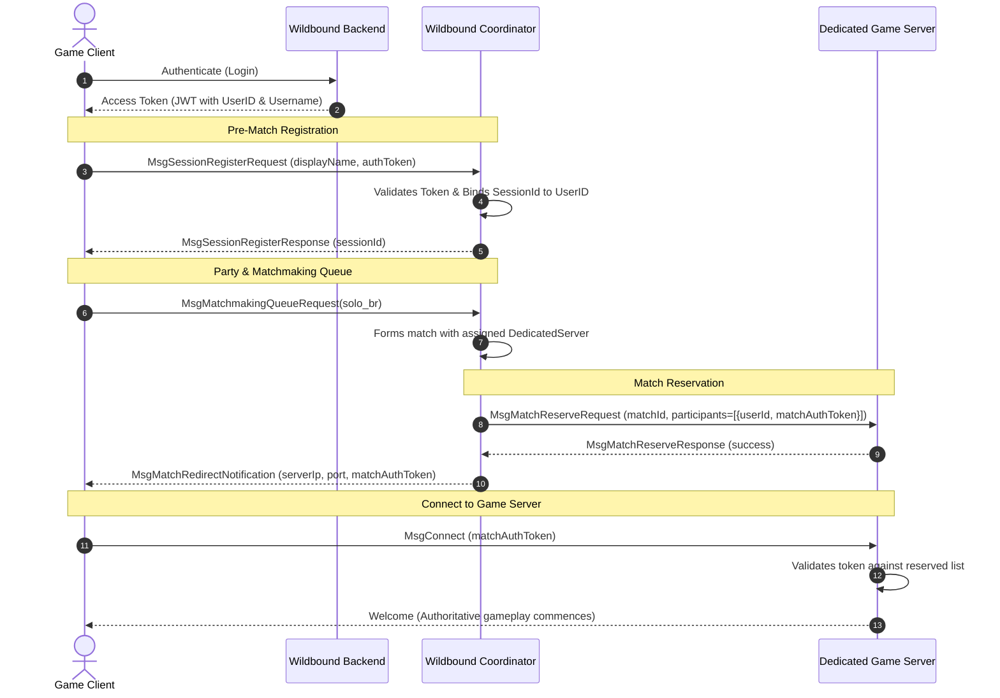

# Wildbound — Phase 42: Coordinator Integration & Identity Verification

## 1. Overview
`WildboundCoordinator` is the pre-match session, party, and matchmaking coordinator implemented in Phase 41. It organizes contenders into groups and matches them with available dedicated game servers.

In Phase 42, the Coordinator integrates with the persistent identity layer by associating client connections with verified backend user accounts.

## 2. Session Protocol Enhancement
- `MsgSessionRegisterRequest`:
  - `displayName`: Contender visual name.
  - `clientVersion`: Client semantic version (e.g. `"1.0.0"`).
  - `authToken`: JWT access token issued by the backend.
- `PlayerSession`:
  - `SessionId sessionId`: Ephemeral uint64 coordinator session identifier.
  - `std::string persistentUserId`: Persistent backend account UUID.
  - `std::string authToken`: Active authorization credentials.

