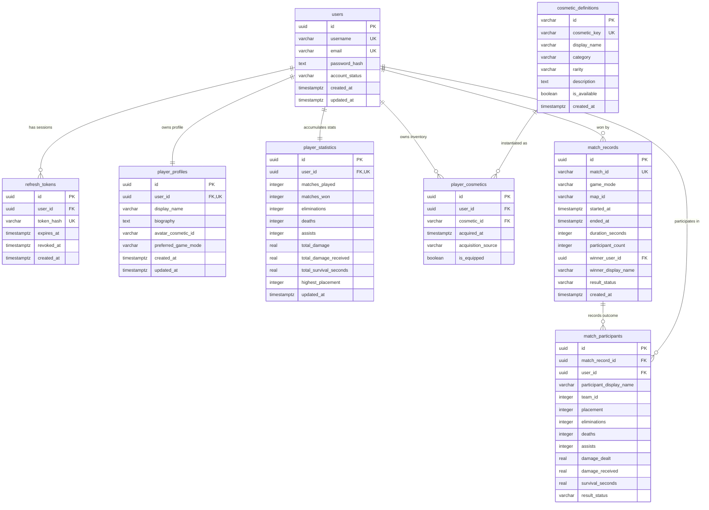

# Wildbound — Phase 42: Database Schema & Migrations

## 1. Overview
The database engine for Wildbound is **PostgreSQL 16**.
All transactional state uses relational integrity, foreign key cascading where appropriate, strict uniqueness constraints, and targeted indexes for high-throughput queries.

## 2. Entity Relationship Diagram

## 3. Table Specifications

### 3.1 `users`
- Primary authentication and account identity table.
- `password_hash`: Argon2id encoded string with salt, cost parameters, and cryptographic digest.
- Account status: `active`, `suspended`, `banned`.

### 3.2 `player_profiles`
- Player-facing customization and metadata.
- `user_id`: Foreign key to `users(id)` with `1:1` unique constraint and `ON DELETE CASCADE`.
- `avatar_cosmetic_id`: References active avatar icon definition.

### 3.3 `refresh_tokens`
- Cryptographic session table for JWT refresh token rotation.
- `token_hash`: SHA-256 digest of the raw random base64url refresh token. Raw tokens are never stored.
- Supports single-use rotation and immediate revocation.

### 3.4 `cosmetic_definitions`
- Catalog of all cosmetic items, categories, rarities, and visual assets.
- Seeded with 12 baseline items (Adventurer Crest, Explorer Fedora, Ranger Rucksack, etc.).

### 3.5 `player_cosmetics`
- Player inventory tracking item ownership, acquisition source, and active equipped state.
- Composite uniqueness constraint: `(user_id, cosmetic_id)` prevents duplicate ownership.

### 3.6 `match_records`
- Immutable history of completed matches submitted by authoritative game servers.
- `match_id`: Unique match identifier generated by Coordinator/DedicatedServer. Ensures idempotency during result ingestion.

### 3.7 `match_participants`
- Per-participant scoreboard for each match. Tracks placement, eliminations, deaths, assists, damage dealt/received, and survival time.

### 3.8 `player_statistics`
- Persistent aggregated player progression table.
- Updated atomically inside the match result ingestion transaction.

