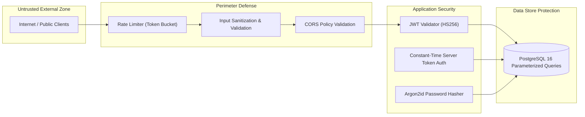

# Wildbound — Phase 42: Security & Threat Mitigation

## 1. Security Architecture & Threat Vectors

The backend enforces strict defense-in-depth across the following boundaries:

## 2. Threat Mitigation Matrix

| Threat Category | Potential Attack Vector | Applied Mitigation in Wildbound |
|---|---|---|
| **SQL Injection (SQLi)** | Malicious SQL syntax in username, email, search filters, or match metadata | 100% of database queries use parameterized SQL via `pgx/v5`. Zero string interpolation or concatenation in SQL statements. Verified via test suite (`TestSecurityAndValidationBoundaries`). |
| **Credential Stuffing & Brute Force** | High-frequency password guessing on `/api/v1/auth/login` | In-memory token bucket rate limiter (`RateLimiter`) with configurable requests per second and burst ceiling. Exceeding quota yields `429 Too Many Requests`. |
| **Password Hash Compromise** | Database exfiltration / offline dictionary cracking | Passwords hashed using Argon2id with 64 MiB memory hardness, 3 iterations, 4 parallelism threads, and unique 16-byte cryptographically random salts. |
| **Token Theft & Replay** | Intercepted refresh tokens used to indefinitely forge sessions | Refresh tokens are single-use with atomic rotation. Database only stores SHA-256 digests. Old tokens are immediately marked `revoked_at`. Replaying a revoked token immediately triggers authorization failure. |
| **Forged Match Results** | Spoofed client reporting fake victories or inflated kill counts | Public clients have ZERO permission to submit match results. Only dedicated game servers presenting valid `X-Server-Token` matching `server_secret` in constant time (`subtle.ConstantTimeCompare`) can ingest results. |
| **Cosmetic Spoofing** | Equipping unowned legendary skins via API manipulation | `EquipCosmetic` performs transactional database verification ensuring `player_cosmetics` contains ownership record before profile update is executed. |
| **Cross-Origin Resource Sharing (CORS)** | Malicious websites initiating authenticated cross-origin requests | Strict CORS origin verification with explicit allowed origins (`CORSAllowedOrigins`) and preflight `OPTIONS` handling. |

