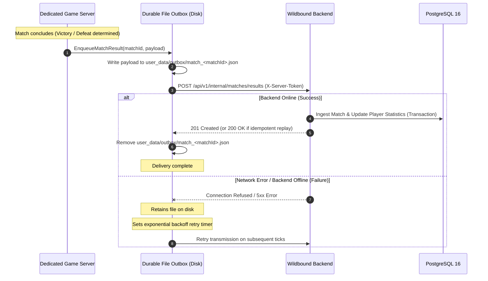

# Wildbound — Phase 42: Dedicated Server Integration & Durable Outbox

## 1. Overview
In Wildbound's authoritative multiplayer architecture, `WildboundServer` maintains 100% authority over game simulation, combat, elimination resolution, and match completion detection.

At match conclusion, `WildboundServer` submits the official match scoreboard to `WildboundBackend`. To ensure zero data loss under transient network partitions, server restarts, or backend downtime, a durable file-backed outbox mechanism is implemented.

## 2. Server Configuration
The dedicated server reads backend connectivity parameters from `config/server_config.json` or command-line arguments:
- `backend_url`: URL of the Wildbound persistent backend (e.g. `http://127.0.0.1:8080`).
- `server_secret_token`: Authentication token matching `server_secret` in the backend configuration (`X-Server-Token`).
- `outbox_dir`: Local durable storage path (default: `user_data/outbox`).

## 3. Idempotent Ingestion Guarantee
The backend ingests matches idempotently:
1. When receiving a submission, the backend checks whether `match_records` already contains the specified `match_id`.
2. If already processed, it immediately responds with `200 OK` (`created: false`), returning the existing match record.
3. Statistics in `player_statistics` are **NEVER double-counted** upon duplicate delivery or retry.

