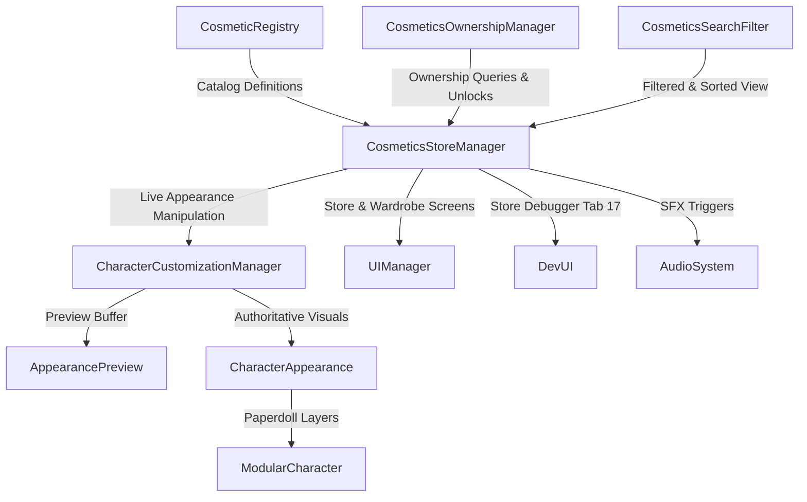
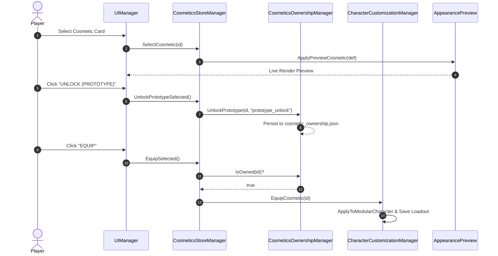

# Cosmetics Store & Wardrobe Architecture (Phase 26)

## 1. System Overview

The **Cosmetics Store and Wardrobe System** in Wildbound provides a complete, modular, and local data-driven architecture that bridges cosmetic item definitions, player visual customisation, ownership tracking, and live interactive character preview.

The system is explicitly decoupled from gameplay combat statistics:
- **Equipment System (`src/entities/EquipmentSystem.hpp`)**: Governs combat ratings, mitigation, attack speeds, defense, and gameplay-altering gear.
- **Cosmetics Store & Customization System (`src/cosmetics/`, `src/customization/`)**: Governs aesthetic appearances, palettes, color variants, loadouts, prototype ownership, and visual presentation.

---

## 2. Component Structure

### 2.1 `CosmeticsRarity` (`src/cosmetics/CosmeticsRarity.hpp`)
Defines the canonical 6 rarity tiers:
1. `Common`: Standard tier, neutral slate color (`#D2D2D2`), sort weight 0.
2. `Uncommon`: Grass green color (`#46D264`), sort weight 1.
3. `Rare`: Azure blue color (`#3C96FA`), sort weight 2.
4. `Epic`: Amethyst violet color (`#BE50FA`), sort weight 3.
5. `Legendary`: Radiant gold color (`#FAB428`), sort weight 4.
6. `Mythic`: Crimson ruby color (`#FA3250`), sort weight 5.

### 2.2 `CosmeticsColorVariant` (`src/cosmetics/CosmeticsColorVariant.hpp`)
Encapsulates tinting and alternative spritesheet bindings for individual cosmetic pieces:
- `id`: Unique variant identifier (e.g., `hair_blonde`, `cloth_crimson`, `metal_gold`).
- `displayName`: Player-facing title.
- `tint`: raylib `Color` value multiplied into rendering vertex/sprite shaders.
- `hexColor`: Web-safe hex string for UI color swatch badges.
- `assetKeyOverride`: Optional alternative spritesheet asset ID.

### 2.3 `CosmeticsOwnership` & `CosmeticsOwnershipManager` (`src/cosmetics/CosmeticsOwnership.hpp`, `CosmeticsOwnershipManager.hpp/.cpp`)
Provides local transactional prototype ownership management:
- Tracks acquisition state (`Owned` vs `Locked`), acquisition source, acquisition timestamp, and chosen active variant.
- Defaults basic starter equipment (default skin, basic hair, adventurer tunic, leather pants, leather boots) to `Owned`.
- Safely validates and persists ownership state to `user_data/cosmetics/cosmetic_ownership.json`.

### 2.4 `CosmeticsSearchFilter` (`src/cosmetics/CosmeticsSearchFilter.hpp/.cpp`)
Provides a fast, zero-allocation multi-predicate engine:
- Case-insensitive multi-field substring queries across display name, description, asset ID, category, and rarity.
- Categorical filtering across Featured, All, Hairstyles, Clothing, Armor, Headwear, Face, Backpacks, Footwear, and Special tiers.
- Predicate chaining with slot masks, rarity filters, and ownership state filters (`All`, `OwnedOnly`, `LockedOnly`).
- 6-axis sorting: Alphabetical (Asc/Desc), Rarity Tier (Asc/Desc), and Ownership status (Owned First / Locked First).

### 2.5 `CosmeticsStoreManager` (`src/cosmetics/CosmeticsStoreManager.hpp/.cpp`)
Central coordinator tying the subsystem together:
- Manages active tab (`Store` vs `Wardrobe`), active category, and search criteria.
- Enforces ownership rules: locked cosmetics cannot be equipped.
- Coordinates live previewing on `AppearancePreview` without modifying gameplay state.
- Executes local prototype unlocking transactions.
- Dispatches UI sound effects via `AudioSystem`.

---

## 3. Data Flow & Lifecycle

---

## 4. Threading & Persistence Boundaries

- **Single-Threaded Simulation**: Runs synchronously within the engine's main frame loop.
- **Atomic Local Persistence**: Disk operations serialize pure JSON structures to `user_data/cosmetics/cosmetic_ownership.json`.
- **Fail-Safe Fallbacks**: Missing or unreadable ownership files gracefully fallback to default starter equipment without crashing the engine.

