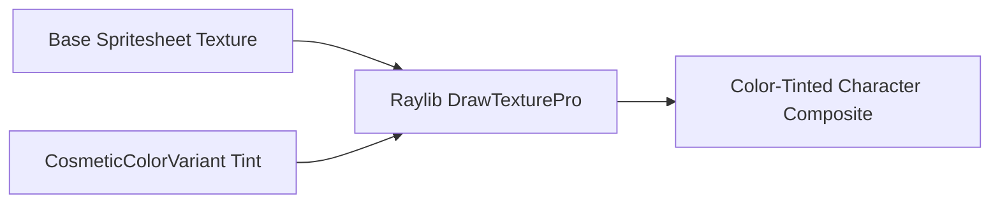

# Cosmetic Color Variations Specification (Phase 26)

## 1. Architecture & Design Principles

Wildbound provides procedural tinting and variant palettes via `src/cosmetics/CosmeticsColorVariant.hpp`.
This allows a single base spritesheet (e.g., adventurer tunic, messy hair) to be rendered in multiple color schemes without multiplying texture memory.

---

## 2. Standard Category Palettes

### 2.1 Hair Color Variants
| Variant ID | Name | Tint Color (RGBA) | Hex Color |
|---|---|---|---|
| `hair_blonde` | Blonde | `(245, 220, 130, 255)` | `#F5DC82` |
| `hair_brown` | Chestnut | `(110, 70, 40, 255)` | `#6E4628` |
| `hair_black` | Raven | `(35, 35, 40, 255)` | `#232328` |
| `hair_ginger` | Auburn | `(190, 85, 35, 255)` | `#BE5523` |
| `hair_silver` | Silver | `(210, 215, 225, 255)` | `#D2D7E1` |
| `hair_crimson` | Crimson | `(180, 30, 50, 255)` | `#B41E32` |
| `hair_azure` | Azure | `(50, 140, 220, 255)` | `#328CDC` |
| `hair_emerald` | Emerald | `(40, 160, 90, 255)` | `#28A05A` |
| `hair_violet` | Amethyst | `(140, 60, 190, 255)` | `#8C3CBE` |

### 2.2 Cloth / Fabric Variants
| Variant ID | Name | Tint Color (RGBA) | Hex Color |
|---|---|---|---|
| `cloth_classic` | Classic White | `(255, 255, 255, 255)` | `#FFFFFF` |
| `cloth_crimson` | Crimson Red | `(210, 60, 60, 255)` | `#D23C3C` |
| `cloth_navy` | Navy Blue | `(50, 80, 160, 255)` | `#3250A0` |
| `cloth_forest` | Forest Green | `(50, 130, 70, 255)` | `#328246` |
| `cloth_shadow` | Midnight Black | `(50, 50, 60, 255)` | `#32323C` |
| `cloth_royal` | Royal Gold | `(230, 190, 60, 255)` | `#E6BE3C` |
| `cloth_purple` | Regal Purple | `(130, 50, 150, 255)` | `#823296` |
| `cloth_snow` | Ivory Snow | `(240, 240, 245, 255)` | `#F0F0F5` |

### 2.3 Metal / Armor Variants
| Variant ID | Name | Tint Color (RGBA) | Hex Color |
|---|---|---|---|
| `metal_iron` | Standard Iron | `(255, 255, 255, 255)` | `#FFFFFF` |
| `metal_steel` | Polished Steel | `(180, 190, 205, 255)` | `#B4BED7` |
| `metal_gold` | Gilded Gold | `(240, 200, 70, 255)` | `#F0C846` |
| `metal_dark` | Darksteel | `(70, 75, 85, 255)` | `#464B55` |
| `metal_copper`| Bronze / Copper | `(200, 120, 80, 255)` | `#C87850` |
| `metal_mithril`| Mithril Sky | `(120, 210, 240, 255)` | `#78D2F0` |

---

## 3. UI Interaction

1. Selecting a cosmetic item updates `CosmeticsStoreManager::GetAvailableVariants()`.
2. The user can cycle or click color swatches in the details panel.
3. Live preview applies the tint immediately to the preview doll.
4. When equipped or saved, the variant ID is persisted in `CosmeticOwnershipRecord::selectedVariantId`.

