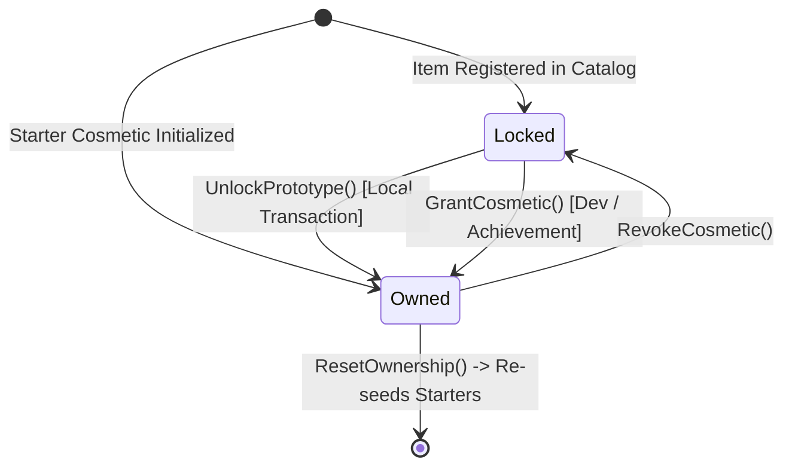

# Cosmetic Ownership System (Phase 26)

## 1. Overview & Architectural Boundaries

Wildbound implements a local prototype ownership tracking architecture:
- **Local Authoritative State**: Managed by `CosmeticsOwnershipManager` (`src/cosmetics/CosmeticsOwnershipManager.hpp/.cpp`).
- **Persistence Path**: `user_data/cosmetics/cosmetic_ownership.json`.
- **Prototype Mode**: Simulates item purchasing, unlocks, grants, and revocations locally without backend server dependencies or real-currency transactions.

---

## 2. Ownership Record Structure

Each record is represented by `CosmeticOwnershipRecord`:

| Field | Type | Description |
|---|---|---|
| `cosmeticId` | `std::string` | Unique identifier matching catalogue item ID. |
| `state` | `OwnershipState` | `Owned` (1) or `Locked` (0). |
| `acquisitionSource` | `std::string` | `"starter"`, `"prototype_unlock"`, `"quest_reward"`, `"dev_grant"`. |
| `acquisitionDate` | `std::string` | Timestamp in `YYYY-MM-DD HH:MM:SS` format. |
| `selectedVariantId` | `std::string` | Active color variant ID (defaults to `"variant_default"`). |

---

## 3. Starter Equipment Defaults

On initial initialization or after an ownership reset, the following starter items are automatically granted as `Owned`:
1. **Skin Variants**: `cosmetic_skin_default`, `cosmetic_skin_pale`, `cosmetic_skin_tan`, `cosmetic_skin_dark`
2. **Base Hairstyles**: `cosmetic_hair_short`, `cosmetic_hair_medium`, `cosmetic_hair_long`
3. **Starter Clothing**: `cosmetic_tunic_adventurer`
4. **Starter Pants**: `cosmetic_pants_leather`
5. **Starter Footwear**: `cosmetic_boots_leather`

All other 88+ cosmetics default to `Locked`.

---

## 4. Ownership Enforcement Rules

1. **Equip Guard**:
   `CharacterCustomizationManager::EquipCosmetic(id)` queries `m_ownershipMgr->IsOwned(id)`. If `false`, the operation is aborted and logged.
2. **Preview Exception**:
   `AppearancePreview` allows live visualization of **both owned and locked** cosmetics so players can inspect them before unlocking.
3. **Loadout Validation**:
   When loading a saved loadout (`LoadLoadout`), any slots referencing unowned cosmetics are safely cleared/defaulted rather than granting unearned ownership.

