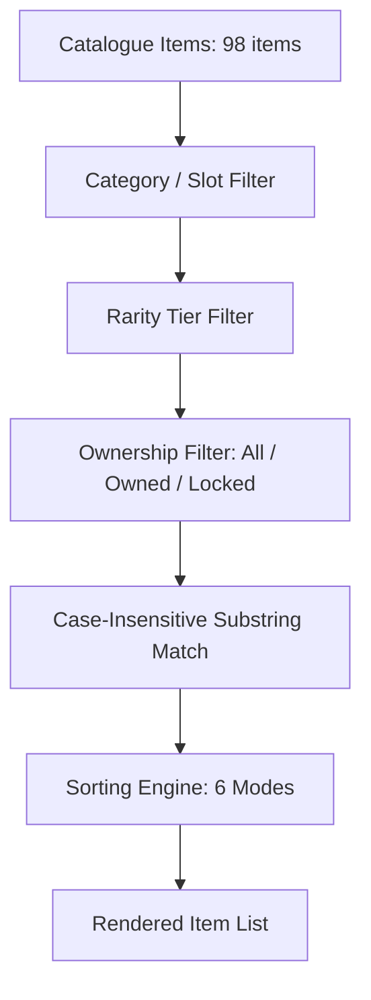

# Cosmetic Search & Filtering Specification (Phase 26)

## 1. Filter Architecture

The filtering engine (`src/cosmetics/CosmeticsSearchFilter.hpp/.cpp`) applies multi-axis criteria across cosmetic catalogue collections.

---

## 2. Multi-Criteria Specification

### 2.1 Category Matching
- `all`: Matches every item.
- `featured`: Matches items with rarity $\ge \text{Epic}$ (Epic, Legendary, Mythic).
- `special`: Matches items with rarity $\ge \text{Legendary}$.
- `hair` / `hairstyles`: Matches items with `slot == Hair` or category containing "hair".
- `clothing`: Matches chest items where `!isGameplayEquipment`.
- `armor`: Matches chest items where `isGameplayEquipment == true` or category is "armor".
- `headwear`: Matches `Headwear` or `Helmet` slots.
- `face`: Matches `Face` slot, goggles, masks.
- `backpacks`: Matches `Back` slot, packs, quivers.
- `footwear`: Matches `Feet` slot, boots, shoes.
- `legs`: Matches `Legs` slot, pants.

### 2.2 Rarity Matching
Matches exact `StringToRarity(item.rarity) == *criteria.rarity`.

### 2.3 Ownership Filtering
- `OwnershipFilter::All`: Shows both owned and locked items.
- `OwnershipFilter::OwnedOnly`: Strictly filters `ownershipMgr.IsOwned(item.id) == true`.
- `OwnershipFilter::LockedOnly`: Strictly filters `ownershipMgr.IsOwned(item.id) == false`.

### 2.4 Text Search Matching
Performs case-insensitive substring search across:
- Item Display Name (`displayName`)
- Item Description (`description`)
- Item ID (`id`)
- Item Category (`category`)
- Item Rarity (`rarity`)

---

## 3. Sorting Algorithms

1. **`AlphabeticalAsc`**: Lexicographical ascending by `displayName`.
2. **`AlphabeticalDesc`**: Lexicographical descending by `displayName`.
3. **`RarityAsc`**: Ascending sort priority ($Common \to Mythic$), fallback to alphabetical.
4. **`RarityDesc`**: Descending sort priority ($Mythic \to Common$), fallback to alphabetical.
5. **`OwnedFirst`**: Owned items first; tie-broken by Rarity Descending, then Alphabetical.
6. **`LockedFirst`**: Locked items first; tie-broken by Rarity Descending, then Alphabetical.

