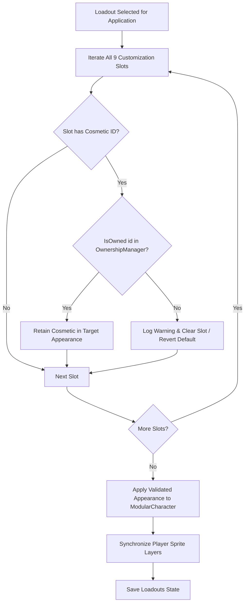

# Loadout Integration Specification (Phase 26)

## 1. Overview & Ownership Safeguards

Phase 25 introduced visual character appearance loadouts (`AppearanceLoadout`, `AppearanceSerializer`).
In Phase 26, loadouts are tightly coupled with the `CosmeticsOwnershipManager` to prevent security and progression exploits:

> **Core Invariant**: Loading a saved loadout **must never** equip or grant unowned cosmetics to a player character.

---

## 2. Validation Algorithm

When a loadout is loaded via `CharacterCustomizationManager::LoadLoadout` or `CosmeticsStoreManager::ApplyLoadoutValidated`:

---

## 3. Operations & API Reference

### 3.1 `ApplyLoadoutValidated(size_t loadoutIndex)`
- Validates each cosmetic slot in the loadout against `CosmeticsOwnershipManager::IsOwned`.
- If an unowned cosmetic is found:
  - Generates warning log: `[WARNING] [COSMETICS_STORE] Loadout contains unowned cosmetic <id> in slot <slot>. Resetting slot to default.`
  - Clears or defaults the unowned slot.
- Retains all valid owned items.
- Synchronizes player appearance and triggers audio event `cosmetics.loadout.apply`.

### 3.2 Loadout Drawer in UI
- Accessible via the `Loadouts` category tab in Wardrobe.
- Displays up to 5 custom named loadout presets.
- Each preset displays:
  - Preset name
  - `[LOAD]`: Loads validated appearance.
  - `[SAVE]`: Overwrites preset with current player appearance.
  - `[COPY]`: Duplicates preset.
  - `[DEL]`: Removes preset.
  - `[+ CREATE NEW LOADOUT]`: Adds a new custom preset if under maximum capacity.

