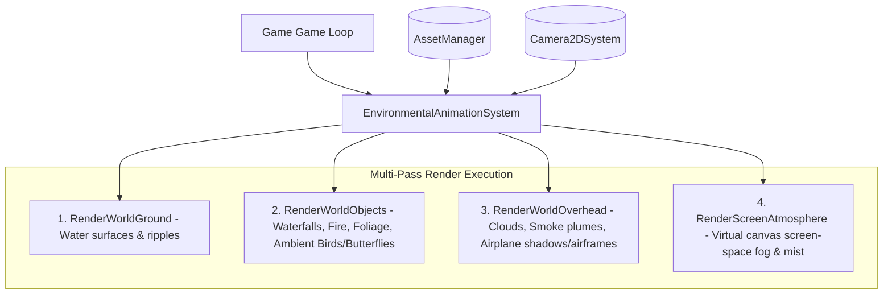

# WILDBOUND — ENVIRONMENTAL ANIMATION ARCHITECTURE

## 1. System Overview

The **Environmental Animation System** (`wildbound::world::environment::EnvironmentalAnimationSystem`) provides a unified, high-performance C++20 subsystem that governs dynamic, living-world behaviors across Wildbound's fantasy environment.

The system is decoupled from core character movement, combat, and physics logic while seamlessly integrating with:
- **Renderer (`Renderer.hpp`)**: Multi-pass rendering across Ground, Object, Overhead, and UI virtual canvas spaces.
- **Camera2DSystem (`Camera2D.hpp`)**: Viewport-aware culling, camera tracking, and coordinate space transformations.
- **AssetManager (`AssetManager.hpp`)**: On-demand spritesheet retrieval, texture binding, and animation clip registration.
- **World & Tilemap (`World.hpp`, `Tilemap.hpp`)**: Map bounds constraints and spawn anchor points.

---

## 2. The Four Environmental Categories

The subsystem organizes all environmental movement into four distinct categories:

### Category A: Animated Environmental Objects
Cyclical, procedural, or timeline-driven spritesheets that bring natural and constructed world objects to life:
- **Water**: 5 water animations including calm ponds, flowing rivers, specular lake surfaces, rapid foam currents, and droplet ripples.
- **Waterfalls**: 3 vertical multi-frame cascade animations (Small 32x48, Medium 48x64, Large 64x80) featuring translucent flow channels and foaming splash bases.
- **Fire**: 3 thermal illumination spritesheets (Torch, Campfire, Bonfire) with dancing tongues of flame and dynamic ember sparks.
- **Grass**: 4 sinusoidal wind-sway grass variations (Small, Tall wave, Dense turf, Flowering meadow).
- **Trees & Foliage**: 4 canopy and branch movement animations (Oak canopy breeze, Pine branch flex, Bush wind rustle, Falling woodland leaves).

### Category B: Ambient Entities
Non-combat, lightweight wandering wildlife that add natural life to biomes:
- **Small Birds (`small_bird`)**: Reuses Phase 9 wildlife artwork with flight flapping, gliding, perch rest, and bounded territory wandering.
- **Butterflies (`forest_butterfly`, `blue_butterfly`, `golden_butterfly`)**: High-frequency fluttering, hovering, and resting behavior with soft ground shadows.

### Category C: Atmospheric Effects
Multi-layered weather, cloud, fog, and smoke phenomena:
- **Overhead Clouds**: 5 distinct cloud sizes and cluster types drifting at independent velocities and altitudes.
- **Ground Mist & Fog**: Dynamic screen-space atmospheric fog layer with continuous horizontal drift and tunable opacity.
- **Smoke Plumes**: Wispy chimney exhaust, campfire thermal smoke, and dense smoldering ruin plumes.

### Category D: Scripted Environmental Events
World-scale atmospheric narrative events:
- **Recon Airplane Flyover (`airplane_recon_001`)**: Timed high-altitude aircraft flyover with spinning propeller animation, linear flight vector calculation, heading rotation, and an elevation-offset ground shadow.

---

## 3. Render Passes & Depth Hierarchy

| Render Pass | Target Space | Sorting / Elevation | Description |
|---|---|---|---|
| `RenderWorldGround` | World Space | Ground / Underlay ($Z=0$) | Water surfaces, river flows, pond ripples rendered beneath characters. |
| `RenderWorldObjects` | World Space | Depth-Sorted Object Layer ($Z=1$) | Waterfalls, campfires, torches, swaying foliage, birds, butterflies. |
| `RenderWorldOverhead` | World Space | Canopy / Sky ($Z=2$) | Smoke plumes, high-altitude drifting clouds, airplane flyovers and shadows. |
| `RenderScreenAtmosphere` | Canvas Space | UI Canvas Overlay | Screen-space mist and fog texture tiling with opacity modulation. |

---

## 4. Performance & Memory Profile

- **Zero Dynamic Allocation in Game Loop**: Object instances, ambient wanderers, and cloud buffers are pre-allocated or statically stored.
- **Direct DrawContext Integration**: Leverages `Renderer::DrawSprite` for batched rendering with point filtering at internal $640 \times 360$ resolution.
- **Camera Viewport Culling**: Objects outside visible camera bounds are skipped during update and draw passes.
- **Independent Time Dilation**: Global animation time scale (`SetGlobalPlaybackSpeed`) allows slow-motion or accelerated environmental simulation.

