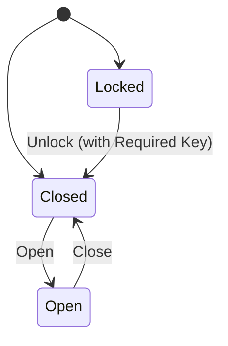

# Door and Building Interactions

## 1. Door Subsystem (`Door.hpp` / `Door.cpp`)

Doors represent physical barriers in the game world that can be toggled between states and optionally require specific keys to unlock.

### 1.1 State Machine



| State | Solid Collider Active? | Allowed Transitions |
| :--- | :--- | :--- |
| `Closed` | **Yes** (Blocks entities) | $\to$ `Open` |
| `Open` | **No** (Passable) | $\to$ `Closed` |
| `Locked` | **Yes** (Blocks entities) | $\to$ `Closed` (if key present in player inventory) |

### 1.2 Solid Collider Synchronization
When a door is closed or locked, its solid physical AABB collider is active in `CollisionManager`. When opened:
```cpp
if (collisionMgr && m_solidColliderId != 0) {
    collisionMgr->SetColliderEnabled(m_solidColliderId, false);
}
```
This instantly permits player, projectile, and enemy passage without removing the collider registration.

### 1.3 Key Requirements & Unlocking
If `m_requiredKeyId` is set, attempting to open a locked door checks `player.GetInventory().HasItem(m_requiredKeyId)`. If present, the door unlocks, transitions to `Closed` (or `Open`), and triggers `"Interact.KeyUnlock"`. If missing, `InteractionResult::MissingRequirement` is returned with prompt feedback `"Locked - Key Required!"`.

---

## 2. Building Subsystem (`BuildingManager`)

Buildings in Wildbound feature seamless transitions between outdoor exploration and detailed interior floorplans.

### 2.1 Entrance and Exit Flow
1. **Exterior Entrance**: Approaching a building doorway discovers an interactable with category `InteractionCategory::Building` and verb `"Enter"`.
2. **Transition**: Calling `BuildingManager::EnterBuilding` sets the interior map active, pans camera to interior bounds, and spawns the player at the entrance foyer.
3. **Interior Exit**: Inside, reaching the exit portal surfaces the prompt `"Exit"`, which returns the player to exterior coordinates and dispatches `"Environment.DoorOpen"`.

