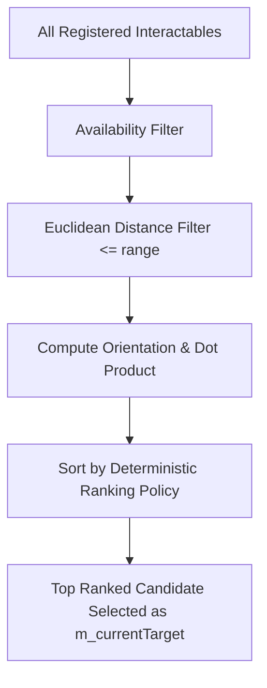

# Interaction Discovery and Candidate Selection

## 1. Overview

In dense game areas (e.g., a room containing a doorway, a treasure chest, multiple dropped loot items, and a wall lever), multiple interactables may fall within the player's proximity radius simultaneously. To prevent flickering, ambiguous selection, or order-dependent behavior, Wildbound implements a strict **Deterministic Candidate Selection Policy**.

---

## 2. Spatial Discovery Pipeline

During each frame of gameplay, `InteractionManager::UpdateDiscovery(playerPos, playerFacing)` executes the following pipeline:

### Step 1: Availability Filtering
An interactable is discarded immediately if:
* `!comp.CanInteract()` (`isAvailable == false` or `isExecuting == true`).
* `comp.definition.oneTimeOnly && comp.hasBeenExecuted`.
* `comp.currentCooldown > 0.0f`.

### Step 2: Distance Filtering
Calculates distance squared between the player position and interactable position:
$$\text{distSq} = (x_{\text{target}} - x_{\text{player}})^2 + (y_{\text{target}} - y_{\text{player}})^2$$
If $\text{distSq} > \text{range}^2$, candidate is discarded.

### Step 3: Directional Alignment (Dot Product)
Calculates normalized displacement vector $\vec{d}$:
$$\vec{d} = \frac{\vec{p}_{\text{target}} - \vec{p}_{\text{player}}}{\|\vec{p}_{\text{target}} - \vec{p}_{\text{player}}\|}$$
Computes the dot product with the player's facing unit vector $\vec{f}$:
$$\text{dot} = \vec{d} \cdot \vec{f}$$
A target with $\text{dot} > 0.15$ is classified as *in front* of the player; otherwise it is *behind/adjacent*.

---

## 3. Deterministic Ranking Policy

When sorting candidates, comparator `RankCandidate` evaluates criteria in strict hierarchical order:

1. **Definition Priority (`definition.priority`)**:
   Higher priority wins (e.g., doors and chests defaults to 20, dropped loot defaults to 10, generic environmental inspectables default to 5).
2. **Directional Facing**:
   An object directly in front of the player ($\text{dot} > 0.15$) strictly beats an object behind the player ($\text{dot} \le 0.15$), even if the rear object is slightly closer.
3. **Proximity Distance**:
   Closer objects win when priorities and facing classifications match.
4. **Stable Identifier Tie-Breaker (`InteractableId`)**:
   If priority, facing quadrant, and distance are identical, the candidate with lower numeric `InteractableId` wins. This guarantees zero frame-to-frame jitter.

