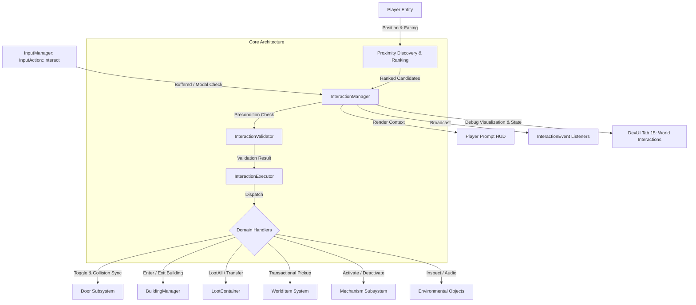

# Wildbound Interaction System Architecture

## 1. Executive Overview

The **World Interaction System** in Wildbound establishes a centralized, data-driven, and modular C++20 framework for discovering, validating, executing, and visualizing interactions between the player character and interactive entities in the game world.

Prior to Phase 22, interactions were fragmented or handled as ad-hoc checks within specific subsystems (e.g., proximity loot checks or entrance prompts). Phase 22 provides a unified abstraction where doors, buildings, containers, ground collectibles, mechanisms (levers, switches, pressure plates), and environmental objects all share a standard component representation, candidate discovery pipeline, precondition validator, deterministic tie-breaking policy, event notification bus, and player-facing prompt UI.



---

## 2. Architectural Pillars

1. **Centralized Coordinator (`InteractionManager`)**:
   Owns the lifecycle of registered interactables, synchronizes dynamic world objects (chests, ground items, building portals), coordinates spatial proximity discovery and ranking, queries input actions, and dispatches validated execution.
2. **Data-Driven Configuration (`InteractionDefinition`)**:
   All interactable behavior is driven by an immutable definition containing display name, action verb, range, priority, cooldown, key requirements, one-time execution flags, and associated audio event identifiers.
3. **Runtime Component (`InteractableComponent`)**:
   Lightweight POD structure maintaining runtime spatial coordinates, activation availability, execution lock flags, and individual cooldown timers.
4. **Deterministic Candidate Selection**:
   Guarantees reproducible target selection when multiple interactable objects overlap within the player's proximity radius.
5. **Precondition Validation (`InteractionValidator`)**:
   Separates prerequisite checking (range, line-of-sight, cooldown, key requirements, player state) from execution side effects, returning rich descriptive failure codes (`InteractionResult`).
6. **Domain Dispatcher (`InteractionExecutor`)**:
   Encapsulates domain-specific execution semantics for doors, buildings, containers, collectibles, and mechanisms without polluting the core loop.
7. **Observer Event Bus (`IInteractionObserver` / `InteractionEvent`)**:
   Decouples gameplay reactions (audio dispatching, quest tracking, animation triggers, telemetry) from core simulation logic.
8. **Context-Aware Modal Input Integration**:
   Directly integrates with Phase 21 `InputManager` and `InputContextManager`, ensuring interaction inputs are evaluated only during active gameplay and suppressed during menu or inventory modes.

---

## 3. Subsystem Directory Structure

```
src/interaction/
├── InteractionTypes.hpp         # Enums (InteractionCategory, InteractionResult, DoorState, MechanismType, etc.)
├── InteractionDefinition.hpp    # Data-driven interaction blueprint
├── InteractionContext.hpp       # Execution environment facade (Player, World, CollisionManager, etc.)
├── InteractableComponent.hpp    # Runtime state component
├── InteractionEvent.hpp         # Event payload and observer interface
├── InteractionPrompt.hpp        # In-world / HUD contextual prompt data
├── InteractionValidator.hpp/.cpp# Precondition validation logic
├── InteractionExecutor.hpp/.cpp # Domain-specific execution dispatcher
├── Door.hpp/.cpp                # Door state machine, key requirements, solid collider synchronization
├── Mechanism.hpp/.cpp           # Levers, switches, pressure plates, cooldowns, and callbacks
└── InteractionManager.hpp/.cpp  # Central interaction coordinator and world sync
```

---

## 4. Key Architectural Patterns

### 4.1 Dependency Injection via `InteractionContext`
To avoid rigid singletons or global state access, execution and validation rely on `InteractionContext`. This struct bundles non-owning pointers to all required subsystems:
* `Player* player`
* `World* world`
* `BuildingManager* buildingManager`
* `ItemManager* itemManager`
* `CollisionManager* collisionManager`
* `AudioSystem* audioSystem`
* `Camera2DSystem* camera`
* `AssetManager* assetManager`

### 4.2 Solid Collider Synchronization for Physical Obstacles
Interactive barriers like doors maintain physical presence in the world using `CollisionManager`. When closed, a solid static AABB collider is active on the `Interactable` or `Environment` layer. When opened, `CollisionManager::SetColliderEnabled(colliderId, false)` is invoked, instantaneously removing physical collision without expensive collider destruction or memory reallocation. Closing the door restores the collider.

### 4.3 Two-Phase Transactional Item Transfer
Ground collectible pickup and container looting strictly enforce two-phase transactional integrity:
1. Query `Inventory::AddItem` to verify available slot capacity or stack room.
2. Only if items are accepted does the ground object mark itself collected or decrement its quantity.
3. If inventory is full, zero items are transferred, the world item remains intact on the ground, and a clear `InteractionResult::Blocked` code is returned.

