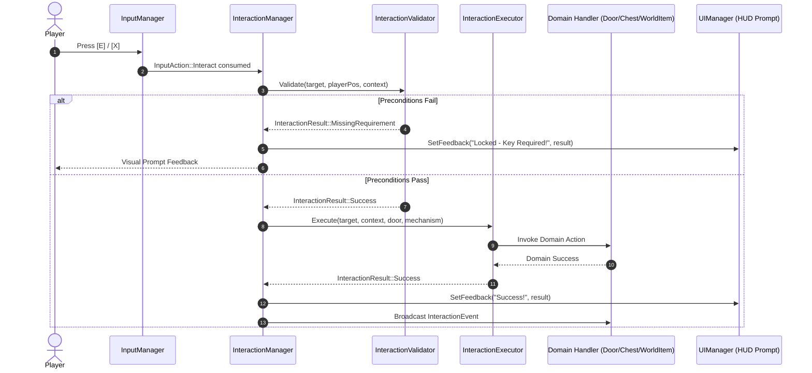

# Interaction Validation and Execution

## 1. Overview

Wildbound strictly decouples **precondition validation** from **action execution**. An interaction request is verified for eligibility before any gameplay state, inventory items, animation triggers, or audio events are modified.

---

## 2. Interaction Result Codes (`InteractionResult`)

The `InteractionResult` enumeration conveys the exact outcome of validation and execution:

| Result Code | Meaning | User Feedback String |
| :--- | :--- | :--- |
| `Success` | Action completed successfully | "Success!" |
| `OutOfRange` | Target moved or player retreated beyond radius | "Too far away." |
| `MissingRequirement` | Locked door or chest; player lacks required key | "Locked - Key Required!" |
| `CooldownActive` | Mechanism or interactable is on internal cooldown | "Please wait a moment." |
| `TargetUnavailable` | Target disabled, consumed, or marked unavailable | "Target unavailable." |
| `AlreadyExecuting` | Concurrency lock (e.g., already opening) | "Action in progress..." |
| `Blocked` | Blocked by gameplay rule (e.g., inventory full) | "Action blocked / Inventory full." |
| `InvalidTarget` | Dangling pointer or null target component | "Invalid target." |
| `Failed` | Subsystem execution returned false | "Action failed." |

---

## 3. Two-Stage Execution Pipeline

---

## 4. Execution Guarantees

1. **Reentrancy Protection**: `target->isExecuting = true` is asserted during `Execute()` and cleared upon completion.
2. **Deterministic State Commitment**: If an action fails partway through (e.g., inventory runs out of space during container transfer), already-transferred items remain with the player while untransferred items remain securely in the container.
3. **Audio Dispatching**: Audio events are dispatched through `AudioSystem` only upon confirmed success.

