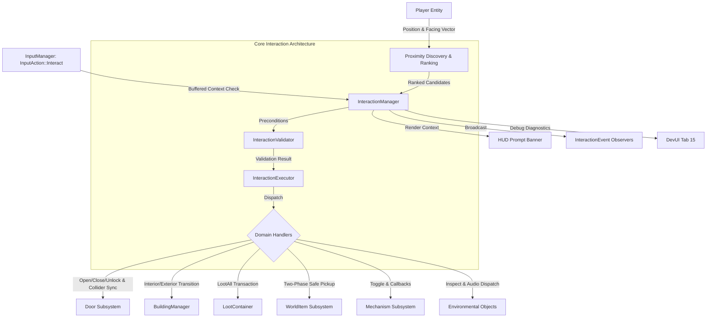

# Wildbound — Phase 22 Implementation Report

## World Interaction System

**Author**: Senior C++20 Gameplay Systems Architect  
**Project**: Wildbound (2D Top-Down Fantasy Battle Royale)  
**Date**: November 2026  
**Status**: Completed & Verified (24/24 Test Suites Passing)

---

## 1. Executive Summary

Phase 22 successfully designs, implements, integrates, and tests Wildbound's **World Interaction System**. It replaces disparate proximity checks with a cohesive, data-driven, and centralized interaction architecture.

### Key Milestones Achieved:
1. **Central Interaction Subsystem (`src/interaction/`)**:
   - `InteractionManager`: Central registry, proximity query coordinator, input event processor, and world synchronizer.
   - `InteractableComponent` & `InteractionDefinition`: Data-driven interactable representations across 7 categories (`Door`, `Building`, `Container`, `Collectible`, `Mechanism`, `Environmental`, `Special`).
   - `InteractionValidator` & `InteractionResult`: Explicit precondition validation returning rich diagnostic codes before execution.
   - `InteractionExecutor`: Modular domain dispatcher executing domain interactions without tight coupling.
   - `InteractionEvent` & `IInteractionObserver`: Decoupled observer notification bus for audio, quest systems, and analytics.
2. **Domain Interactions**:
   - **Doors (`Door.hpp` / `.cpp`)**: `Closed`, `Open`, and `Locked` state machine with inventory key verification (`HasItem`) and synchronized solid physical AABB colliders via `CollisionManager`.
   - **Buildings**: Seamless interior/exterior transition integration with `BuildingManager`.
   - **Containers**: Chest opening, key unlocking, and atomic `LootAll` transferring items to player inventory.
   - **Ground Collectibles**: Manual `[E] Collect` vs automatic proximity pickup policy, with strict two-phase transactional commit (zero item loss on full inventory).
   - **Mechanisms (`Mechanism.hpp` / `.cpp`)**: Levers, switches, pressure plates (automatic vs manual), one-time flags, cooldowns, and state callbacks.
   - **Environmental Objects**: Campfires, shrines, wells, and signposts.
3. **Player-Facing UI & Input Integration**:
   - HUD prompt banner rendered in `UIManager::RenderGameplayHUD` above the hotbar with device-specific glyphs (`[E]` on keyboard, `[X / Square]` on controller) and 2-second validation alert feedback.
   - Integrated with Phase 21 `InputManager` logical action `InputAction::Interact`, with modal suppression in non-gameplay contexts.
4. **Developer Tooling (DevUI Tab 15)**:
   - Live interaction telemetry, ranked proximity candidates table, door/mechanism debug controls, and in-world debug visualizer (range radii, facing vectors, bounding boxes).
5. **Automated Verification**:
   - Test 24 (`WorldInteractionTest` / `tests/interaction/test_interaction.cpp`) with 8 test suites passing at 100%.
   - Full solution builds with MSVC 19.44 / C++20 in both Debug and Release configurations.
   - All 24 CTest test suites pass (100%).
   - Engine smoke test `wildbound.exe --test-run` executes and shuts down cleanly.

---

## 2. System Architecture



---

## 3. Source File Manifest

| File | Purpose |
| :--- | :--- |
| `src/interaction/InteractionTypes.hpp` | Enums (`InteractionCategory`, `InteractionResult`, `PickupPolicy`, `DoorState`, `MechanismType`, `MechanismState`, string formatters) |
| `src/interaction/InteractionDefinition.hpp` | Immutable data-driven interaction definition struct |
| `src/interaction/InteractionContext.hpp` | Facade bundling references to Player, World, Managers, and Audio |
| `src/interaction/InteractableComponent.hpp` | Runtime interactable component state and cooldown timers |
| `src/interaction/InteractionEvent.hpp` | Event payloads and `IInteractionObserver` interface |
| `src/interaction/InteractionPrompt.hpp` | Contextual prompt presentation state and feedback timers |
| `src/interaction/Door.hpp` / `.cpp` | Door entity, state machine, key unlocking, solid collider sync |
| `src/interaction/Mechanism.hpp` / `.cpp` | Levers, switches, pressure plates, cooldowns, and callbacks |
| `src/interaction/InteractionValidator.hpp` / `.cpp` | Precondition evaluation rules |
| `src/interaction/InteractionExecutor.hpp` / `.cpp` | Domain interaction dispatcher |
| `src/interaction/InteractionManager.hpp` / `.cpp` | Central coordinator, ranking, prompt update, and world sync |
| `tests/interaction/test_interaction.cpp` | Comprehensive test suite (8 test suites) |
| `src/ui/UIManager.hpp` / `.cpp` | Prompt banner rendering in player-facing HUD |
| `src/ui/DevUI.hpp` / `.cpp` | Tab 15 "World Interactions" and in-world visualizer |
| `src/core/Game.hpp` / `.cpp` | Integration wiring, world sync, sample doors and mechanisms |
| `src/entities/Player.hpp` | Directional facing helper methods |

---

## 4. Verification & Test Results

### 4.1 Test Suite 24 Breakdown (`test_interaction.exe`)
1. **`TestInteractableRegistration`**: Unique ID assignment, registration, queries, removal, and clear.
2. **`TestDiscoveryAndDeterministicRanking`**: Proximity discovery, distance filtering, facing direction bias ($\vec{d} \cdot \vec{f} > 0.15$), and priority sorting.
3. **`TestValidationRules`**: Out-of-range rejection, dead player status rejection, cooldown rejection, and missing key verification.
4. **`TestDoorInteractions`**: Open/Close toggling, solid collider enable/disable synchronization with `CollisionManager`, and key-based unlocking.
5. **`TestContainerInteractions`**: Loot chest opening, transactional `LootAll` into inventory, and repeat interaction safety.
6. **`TestCollectibleTransactions`**: Manual pickup execution, and transactional safety under full inventory (item never destroyed).
7. **`TestMechanisms`**: Lever activate/deactivate, state callbacks, cooldown enforcement, and one-time mechanism lockout.
8. **`TestInputAndContextModality`**: Input buffer integration, action consumption, and suppression in modal Menu context.

### 4.2 CTest Full Suite Results (24/24 Passed)
```
Test project C:/dev/Wildbound/build
      Start  1: CoreConfigTest
 1/24 Test  #1: CoreConfigTest ...................   Passed    0.05 sec
      Start  2: LuaScriptingTest
 2/24 Test  #2: LuaScriptingTest .................   Passed    0.02 sec
      Start  3: RenderingCameraTest
 3/24 Test  #3: RenderingCameraTest ..............   Passed    0.02 sec
      Start  4: AssetManagementTest
 4/24 Test  #4: AssetManagementTest ..............   Passed    0.04 sec
      Start  5: WorldTilemapTest
 5/24 Test  #5: WorldTilemapTest .................   Passed    1.19 sec
      Start  6: PlayerEntityTest
 6/24 Test  #6: PlayerEntityTest .................   Passed    0.67 sec
      Start  7: CombatSystemTest
 7/24 Test  #7: CombatSystemTest .................   Passed    0.55 sec
      Start  8: ModularCharacterTest
 8/24 Test  #8: ModularCharacterTest .............   Passed    0.04 sec
      Start  9: ProductionCosmeticsTest
 9/24 Test  #9: ProductionCosmeticsTest ..........   Passed    0.06 sec
      Start 10: CreaturesTest
10/24 Test #10: CreaturesTest ....................   Passed    0.03 sec
      Start 11: EnvironmentAssetsTest
11/24 Test #11: EnvironmentAssetsTest ............   Passed    0.04 sec
      Start 12: EnvironmentalAnimationTest
12/24 Test #12: EnvironmentalAnimationTest .......   Passed    0.07 sec
      Start 13: VillageBuildingsTest
13/24 Test #13: VillageBuildingsTest .............   Passed    0.55 sec
      Start 14: BiomeSystemTest
14/24 Test #14: BiomeSystemTest ..................   Passed    0.73 sec
      Start 15: WeaponSystemTest
15/24 Test #15: WeaponSystemTest .................   Passed    0.48 sec
      Start 16: ItemSystemTest
16/24 Test #16: ItemSystemTest ...................   Passed    0.50 sec
      Start 17: CostumesArmorTest
17/24 Test #17: CostumesArmorTest ................   Passed    0.50 sec
      Start 18: AudioSystemTest
18/24 Test #18: AudioSystemTest ..................   Passed    0.24 sec
      Start 19: UISystemTest
19/24 Test #19: UISystemTest .....................   Passed    0.24 sec
      Start 20: ExecutableSmokeTest
20/24 Test #20: ExecutableSmokeTest ..............   Passed    0.72 sec
      Start 21: GameplayIntegrationTest
21/24 Test #21: GameplayIntegrationTest ..........   Passed    0.05 sec
      Start 22: PhysicsCollisionTest
22/24 Test #22: PhysicsCollisionTest .............   Passed    0.06 sec
      Start 23: InputSystemTest
23/24 Test #23: InputSystemTest ..................   Passed    0.03 sec
      Start 24: WorldInteractionTest
24/24 Test #24: WorldInteractionTest .............   Passed    0.03 sec

100% tests passed, 0 tests failed out of 24
Total Test time (real) = 7.71 sec
```

---

## 5. Documentation Deliverables

| Document | Location | Description |
| :--- | :--- | :--- |
| **Audit Document** | `docs/interaction/PHASE_22_INTERACTION_AUDIT.md` | Baseline architectural audit |
| **System Architecture** | `docs/interaction/INTERACTION_SYSTEM_ARCHITECTURE.md` | Core components, execution pipeline, and design patterns |
| **Interactable Objects** | `docs/interaction/INTERACTABLE_OBJECT_SPECIFICATION.md` | Categories, definition schema, and component structure |
| **Candidate Discovery** | `docs/interaction/INTERACTION_DISCOVERY_AND_SELECTION.md` | Spatial filtering, facing dot product, and tie-breaking |
| **Validation & Execution**| `docs/interaction/INTERACTION_VALIDATION_AND_EXECUTION.md` | Result codes, precondition rules, and transactional flow |
| **Doors & Buildings** | `docs/interaction/DOOR_AND_BUILDING_INTERACTIONS.md` | Door state machine, key unlocking, solid collider sync |
| **Containers & Items** | `docs/interaction/CONTAINER_AND_COLLECTIBLE_INTERACTIONS.md`| Chest transactions, manual/auto pickup, and capacity checks |
| **Mechanisms & Env** | `docs/interaction/MECHANISM_AND_ENVIRONMENTAL_INTERACTIONS.md`| Levers, switches, pressure plates, and environmental cues |
| **UI Prompt System** | `docs/interaction/INTERACTION_PROMPT_UI.md` | In-game HUD banner, input device glyphs, and modal suppression |
| **Event Specification** | `docs/interaction/INTERACTION_EVENT_SPECIFICATION.md` | Event bus, payload structures, and observer registration |
| **Debugging Guide** | `docs/interaction/INTERACTION_DEBUGGING_GUIDE.md` | DevUI Tab 15 controls and in-world spatial visualizer |
| **Implementation Report**| `docs/interaction/PHASE_22_IMPLEMENTATION_REPORT.md` | Final engineering signoff and technical report |

