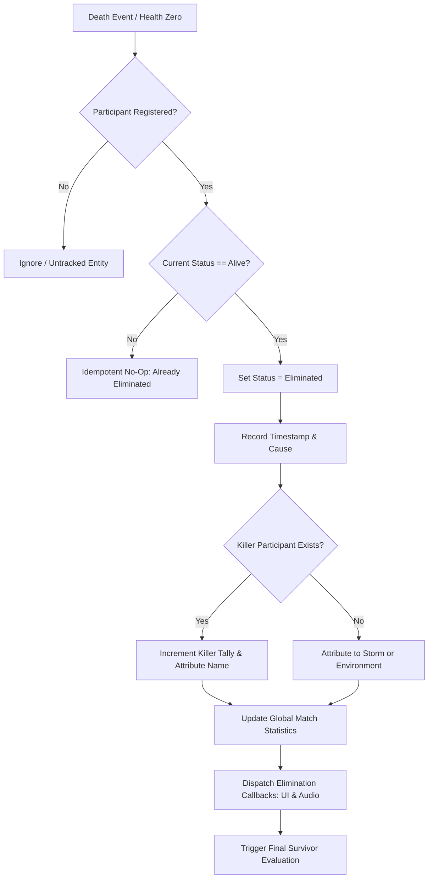

# Match Elimination System Specification

## 1. Authoritative Elimination Pipeline

Player eliminations are processed strictly through `wildbound::match::MatchEliminationSystem`:



---

## 2. Elimination Causes

The system supports 5 explicit causes defined in `EliminationCause`:
- `Combat`: Damage applied by weapons, projectiles, or abilities from another competitor.
- `CorruptionStorm`: Entity perished while outside the safe zone boundary due to cumulative corruption damage.
- `Environment`: Hazard or fall damage outside direct competitor combat.
- `Disconnect`: Participant dropped session or conceded.
- `Unknown`: Fallback state when attribution cannot be verified.

---

## 3. Idempotency & Repeat Event Protection

In high-frequency combat loops with damage-over-time ticks, duplicate death notifications may occur within the same frame.
The elimination pipeline checks:
```cpp
if (victim->status == ParticipantStatus::Eliminated) {
    return false;
}
```
This guarantees that victim statistics, killer kill counts, match survivor counts, and leaderboard records are never duplicated.

