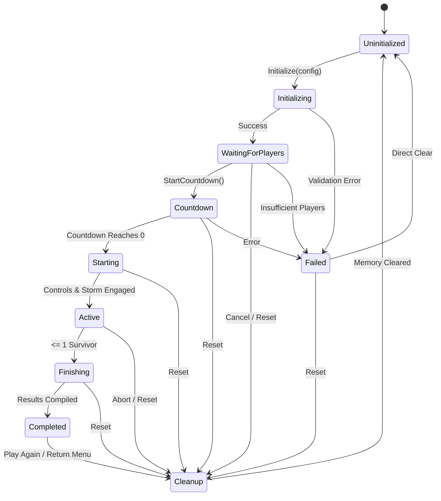

# Match State Machine Specification

## 1. Formal State Definitions

Wildbound defines 10 explicit match lifecycle states in `wildbound::match::MatchState`:

| State | Name | Functional Purpose |
|---|---|---|
| 0 | `Uninitialized` | Standby idle state; no match is instantiated. |
| 1 | `Initializing` | Reading configuration, loading world definitions, verifying bounds. |
| 2 | `WaitingForPlayers` | Competitor registration phase; minimum participant count checked. |
| 3 | `Countdown` | Pre-match countdown timer active; player actions & combat locked. |
| 4 | `Starting` | Final transition phase; setting up storm & uninhibiting controls. |
| 5 | `Active` | Core gameplay active; combat, movement, looting, storm progression. |
| 6 | `Finishing` | Final survivor or draw condition evaluated; computing placements. |
| 7 | `Completed` | Post-match state; results screen displayed with statistics. |
| 8 | `Cleanup` | Releasing match-owned objects, resetting timers & registries. |
| 9 | `Failed` | Unrecoverable error during initialization or participant validation. |

---

## 2. Transition Graph

---

## 3. Transition Rules & Invariants

1. **Self-Transitions**: All self-transitions (`state -> state`) are strictly rejected.
2. **Deterministic Preconditions**:
   - `WaitingForPlayers -> Countdown` requires $\text{Count} \ge \text{minimumParticipants}$ (unless explicit developer bypass flag is set).
   - `Countdown -> Starting` can only fire when `m_timeRemaining == 0.0f`.
   - `Starting -> Active` immediately sets `IsGameplayAllowed() == true` and fires `StormManager::StartStorm()`.
3. **Idempotence**:
   - `CompleteMatch()` will execute exactly once, transitioning `Active -> Finishing -> Completed`.
   - `ResetMatch()` safely transitions through `Cleanup` to `Uninitialized` regardless of starting state.

