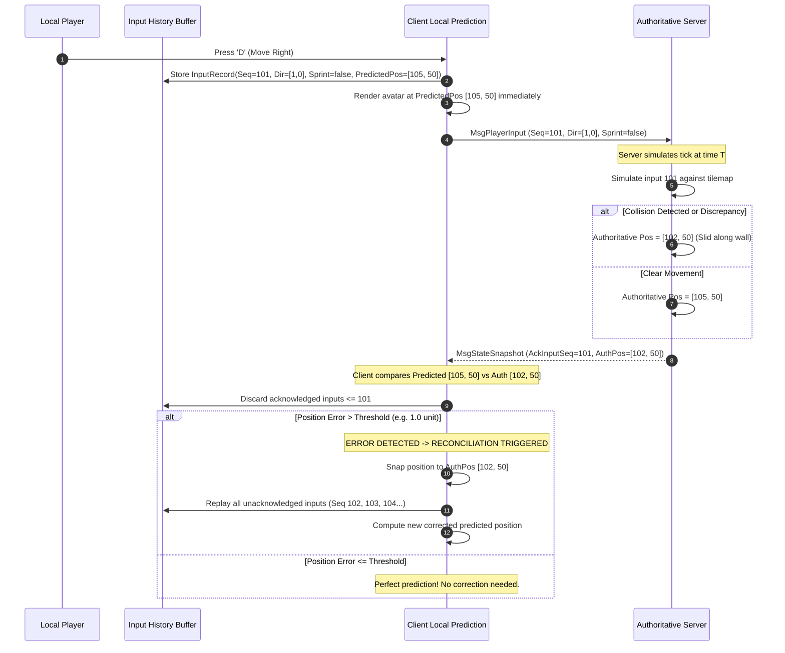

# WILDBOUND — CLIENT PREDICTION & SERVER RECONCILIATION
## Speculative Local Movement, Input History Ring Buffers, and Error Correction

**Document ID:** `WB-NET-009`  
**Phase:** 35 — Multiplayer Architecture & Server Authority Design  
**Author:** Wildbound Engine Architecture Team  
**Date:** 2026-11-07  
**Status:** Approved / Authoritative  

---

### 1. The Need for Client Prediction

In an authoritative architecture, if a client had to wait for the server to acknowledge an input before moving the player avatar on screen, the player would feel an input latency equal to their full Round Trip Time (RTT). Under typical network conditions ($50\text{ ms} - 100\text{ ms}$ ping), this would make character movement feel sluggish and unresponsive.

To provide immediate, zero-latency feedback, Wildbound implements **Client-Side Movement Prediction** coupled with **Server Reconciliation**.

> [!IMPORTANT]
> **Scope Restriction**: Prediction is applied **exclusively to local player movement**. Combat hits, health changes, loot pickups, door toggles, and storm damage are **never predicted** to avoid confusing visual rollbacks and anti-cheat loopholes.

---

### 2. Prediction & Reconciliation Cycle



---

### 3. Data Structures

#### Input Command Record
```cpp
namespace wildbound::network {

struct PlayerInputCommand {
    uint32_t sequenceNumber{ 0 };     // Incremental sequence ID
    uint64_t clientTimestampMs{ 0 };  // Local time when input was sampled
    Vector2 movementDirection{ 0.0f, 0.0f }; // Normalized WASD vector
    float facingAngle{ 0.0f };        // Radians [0, 2*PI)
    bool isSprinting{ false };        // Running modifier
    bool attackRequested{ false };    // Primary attack trigger
    bool interactRequested{ false };  // Interact trigger
};

struct PredictionRecord {
    uint32_t sequenceNumber{ 0 };
    PlayerInputCommand input;
    Vector2 predictedPosition{ 0.0f, 0.0f };
    Vector2 predictedVelocity{ 0.0f, 0.0f };
};

} // namespace wildbound::network
```

#### Client Prediction Buffer
The client maintains a circular ring buffer storing the last 128 inputs (approx. 2.1 seconds of history at 60 Hz). When the server acknowledges input $N$, all entries $\le N$ are discarded.

---

### 4. Reconciliation Algorithm

When a new server snapshot arrives:

```cpp
void ClientPredictionSystem::Reconcile(uint32_t ackSeq, Vector2 authoritativePos) {
    // 1. Locate the prediction record corresponding to the acknowledged sequence
    auto it = std::find_if(m_historyBuffer.begin(), m_historyBuffer.end(),
        [ackSeq](const PredictionRecord& rec) { return rec.sequenceNumber == ackSeq; });

    if (it == m_historyBuffer.end()) {
        // Ack is older than our buffer; snap directly
        m_localPlayer->SetPosition(authoritativePos);
        return;
    }

    // 2. Measure prediction divergence error
    float errorDistance = Vector2Distance(it->predictedPosition, authoritativePos);
    constexpr float RECONCILIATION_TOLERANCE = 1.0f; // 1 pixel / world unit

    if (errorDistance > RECONCILIATION_TOLERANCE) {
        // 3. Rollback: Snap current simulation position to authoritative coordinate
        Vector2 replayedPos = authoritativePos;

        // 4. Replay all subsequent unacknowledged inputs forward in time
        for (auto replayIt = it + 1; replayIt != m_historyBuffer.end(); ++replayIt) {
            replayedPos = SimulateMovement(replayedPos, replayIt->input);
            replayIt->predictedPosition = replayedPos;
        }

        // 5. Update local player presentation position
        m_localPlayer->SetPosition(replayedPos);
        m_reconciliationCount++;
    }

    // 6. Prune acknowledged history from buffer
    m_historyBuffer.erase(m_historyBuffer.begin(), it + 1);
}
```

---

### 5. Existing Movement Architecture Audit & Refactoring Needs

The audit of `src/entities/CharacterController.cpp` and `src/entities/Player.cpp` confirmed:
- `CharacterController::SetManualOverride(true)` allows bypassing hardware keyboard polling.
- `Player::ResolveMovement(Vector2 delta, const world::World& world)` executes swept AABB tilemap collision resolution without window or rendering calls.
- **Refactoring Need**: In Phase 36, `Player::ResolveMovement` must be extracted into a pure, static physics helper:
  ```cpp
  Vector2 PhysicsSystem::ResolveSweptAABB(Vector2 startPos, Vector2 delta,
                                          Vector2 boxSize, const world::World& world);
  ```
  This allows both the server simulation loop and the client prediction loop to execute the identical mathematical collision function with zero divergence.

