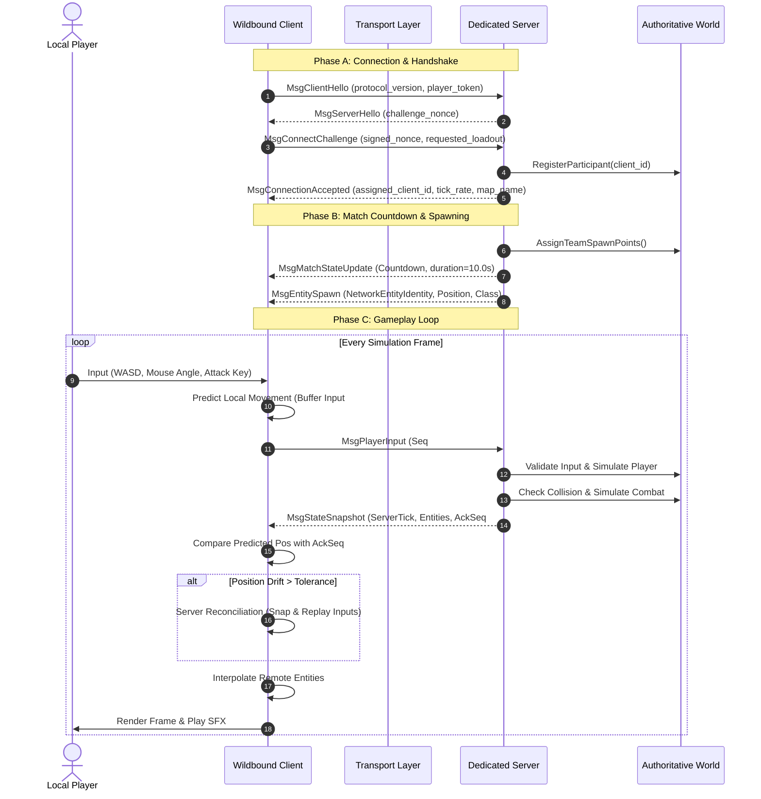

# WILDBOUND — CLIENT-SERVER ARCHITECTURE SPECIFICATION
## Authoritative Dedicated Server & Thin Presentation Client Contracts

**Document ID:** `WB-NET-003`  
**Phase:** 35 — Multiplayer Architecture & Server Authority Design  
**Author:** Wildbound Engine Architecture Team  
**Date:** 2026-11-07  
**Status:** Approved / Authoritative  

---

### 1. Architectural Model

Wildbound implements a strict **Client-Server Architecture** utilizing a headless dedicated server executable. The listen-server (host-and-play) model is explicitly rejected for competitive modes due to host advantage and security vulnerabilities.

---

### 2. Dedicated Server Subsystems

The dedicated server contains zero rendering, audio, or local window dependencies. Its subsystems include:

1. **`ServerApplication`**: Headless entry point managing command-line flags (`--port`, `--map`, `--max-players`, `--tick-rate`).
2. **`NetworkServer`**: Manages client connection slots, validates incoming packet headers, handles disconnection timeouts.
3. **`AuthoritativeWorld`**: Headless instance of `world::World` loading tile layers and collision metadata without textures.
4. **`AuthoritativeCombatSystem`**: Evaluates attack hitboxes, calculates critical strikes and armor reduction, and issues authoritative damage events.
5. **`AuthoritativeStormManager`**: Advances storm phases, contracts safe-zone circles, and applies outside-zone health attrition.
6. **`ReplicationManager`**: Tracks network entities, dirty component bitmasks, and packs delta snapshots filtered by interest management.

---

### 3. Client Subsystems

The client manages user interaction, rendering, and speculative presentation:

1. **`NetworkClient`**: Maintains connection state with the server, sends heartbeats, serializes input commands.
2. **`ClientPredictionSystem`**: Executes local movement forward in time, caching historical `(Tick, Input, Position)` tuples in a circular ring buffer.
3. **`RemoteEntityInterpolator`**: Buffers incoming entity snapshots (typically 100 ms buffer) and linearly/spherically interpolates remote positions and orientations to guarantee smooth motion regardless of jitter.
4. **`PresentationBridge`**: Feeds replicated health, ammo, and inventory states into `HUDManager`, `UIManager`, and `AudioSystem`.

---

### 4. Client State vs. Server State Separation

To prevent architectural bleeding, state is strictly classified:

| State Type | Location | Authoritative? | Replicated? | Persistence |
|---|---|---|---|---|
| **Raw Hardware Input** | Client only | No | No (sent as logical actions) | Frame only |
| **Predicted Position** | Client only | No (speculative) | No | Overwritten on reconciliation |
| **Authoritative Transform** | Server | **Yes** | Yes (to interested clients) | Duration of entity life |
| **Health & Armor** | Server | **Yes** | Yes (broadcast or owner) | Duration of match |
| **Inventory Contents** | Server | **Yes** | Yes (owner client only) | Match duration |
| **Ground Loot Table** | Server | **Yes** | Yes (nearby clients) | Dynamic until picked up |
| **Storm Radius & Center** | Server | **Yes** | Yes (broadcast to all) | Match duration |
| **Camera Zoom & Pan** | Client only | No | No | Local session |
| **Audio Playback Buffers** | Client only | No | No | Disposable |

---

### 5. Architectural Guardrails

- The client **never** updates an entity's health directly.
- The client **never** removes an item from a chest directly.
- The server **never** reads Windows virtual key codes.
- The server **never** attempts to allocate raylib `Texture2D` or `Sound` objects.

