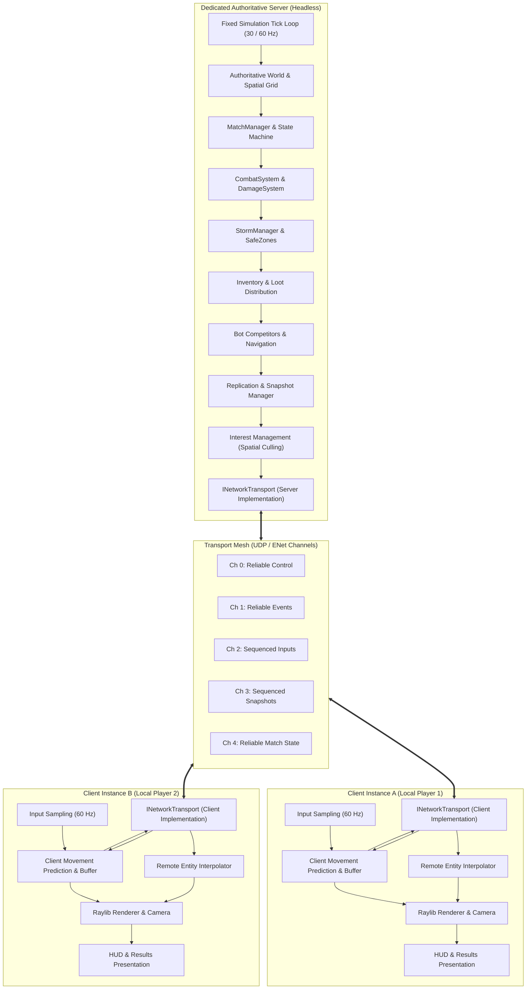

# WILDBOUND — MULTIPLAYER ARCHITECTURE SPECIFICATION
## High-Level Distributed Architecture for Top-Down Battle Royale

**Document ID:** `WB-NET-002`  
**Phase:** 35 — Multiplayer Architecture & Server Authority Design  
**Author:** Wildbound Engine Architecture Team  
**Date:** 2026-11-07  
**Status:** Approved / Authoritative  

---

### 1. Architectural Philosophy

Wildbound is a competitive, high-stakes 2D Battle Royale game. In any competitive survival game, client trust is an immediate attack surface for exploits (teleportation, speed hacking, god mode, infinite ammo, item spawning). Therefore, Wildbound adheres strictly to the **Authoritative Dedicated Server** model.

#### Core Tenets
1. **Dumb Client, Smart Server**: The client is primarily a rendering and audio presentation terminal with local input sampling and responsive client-side movement prediction.
2. **Zero Client Authority Over Game Rules**: Clients are never permitted to declare game-altering outcomes (e.g. "I shot Player B for 40 damage" or "I picked up item X"). The client transmits *intent* ("I request an attack at angle theta"), and the server validates and simulates the outcome.
3. **Transport Independence**: The gameplay simulation never calls third-party network libraries (like ENet) directly. All networking flows through abstract transport and message dispatching interfaces.
4. **Predictive Local Responsiveness**: Local movement uses client-side prediction and server reconciliation so players experience zero perceptible input lag under reasonable network latency (<= 100 ms).
5. **Bandwidth & CPU Scalability**: Network interest management (spatial grid culling) ensures clients only receive replicated snapshots for entities in their tactical vicinity.

---

### 2. System Topology



---

### 3. Layered Network Architecture

The multiplayer software stack is structured into five distinct, decoupled layers:

```text
+--------------------------------------------------------------------------+
| Layer 5: Gameplay & Simulation Presentation (Game, Player, HUD, Audio)   |
+--------------------------------------------------------------------------+
| Layer 4: Replication & State Synchronization (ReplicationManager, Snaps) |
+--------------------------------------------------------------------------+
| Layer 3: Network Messages & Protocol (NetworkMessage, ByteStream)        |
+--------------------------------------------------------------------------+
| Layer 2: Network Session & Connection Lifecycle (NetworkServer/Client)  |
+--------------------------------------------------------------------------+
| Layer 1: Network Transport Abstraction (INetworkTransport, ENet Adapter) |
+--------------------------------------------------------------------------+
```

#### Layer 1: Network Transport Abstraction
Provides non-blocking raw packet sending and receiving over multiple channels. Completely isolates the engine from underlying socket APIs (ENet, SteamSockets, WebSockets).

#### Layer 2: Network Session & Connection Lifecycle
Manages client connection slots, authentication handshakes, connection heartbeats, timeout detection, and client disconnection cleanup.

#### Layer 3: Network Messages & Protocol
Defines strongly-typed messages (e.g. `MsgPlayerInput`, `MsgStateSnapshot`, `MsgAttackRequest`). Handles endian-safe binary serialization using `ByteStreamWriter` and `ByteStreamReader`.

#### Layer 4: Replication & State Synchronization
Maintains the mapping between local game entities and server-authoritative `NetworkEntityIdentity`. Compiles delta updates, filters by spatial interest, and reconciles predicted local player states.

#### Layer 5: Gameplay Presentation
Consumes verified network events and interpolated states to drive raylib sprite rendering, animation state machines, minimap badges, and sound effects.

---

### 4. Responsibilities Boundary

| Feature / System | Server Authority | Client Authority |
|---|---|---|
| **Player Movement** | Validates collisions, bounds, speed limits, computes authoritative $(x, y, v_x, v_y)$. | Predicts immediate local movement, sends sampled inputs to server. |
| **Remote Entities** | Simulates and replicates world transforms. | Smoothly interpolates positions between received snapshots (interpolation buffer). |
| **Melee Combat** | Computes weapon swing arc, checks range, calculates damage, resolves hits. | Plays local swing animation and audio on button press (cosmetic only). |
| **Ranged Weapons** | Simulates authoritative projectile trajectory, checks AABB collisions, applies damage. | Spawns visual predicted bullet tracer; destroys tracer on server impact event. |
| **Health & Armor** | Decrements health, applies armor absorption, evaluates death condition. | Reads replicated health/armor for HUD display. Cannot modify values. |
| **Loot & Inventory** | Manages container contents, ground loot drops, inventory transactions, weight/slots. | Sends pickup requests; renders inventory icons based on server-acknowledged inventory. |
| **Corruption Storm** | Progresses phases, computes safe-zone center and radius, applies storm DPS. | Renders storm boundary shader/effects, triggers audio warnings based on replicated storm state. |
| **Match Lifecycle** | Enforces participant count, runs countdown, detects final survivor, assigns ranks. | Displays countdown overlay, victory/defeat banners, post-match statistics. |
| **AI Entities** | Runs behavior trees, A* pathfinding, weapon attacks for bots. | Renders enemy sprites and health bars as replicated remote entities. |

---

### 5. Architectural Scalability

- **Target Match Scale**: 20–60 simultaneous participants (human and AI bots) per match.
- **Tick Rate**:
  - Server Simulation: Fixed 30 Hz or 60 Hz.
  - Client Input Sampling: 60 Hz.
  - Snapshot Broadcast: 20–30 Hz (adaptive based on entity velocity).
- **Target Bandwidth**: Under 45 KB/s per client in dense combat; under 15 KB/s during exploration.

